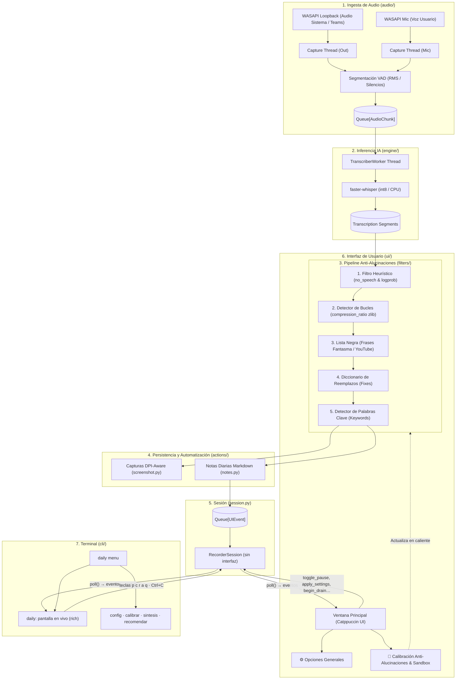

# Arquitectura del Sistema - Recorder (Fase 2)

Este documento describe la arquitectura modular de **Recorder**, diseñada para la captura de flujos de audio en tiempo real, transcripción automática mediante Inteligencia Artificial (Whisper), filtrado avanzado anti-alucinaciones y generación de notas con capturas de pantalla automáticas.

---

## 1. Visión General

El sistema sigue una arquitectura por capas desacoplada (**Clean Architecture**) combinada con un **Pipeline Productor-Consumidor Concurrente**.

---

## 2. Descripción de Componentes

### 2.1. Ingesta y Audio (`recorder/audio/`)
* **`devices.py`**: Interfaz con `pyaudiowpatch` para consultar la API WASAPI de Windows. Resuelve dispositivos físicos de entrada (micrófono) y dispositivos virtuales de loopback (altavoces/auriculares para escuchar a otros participantes).
* **`processing.py`**: Funciones puras de procesamiento digital de señales:
  * `rms(pcm)`: Cálculo de valor cuadrático medio para niveles de volumen.
  * `bars(rms)`: Conversión a escala logarítmica (-60 dB a 0 dB) representada en bloques `█░`.
  * `to_16k(pcm, rate, channels)`: Remuestreo y mezcla a mono en formato `float32` a 16.000 Hz.
* **`capture.py`**: Gestiona los hilos de lectura continuos. Segmenta el audio detectando silencios entre frases (`PAUSE_SEC = 0.6s`) o al alcanzar un máximo de tiempo (`MAX_SEC = 20s`). Cada fuente vive en su propio hilo (`capture_thread`) que abre el flujo, lee hasta que muere y lo **reabre con espera creciente** (`retry_delay`: 1, 2, 4… hasta 30 s), resolviendo el dispositivo de nuevo en cada intento; al morir el flujo, lo grabado a medias se encola igual. El gestor (`AudioCaptureManager`) expone `attempts` (0 = viva, n = reintento n) y avisa por `source_callback` cuando una fuente cae o vuelve; `meter_label` y `pending_summary` son las políticas puras que la interfaz pinta. Cada `start()` lleva su propio `Event` de parada, de modo que `restart()` no resucita hilos del arranque anterior. PortAudio enumera dispositivos solo al inicializar: se reabre el mismo dispositivo, no se sigue un cambio del predeterminado a otro distinto.

### 2.2. Motor de Inferencia (`recorder/engine/`)
* **`whisper_worker.py`**: Hilo consumidor que procesa los fragmentos de audio (`AudioChunk`) mediante la biblioteca `faster-whisper`.
* Soporta la actualización en caliente del pipeline de filtrado sin necesidad de recargar el modelo de IA de la memoria.

### 2.3. Pipeline Anti-Alucinaciones (`recorder/filters/`)
* **`normalizer.py`**: Normalización Unicode NFKD (descompone caracteres con tildes y convierte a minúsculas).
* **`quality.py`**: Valida métricas internas de inferencia de Whisper (`no_speech_prob`, `avg_logprob`) y calcula el ratio de compresión zlib para evitar bucles repetitivos.
* **`blacklist.py`**: Descarta transcripciones completas si coinciden con patrones típicos de alucinación en silencios.
* **`lexicon.py`**: Aplica un diccionario fonético personal basado en límites de palabra (`\b`) para corregir términos técnicos o nombres propios mal reconocidos.
* **`keywords.py`**: Detecta palabras clave de acción configuradas para disparar capturas.
* **`pipeline.py`**: Encapsula todo el flujo en una clase reutilizable `TextPipeline` y proporciona un método `test_sample()` para pruebas interactivas en la UI.

### 2.4. Automatización y Salida (`recorder/actions/`)
* **`screenshot.py`**: Obtiene coordenadas precisas de cada monitor respetando el escalado DPI de Windows (`ctypes.windll.shcore.SetProcessDpiAwareness(2)`) y captura la pantalla seleccionada con Pillow, o una ventana de aplicación concreta con `PrintWindow` (`PW_RENDERFULLCONTENT`), que la dibuja aunque esté tapada sin traerla al frente. La política de qué ventana abierta corresponde a la guardada en config (`pick_window`: título exacto o misma aplicación) es una función pura; si no hay ninguna o está minimizada, cae a la pantalla configurada, y si `PrintWindow` devuelve negro, recorta lo visible en su rectángulo.
* **`notes.py`**: Mantiene abierta la sesión diaria en un archivo `.md`. Coordina el acceso concurrente mediante un cerrojo (`threading.Lock`) y permite trasladar la carpeta de notas en caliente.
* **`power.py`**: Retiene el equipo despierto (`SetThreadExecutionState` con `ES_SYSTEM_REQUIRED`) mientras hay trabajo. La política `should_stay_awake` es pura: cola pendiente o fragmento en curso, o audio oído hace menos de 15 min sin estar en pausa. No puede impedir el cierre de la tapa (directiva de energía de Windows; ver README).

### 2.5. Sesión (`recorder/session.py`)
* **`RecorderSession`**: la sesión de grabación sin interfaz (no importa tkinter). Construye el núcleo (notas, PyAudio, colas, `AudioCaptureManager`, `TranscriberWorker`), detecta el equipo en un hilo y en el primer arranque aplica la recomendación antes de cargar el modelo, y concentra las acciones del usuario: `toggle_pause`, `manual_screenshot` (captura y guarda el PNG en un hilo para no congelar la interfaz; la línea llega después por `poll()` y, si falla, un `Notice`; otro clic con una en curso se ignora), `reconnect_audio`, `apply_settings` (Opciones: mueve la nota en caliente, guarda, recarga filtros y reabre el audio si cambiaron los dispositivos), `apply_tuning` (Calibrar: filtros en caliente sin recargar el modelo) y el cierre en tres pasos: `request_close` (resumen de la cola pendiente o `None`), `begin_drain` (para la captura y espera) y `shutdown` (para los hilos **sin** `pa.terminate()`).
* Modelo de tirón para cualquier frontal: cada sondeo llama a `poll()`, que traduce lo que llega por `ui_queue` en eventos (`Status`, `Line`, `Notice`, `SourceChanged`, `HardwareReady`), deja constancia en la nota de lo que corresponde (fuentes que caen o vuelven) y decide si retener el equipo despierto (`keep_awake`, por eso se llama siempre desde el hilo de la interfaz). `status` devuelve un `StatusSnapshot` con los campos crudos (pendientes, pausa, terminando, `finished`, ☕, fallos, niveles, reintentos, ruta de la nota) y los textos ya compuestos `status_text` (`● Escuchando…`, `⏸ En pausa…`, `⏳ Terminando…`; `compose_status` es pura) y `meter_text`, para que la ventana y un frontal de terminal pinten exactamente lo mismo.
* Lo que hay que preguntarle al usuario (cerrar con cola pendiente) lo decide la interfaz con los datos de la sesión. Las fábricas del constructor (`pa_factory`, `audio_manager_factory`, `transcriber_factory`, `hardware_detector`) permiten probarla entera sin audio ni Whisper (`tests/test_session.py`).

### 2.6. Presentación Gráfica (`recorder/ui/`)
* Construida en Tkinter con diseño oscuro Catppuccin Mocha.
* **`main_window.py`**: vista delgada sobre `RecorderSession`: widgets, diálogos y el sondeo cada 200 ms (`session.poll()` → pinta los eventos; `session.status` → cabecera y medidores `🔊 █░   🎤 █░`, o `🔊 ⛔ reintento n` si la fuente está caída; clic sobre ellos reabre las fuentes). Al cerrar con cola pendiente pregunta si esperar (`request_close`): si sí, `begin_drain`, muestra `⏳ Terminando…` y se cierra sola cuando `status.finished`. Pinta barato: en las etiquetas de la cabecera solo escribe lo que cambió (cada `config` cuesta aunque el texto sea el mismo, ~1 % de CPU con dos por tic; en silencio no se escribe nada); minimizada o retirada no pinta la cabecera y sondea cada 1 s, pero sigue llamando a `poll()` e insertando líneas para no perder nada, y al volver a la vista (`<Map>`) repinta al momento. El visor conserva las últimas 5 000 líneas (recorta por arriba de 500 en 500): la nota en disco es la que guarda la reunión entera. Acepta una sesión inyectada (`MainWindow(session=…)`) para probarla con un núcleo de mentira (`tests/test_main_window.py`).
* **`dialogs/settings_dialog.py`**: Configuración de dispositivos, carpetas y objetivo de captura (pantallas, monitor o ventana de aplicación, con botón 🔄 para releer las ventanas abiertas).
* **`dialogs/tuning_dialog.py`**: Ventana dedicada para calibración de alucinaciones, umbrales y probador en vivo (sandbox).

### 2.7. Terminal (`recorder/cli/`)
* **`app.py`**: la entrada de `daily` (`recorder.py` y `python -m recorder` llaman a `arrancar`). Sin consola (`sys.stdout is None`: pythonw, un ejecutable de ventana) o con `--gui`/`ventana` abre la ventana; si no, reparte los subcomandos con argparse (`--ascii` fuerza los símbolos ASCII). `abrir_ventana` sin consola da un sumidero a `sys.stdout`/`sys.stderr` (son `None`, y la barra de progreso de tqdm al descargar el modelo reventaría) y, si la ventana no llega a abrirse, lo deja en el registro de fallos y avisa con un cuadro de diálogo que señala el archivo; con consola el fallo sale como siempre. Los comandos `config`, `calibrar`, `sintesis` y `recomendar` son módulos con un contrato mínimo (`NOMBRE`, `AYUDA`, `agregar_argumentos(parser)`, `ejecutar(args, consola)`) que se cargan por nombre desde `COMANDOS`: el que falta se omite sin ruido, el que está roto avisa; `ejecutar_comando(nombre, argv, consola)` los lanza por nombre (así los usa el menú). Nada de este paquete importa tkinter; la ventana se importa dentro de `abrir_ventana` y una prueba lo comprueba en otro proceso.
* **`live.py`**: `daily` sin más. El mismo modelo de tirón que la ventana, en el hilo principal cada 200 ms: `poll()` → las frases, avisos y fuentes que caen o vuelven se imprimen como líneas normales (`HH:MM:SS  texto`, 🎤 en las del micrófono, `📸 captura: …` debajo si hubo palabras clave) y se quedan en el historial de la terminal; debajo vive un pie de tres líneas (`rich.live.Live` con `auto_refresh=False`, transitorio) con `status_text`, `meter_text` y las teclas, que **solo se redibuja si cambió**: en silencio no se escribe nada y la CPU se queda en cero. Las líneas se construyen con `rich.text.Text`, no con marcado: una frase con corchetes («[música]») se tomaría por una etiqueta. Teclas con `msvcrt` (p, c, r, a, q; se descartan las especiales de dos bytes). Ctrl+C se encola como una tecla desde el manejador de SIGINT para que no corte el bucle: la primera vez equivale a `q` (con cola pendiente pregunta en el pie `[e] esperar · [s] salir perdiéndolos · [c] cancelar`, como la ventana), y mientras pregunta o termina sale perdiendo lo pendiente; `shutdown()` va siempre en un `finally`. Sin terminal (`daily > log.txt`) no hay pie: líneas planas sin partir y los cambios de cabecera como líneas. En `ascii_mode` todo pasa por `asciify`. Se prueba con la sesión de mentira inyectando sesión, teclado, espera y consola (`tests/test_cli_live.py`).
* **`menu.py`**: `daily menu`, numerado y a golpe de `input()`: 1 Grabar, 2 Opciones, 3 Calibrar, 4 Síntesis, 5 Recomendación del equipo, 6 Abrir la ventana, 0 Salir. Los números no cambian; lo que no está cargado no se ofrece. Vuelve al menú tras cada comando salvo Grabar y la ventana.
* **`consola.py`**: la consola de rich que comparten todos los comandos: el tema de la ventana, la detección de la consola clásica (conhost) y `asciify`.
* **`recomendar.py`**: `daily recomendar [--aplicar]`; es también lo que ejecuta `recorder.py --recomendar` (lo usa install.ps1).

### 2.8. Rutas, registro de fallos e instalado (`recorder/rutas.py`, `recorder/registro.py`)
Recorder corre de dos maneras: desde el código (`daily`, `python recorder.py`) y **instalado** como ejecutable de PyInstaller en modo *onedir*: `Recorder.exe` (de ventana, sin consola → `sys.stdout is None` → la ventana) y `daily.exe` (de consola → la terminal), los dos congelados de `recorder.py` y compartiendo `_internal`, en `%LOCALAPPDATA%\Programs\Recorder`, que se trata como de solo lectura. `rutas.py` es la única fuente de verdad de dónde está cada cosa (solo biblioteca estándar; no crea carpetas al importar):

| Qué | Desde el código | Instalado (`rutas.congelado()`) |
| :--- | :--- | :--- |
| Archivos del programa (`rutas.recurso("tools/instalar_whispercpp.ps1")`, `docs/*.md`, `recorder/assets/recorder.ico`) | la raíz del repositorio | `_internal` (`sys._MEIPASS`), con la misma estructura relativa |
| `config.json` (`rutas.ruta_config()`, lo que usa `ConfigManager()` sin ruta) | `config.json` en la raíz del repositorio, como siempre | `%APPDATA%\Recorder\config.json`; la carpeta se crea al guardar |
| La variable **`RECORDER_CONFIG`** | manda sobre lo anterior en los dos modos (pruebas, uso portable, varias configuraciones) | igual |
| Registro de fallos (`rutas.carpeta_logs()`) | `%LOCALAPPDATA%\Recorder\logs\recorder.log`; no se crea nada hasta el primer fallo | igual, y además una línea al arrancar con la versión |
| Mensajes que citan `tools\instalar_whispercpp.ps1` o `docs/….md` (`rutas.como_instalar_whispercpp()`, `rutas.documento()`, `rutas.citar_documentos()`) | la ruta relativa corta de siempre | la orden completa, `powershell -ExecutionPolicy Bypass -File "<_internal>\tools\instalar_whispercpp.ps1"`, y la URL del documento en GitHub |
| Consulta de Vulkan en otro proceso (`hardware.vulkan_probe_command()`) | `python -I hardware.py --vulkan` con el intérprete base | se relanza el ejecutable con solo `--vulkan`: `daily.exe` si está junto al que corre (`rutas.ejecutable_consola()`), si no el propio. `recorder.py` y `recorder/__main__.py` atienden `--vulkan` **antes de importar nada pesado** (`hardware.sonda_vulkan()` imprime el JSON y sale). Misma captura por tuberías, `CREATE_NO_WINDOW` y tiempo límite |
| Icono de la ventana (`ui.theme.app_icon`) | si existe `recorder/assets/recorder.ico`, se pone con `iconbitmap(default=…)`, que alcanza a los diálogos; si no, nada | igual, con el `.ico` empaquetado |

`tools\instalar_whispercpp.ps1` sigue la misma regla para escribir `whispercpp_dir`: `-ConfigPath` explícito; si no, `RECORDER_CONFIG`; si no, `config.json` junto a `recorder.py` cuando el script está en el repositorio y, si no (instalado, en `_internal\tools`), `%APPDATA%\Recorder\config.json`. Con `-SoloConfig` solo hace ese paso.

**Registro de fallos** (`registro.py`): instalado como ejecutable de ventana, una excepción sin atrapar desaparecía o salía en el diálogo crudo de PyInstaller. Las dos entradas (`recorder.py`, `python -m recorder`) llaman a `registro.instalar()`, que engancha `sys.excepthook` y `threading.excepthook` a un archivo rotatorio (1 MB × 3, `logging` de la biblioteca estándar) y la ventana engancha `report_callback_exception` de Tk (`MainWindow._fallo_en_callback`). Los ganchos anotan y después llaman a los de siempre, así que en la terminal no cambia nada que se vea. Se registran solo excepciones con su traceback y la línea de arranque (versión, modo): nunca texto transcrito ni audio. El `--vulkan` del proceso hijo sale antes de instalar nada.

---

## 3. Modelo de Concurrencia y Flujo de Datos

1. **Hilos de Captura (2)**: Leen audio de baja latencia mediante WASAPI, calculan RMS en cada frame y depositan `AudioChunk` en una cola `chunk_queue`. Cada hilo abre y reabre su propio flujo (las aperturas se serializan con un cerrojo: PortAudio no soporta abrirlas desde dos hilos a la vez) y solo termina cuando se le pide; una fuente caída nunca mata al hilo ni afecta a la otra. Al cerrar la aplicación **no** se llama a `pa.terminate()`: cerraría los streams desde el hilo principal mientras el del loopback sigue bloqueado en `read()`, lo que revienta el proceso (`0xC0000005`); el proceso termina justo después y Windows recoge los recursos.
2. **Hilo de Inferencia (1)**: Espera en `chunk_queue.get()`, realiza la inferencia con Whisper, ejecuta el pipeline de filtros y guarda en el archivo Markdown.
3. **Hilo Principal (interfaz)**: Ejecuta el bucle de eventos de Tkinter (o el bucle de la terminal, con `time.sleep`) y cada 200 ms llama a `RecorderSession.poll()`, que vacía `ui_queue` y devuelve los eventos a pintar; la sesión no tiene hilos propios salvo el de detección del equipo (~1 s, una vez) y el de cada captura manual (capturar y guardar el PNG tarda); el resultado de ambos vuelve por `ui_queue`. Todo lo que la sesión hace con el estado (pausa, cierre, `keep_awake`, que es por hilo) ocurre en este hilo, así que la interfaz nunca se congela y no hace falta más sincronización que la de las colas.
