# Introducción de Recorder: storyboard

Presentación de la app para la primera vez que se abre el ejecutable: 7,5 s, cinco escenas, se
puede saltar desde el primer fotograma. Este documento es el storyboard; el detalle de movimiento,
accesibilidad, terminal y assets está en [especificacion.md](especificacion.md), y los valores
exactos (tiempos, medidas, tokens de color, claves de texto) en
[`recorder/assets/intro/intro.json`](../../recorder/assets/intro/intro.json), que es lo que lee el
código.

## Concepto

El micrófono del icono cobra volumen. La baldosa del icono gira hasta quedar de frente, de ella
sale el micrófono y se enciende el punto rojo de «grabando»; el último fotograma es el icono
(`packaging/generar_icono.py`), ahora en 3D. Después el logotipo se aparta y, a su derecha, una
única ilustración hecha de doce rectángulos cuenta lo que hace la app sin cambiar de plano: las
barras de audio se tumban en líneas de texto, las líneas quedan dentro de un portátil, y el
portátil se convierte en la hoja de la nota con su captura.

Respecto a la propuesta de partida cambian tres cosas:

1. **Un solo botón, siempre en el mismo sitio.** «Saltar» está desde el primer fotograma abajo a
   la derecha y en la última escena pasa a ser «Comenzar» (cambia de color y de rótulo, no de
   lugar). Enter hace siempre lo mismo: seguir.
2. **La ilustración es continua.** Las mismas doce piezas pasan por las escenas 2, 3 y 4, así que
   entre escenas solo cambia el texto; no hay cortes.
3. **El logotipo no desaparece.** Tras el revelado se queda a la izquierda como ancla.

## Vista animada

| Tema oscuro | Tema claro |
| :-: | :-: |
| 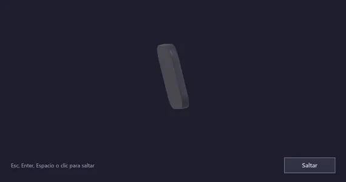 | 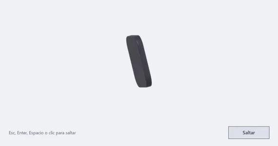 |

Las genera `generar_vistas.py` leyendo el contrato, con las mismas operaciones que tiene Tkinter.

## Escenas

Tiempos desde que la ventana es visible. Las curvas: **ease-out** arranca rápido y frena al final;
**ease-in-out** arranca y frena suave.

| # | Escena | Tiempo | Duración | Texto exacto |
| :-: | :--- | :-: | :-: | :--- |
| 1 | Logotipo | 0,00 – 1,70 s | 1,70 s | «Recorder» |
| 2 | Graba | 1,70 – 3,20 s | 1,50 s | «Graba tu daily» · «Tu micrófono y la reunión, a la vez.» |
| 3 | Transcribe | 3,20 – 4,65 s | 1,45 s | «Transcribe en tu equipo, sin nube» · «El texto aparece mientras hablan.» |
| 4 | Notas | 4,65 – 6,10 s | 1,45 s | «Notas en Markdown con capturas» · «Cada frase, con su hora.» |
| 5 | Comenzar | 6,10 – 7,50 s | 1,40 s | «Listo para tu próxima daily» · «Está también en el menú «Más».» · botón «Comenzar» |

Fijo en todas: botón «Saltar» y, abajo a la izquierda, «Esc, Enter, Espacio o clic para saltar».

### 1. Logotipo (0,00 – 1,70 s)

| Oscuro | Claro |
| :-: | :-: |
| 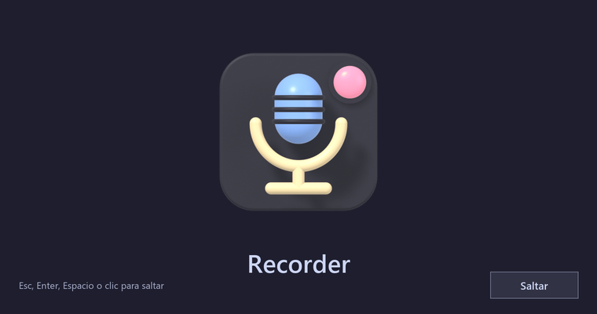 | 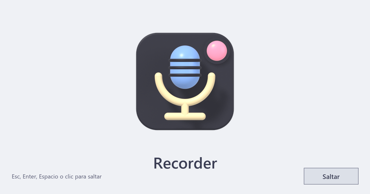 |

* **Qué se mueve.** La secuencia de 36 fotogramas (1,5 s): la baldosa llega de canto, gira hasta
  quedar de frente y crece; el micrófono sale de ella con un pequeño rebote; al final se enciende
  el punto de grabación. A los 0,9 s entra debajo el rótulo «Recorder».
* **Curva.** Giro y rótulo, ease-out. Micrófono y punto, ease-out con rebote (se pasan un 6 % y
  vuelven).
* **Transición a la 2.** El rótulo se funde con el fondo mientras el logotipo se desplaza.

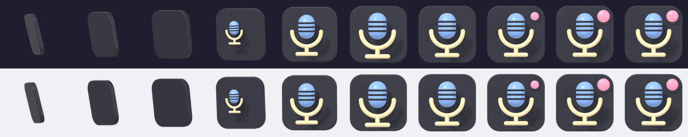

### 2. «Graba tu daily» (1,70 – 3,20 s)

| Oscuro | Claro |
| :-: | :-: |
| 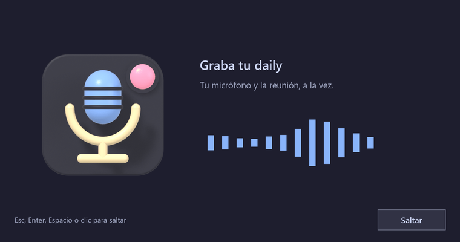 | 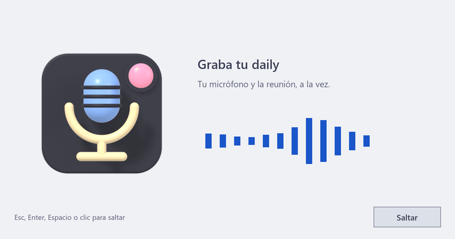 |

* **Qué se mueve.** El logotipo se aparta a la izquierda. Entran el título y, escalonado, el
  subtítulo. Aparecen doce barras de audio que laten y, una tras otra de izquierda a derecha, se
  tumban y se colocan como tres líneas de texto.
* **Curva.** Desplazamiento del logotipo y conversión de las barras, ease-in-out. Fundidos de
  texto, ease-out. El latido de las barras es un seno.
* **Transición a la 3.** Fundido cruzado del texto; las líneas se quedan donde están.

### 3. «Transcribe en tu equipo, sin nube» (3,20 – 4,65 s)

| Oscuro | Claro |
| :-: | :-: |
| 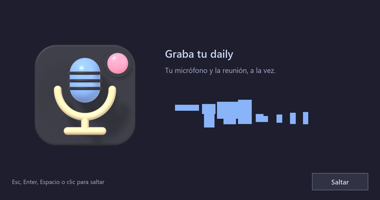 | 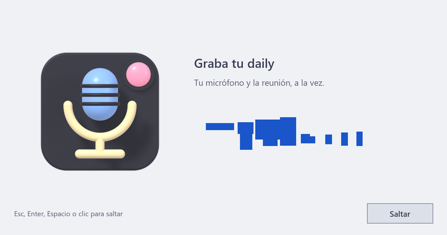 |

* **Qué se mueve.** Nada cambia de sitio. Alrededor de las líneas aparece el contorno de un
  portátil (pantalla y base) y las líneas pasan del color del micrófono al del texto, fila a fila;
  un tramo queda en el color de acento, como una palabra clave.
* **Curva.** Ease-out, con escalonado por filas.
* **Transición a la 4.** Fundido cruzado del texto; la base del portátil se funde y el contorno
  pasa a ser la hoja.

### 4. «Notas en Markdown con capturas» (4,65 – 6,10 s)

| Oscuro | Claro |
| :-: | :-: |
| 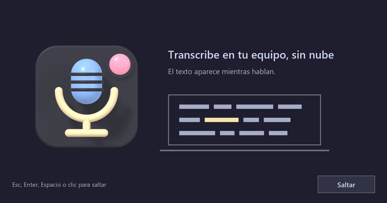 | 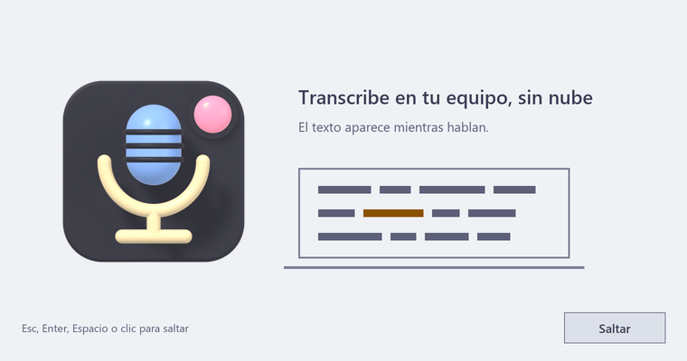 |

* **Qué se mueve.** Los doce tramos se recolocan como una nota: una marca de título en acento, el
  título y tres párrafos. A su derecha entra la miniatura de una captura de pantalla.
* **Curva.** Recolocación, ease-in-out. Miniatura, ease-out.
* **Transición a la 5.** Fundido cruzado del texto; la nota se queda.

### 5. «Comenzar» (6,10 – 7,50 s)

| Oscuro | Claro |
| :-: | :-: |
| 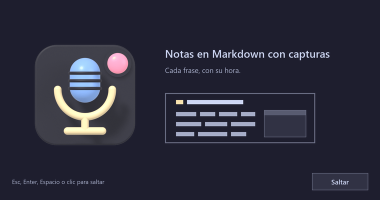 | 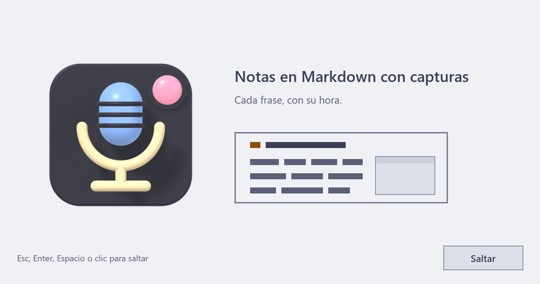 |

* **Qué se mueve.** Solo el botón: funde su fondo al color de acento y su rótulo pasa de «Saltar» a
  «Comenzar».
* **Curva.** Ease-out.
* **Final.** A los 7,5 s, o antes si se pulsa el botón o cualquier tecla de salto, la ventana se
  funde (la salida estándar de la app) y se abre la ventana principal.

## Terminal

Logotipo de 0,9 s en tres pasos, en los tres juegos de símbolos, sobre negro y sobre el azul del
acceso directo de PowerShell. Detalle en [especificacion.md](especificacion.md#5-terminal).

| Completo | Consola | ASCII |
| :-: | :-: | :-: |
| 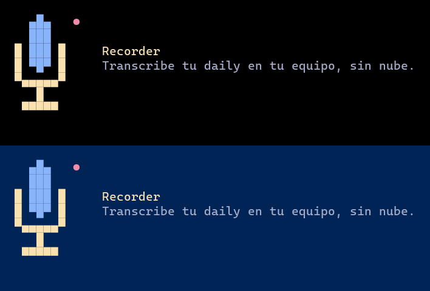 | 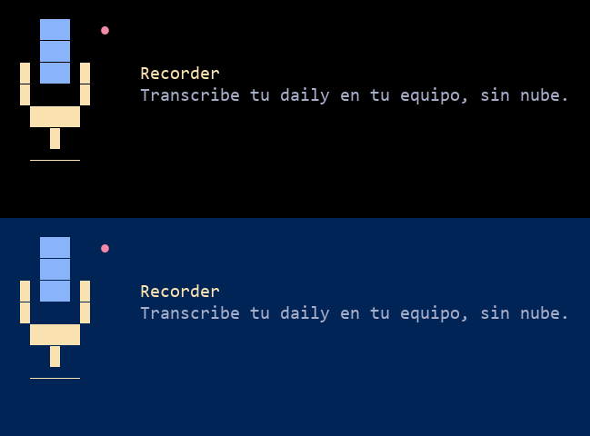 | 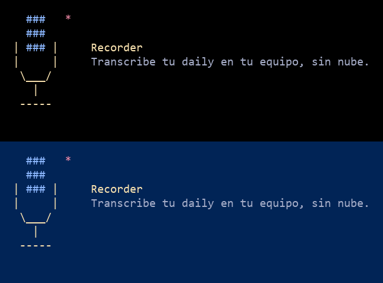 |

## Entregables

| Qué | Dónde | Peso |
| :--- | :--- | :-: |
| Storyboard (este documento) y especificación | `docs/intro/README.md`, `docs/intro/especificacion.md` | — |
| Contrato para el código | `recorder/assets/intro/intro.json` | 9 KB |
| Logotipo 3D, 36 fotogramas de 480 px a 24 fps, fondo transparente | `recorder/assets/intro/logo/logo_001.png` … `logo_036.png` | 1 732 KB |
| Fotograma estático de reserva | `recorder/assets/intro/logo_estatico.png` | 56 KB |
| Logotipo de terminal (completo, consola, ASCII) | `recorder/assets/intro/terminal/*.txt` | 1 KB |
| **Total de assets** (presupuesto: 3 MB) | `recorder/assets/intro/` | **1 798 KB** |
| Escena de Blender y guiones que la construyen y preparan los fotogramas | `docs/intro/blender/` (el `.blend` pesa 191 KB: se queda en el repositorio) | 210 KB |
| Miniaturas, tira del logotipo, terminal y vistas animadas | `docs/intro/img/`, con `docs/intro/generar_vistas.py` | 1 459 KB |

Duración total: **7,5 s** (más el fundido de salida de la ventana).

## Preguntas abiertas

1. **¿La última escena espera o sigue sola?** Está diseñada para seguir sola a los 7,5 s («no debe
   retrasar la grabación»). La alternativa es que se quede en «Comenzar» hasta que se pulse.
2. **Clic en cualquier parte.** Ahora salta, como pide la accesibilidad del encargo. Si se prefiere
   que solo salte el botón (para evitar saltos sin querer), se cambia la pista de abajo a la
   izquierda.
3. **Subtítulos.** «Sin nube» es cierto con el motor local; si la app llega a ofrecer
   transcripción en la nube (`docs/stt-nube-y-privacidad.md`), el título de la escena 3 debería
   decir «por defecto».
4. **Baldosa del logotipo.** Con luz, la baldosa se ve algo más clara que el fondo del tema oscuro,
   y por eso una sola secuencia sirve para los dos temas. Si se quiere una variante para el tema
   claro con baldosa clara, es otro render (y el peso se duplica: seguiría bajo los 3 MB si se baja
   a 360 px).
5. **Terminal con tema claro.** El logotipo de terminal usa los estilos de `recorder/cli/consola.py`;
   el contraste se ha medido con el tema oscuro, que es el de fábrica. Con el tema claro sobre una
   consola negra, los colores oscuros de ese tema no se leerían: es una cuestión de toda la
   terminal, no solo de la introducción.
