# Especificación visual y de textos de la terminal

Noviembre de 2026. Paso 2 de `docs/plan-pulido-terminal.md`. Fija cómo se ve, cómo se maneja y qué
dice cada vista de `daily`, para que los pasos de código (3 a 8) solo tengan que construirlo. Lo
que aquí se llama por su nombre (`MARGEN`, `acento`, `calibrar_probar`) es una constante, un token de
`recorder/paleta.py` o una clave de `recorder/ayuda.py`: el código no lleva valores sueltos.

Cómo leerla: las secciones 1 a 6 son el sistema común; la 7 trae la maqueta final de cada vista en
texto monoespaciado, a 100×30 y a 60×24, en el juego de símbolos «consola» (el del día a día); la 8
es la tabla de textos; la 9, lo que cambia en cada vista respecto a hoy; la 10, decisiones,
preguntas abiertas y lo que quedó fuera.

Láminas en color (las mismas maquetas con la paleta): carpeta `terminal-especificacion/`, un SVG por
vista, enlazado en cada apartado de la sección 7.

Las maquetas en texto mandan sobre las láminas: son lo que el código copia. En los bloques de texto,
un emoji del juego «completo» puede verse desalineado en el editor; en la terminal ocupa dos celdas,
que es como están contadas.

## 0. Plan de trabajo seguido

1. Inventario: las 13 vistas del plan más dos que aparecieron al revisar el código: «terminal
   demasiado pequeña» (hoy el cuadro se descoloca por debajo de 60×24) y «Crear la copia» de Reagrupar
   como confirmación propia. Se tratan dentro de las vistas 11 y 4.
2. Sistema común (maquetación, símbolos, color, componentes, teclas, movimiento).
3. Maquetas, generadas todas con las mismas reglas de recorte y partido que se describen en la
   sección 1 y comprobadas una a una: cada línea mide exactamente el ancho de la terminal en los tres
   juegos de símbolos y a los dos tamaños, y en ASCII no queda ningún carácter fuera del juego.
4. Textos con su clave y lista de cambios.

Datos de ejemplo: todas las maquetas usan notas, carpetas y dispositivos inventados
(`C:\Users\ana\Documents\Dailies`, «Altavoces», «Micrófono del portátil»).

---

## 1. Sistema de maquetación

### 1.1 Regiones

Toda vista interactiva vive en la pantalla alternativa y se compone de regiones apiladas. De arriba
abajo:

| Región | Alto | Contenido | Estilo |
| :--- | :--- | :--- | :--- |
| Cabecera | `ALTO_CABECERA` = 1 (2 en la grabación) | «Recorder · nota de hoy · calidad · dónde se transcribe». En la grabación, segunda línea de estado: indicador, tiempo, cola y medidores | «Recorder» en negrita; la nota en `texto`; el resto en `tenue` |
| Regla | 1 | `─` a todo el ancho útil | `borde` |
| Ruta | 1 | «Inicio › Opciones › Guardar» a la izquierda; a la derecha «● cambios sin guardar» o la posición «1-19 de 24» | ruta en negrita; marca en `acento`; posición en `tenue` |
| Cuerpo | lo que quede | Lista, tarjeta, vista previa o transcripción | según el componente |
| Panel | fijo, solo en la grabación | Opciones [o], pregunta de salida o progreso del vaciado, bajo la transcripción y con su título en una regla | título en negrita entre `borde` |
| Ayuda | `alto_ayuda(ancho)`: 2 líneas desde 92 columnas, 3 desde 74, 4 por debajo | La explicación de lo elegido (`ayuda.linea(clave)`), partida por palabras | `tenue` |
| Aviso | 1 (crece a 2 solo si el aviso no cabe) | Aviso pasajero o persistente; vacía si no hay | `ok`, `error`, `aviso` o `acento`, siempre con su símbolo |
| Pie | `ALTO_PIE` = 1 | Botones «[tecla] Acción» separados por « · » | tecla en `acento`, acción en `tenue` |

La altura de Ayuda es fija para cada ancho: al mover la selección el cuerpo no salta. La grabación no
tiene región de Ayuda (no hay fila elegida) salvo dentro de su panel.

`MARGEN` = 1 columna a cada lado: el ancho útil es `ancho − 2·MARGEN` (98 a 100 columnas, 58 a 60).

`ANCHO_MINIMO` = 60 y `ALTO_MINIMO` = 24. Por debajo no se pinta ninguna vista: solo el aviso
`terminal_pequena`, y se vuelve sola al agrandar (vista 11).

### 1.2 Reparto del espacio vertical

1. Cabecera, Regla, Ruta, Ayuda, Aviso y Pie son fijas. El Cuerpo recibe el resto.
2. Líneas en blanco de respiro, por este orden de prioridad: una entre Cuerpo y Ayuda si el espacio
   libre es de `RESPIRO_ABAJO` = 12 líneas o más; otra entre Ruta y Cuerpo si además quedan
   `RESPIRO_ARRIBA` = 15 o más. A 60×24 solo queda la primera.
3. El contenido del cuerpo va arriba; lo que sobra queda en blanco debajo. La grabación es la
   excepción: la transcripción se apoya abajo (lo último, junto al pie).
4. Si el contenido no cabe: las listas enseñan una ventana alrededor de la fila elegida y su primera
   y última línea pasan a ser «↑ N más arriba» / «↓ N más abajo» (`terminal_mas_arriba`,
   `terminal_mas_abajo`); los bloques secundarios se quitan en este orden: ficha «Equipo», líneas en
   blanco internas, columnas opcionales de una tabla. Lo que es acción (la fila «Aplicar», «Crear la
   copia», «Probar una frase») no se quita nunca: si hace falta, se fija abajo y la lista se desplaza
   encima.
5. Dos columnas desde `ANCHO_DOS_COLUMNAS` = 96 (Inicio con su ficha, Reagrupar con su vista previa),
   separadas por ` │ `; por debajo, la segunda columna pasa debajo de la primera tras una regla, o
   desaparece si no cabe (ficha de Inicio a menos de 24 líneas útiles).
6. Pantallas grandes: el cuerpo no se estira. Las listas conservan su ancho natural; los párrafos se
   parten como mucho a `ANCHO_LECTURA` = 100 columnas; solo crecen la vista previa, la transcripción y
   las tendencias (hasta `ANCHO_TENDENCIA_MAX` = 60 muestras, los 2 minutos).

### 1.3 Recorte y partido de líneas

| Qué | Regla |
| :--- | :--- |
| Fila de lista, cabecera, ruta | Una sola línea. Lo que no cabe se corta con «…» al final (`...` en ASCII, también ahí: hallazgo 27) |
| Rutas de carpeta y de archivo | Se recortan por el medio: se conserva el principio (un tercio) y el final, que es lo que distingue (`C:\Users…\Dailies\capturas`) |
| Ruta de navegación | Si no cabe, se recorta el último tramo cuando es un nombre de archivo; nunca «Inicio» |
| Línea de ayuda, avisos, párrafos | Se parten por palabras. Si superan su alto, la última línea acaba en «…» |
| Párrafo con viñeta o etiqueta | Las líneas de continuación se sangran hasta donde empieza el texto (`SANGRIA_PARRAFO`), no vuelven a la columna 0 |
| Frase de la transcripción | Se parte por palabras con sangría bajo el texto (`COLUMNA_TEXTO` = 14: hora 8 + 2 + fuente 3 + 1). Arriba nunca queda media frase: lo que no entra entero se deja en blanco |
| Valor de un ajuste | Se recorta con «…»; la etiqueta nunca se recorta (la columna de etiquetas mide la más larga + 2) |
| Pie de botones | Si no cabe: primero se prueban las etiquetas cortas («Seguir» por «Seguir grabando»); después se quitan botones de menor prioridad y se añade «[?] Más» al final. Los botones de cada vista están en orden de prioridad en la sección 5 |
| Tablas | Si una fila no cabe, toda la tabla pasa a su forma estrecha (cabeceras cortas o dos líneas por fila), no solo esa fila |

Nada deja restos: cada línea del cuadro se rellena hasta el ancho completo (con el fondo propio si lo
hay, sección 3.3) y el cuadro tiene siempre la altura de la terminal.

---

## 2. Juegos de símbolos definitivos

Tres juegos, elegidos por `consola.elegir_juego` (ya construido en el paso 2b). El color se decide
aparte (sección 3).

Para el juego «consola» hay dos niveles de comprobación, y la tabla los distingue:

* **V** (visto): dibujado en la consola real y revisado en captura (`docs/capturas-terminal/powershell/`).
  Son los de `SEGUROS_CONSOLA`: `─ █ ░ ‹ › ● · « »`.
* **G** (glifo): la fuente Consolas tiene el glifo propio, consultado a la fuente con
  `GetGlyphIndicesW` el 24-nov-2026; falta verlo en una captura. Si la captura del paso 3 saliera mal,
  se usa la columna «reserva», que solo tiene símbolos V o ASCII.

Dos correcciones a lo anotado hasta ahora, fruto de esa consulta:

* `‥` (U+2025) **no** está en Consolas: se ve porque Windows lo toma de otra fuente. Sale de la tabla;
  los rangos se dicen con flechas y palabras («← descarta más · descarta menos →»).
* `▶ ▁▂▃▅▆▇ ✔ ⚠` y el braille del spinner de rich (`⠋⠙⠹…`) no están en Consolas, como ya se sabía de
  los primeros. `► ▲ ▼ ↑ ↓ ← → … ○ ■ ▌ ▄ │ √ ‖ • ∙` sí están.

| Uso | completo | consola | nivel | reserva | ASCII |
| :--- | :-: | :-: | :-: | :-: | :-: |
| Fila elegida | `▶` | `►` | G | `›` | `>` |
| Ruta de navegación | `›` | `›` | V | | `>` |
| Flechas de un valor | `‹ ›` | `‹ ›` | V | | `< >` |
| Entrada de un campo de texto | `›` | `›` | V | | `>` |
| Cursor de texto | `▌` | `▌` | G | `_` | `_` |
| Interruptor sí / no | `●` / `○` | `●` / `○` | V / G | `●` / `·` | `[x]` / `[ ]` |
| Grabando; cambios sin guardar; «cambia» | `●` | `●` | V | | `*` |
| Pausa | `⏸` | `‖` | G | `=` | `\|\|` |
| Terminando / en espera | `⏳` | `…` | G | `...` | `...` |
| Correcto | `✅` | `√` | G | `OK` | `OK` |
| Aviso | `⚠` | `▲` | G | `!` | `!` |
| Error; fuente caída | `⛔` | `×` | V (Latin-1) | | `x` |
| Veces («2,6×») | `×` | `×` | V (Latin-1) | | `x` |
| Salida de audio | `🔊` | `PC` | texto | | `PC` |
| Micrófono | `🎤` | `Mic` | texto | | `Mic` |
| Fuente sin audio | `🔇` | `sin audio` | texto | | `sin audio` |
| Captura | `📸` | `■` | G | `·` | `[cap]` |
| Barra llena / vacía | `█` / `░` | `█` / `░` | V | | `#` / `.` |
| Tendencia (por fila) | `▁▂▃▄▅▆▇█` | `▄ █` | G / V | `░ █` | `. :` |
| Regla | `─` | `─` | V | | `-` |
| Separador de columnas | `│` | `│` | G | dos espacios | `\|` |
| Separador de datos | `·` | `·` | V | | `·` |
| Más arriba / más abajo | `↑` / `↓` | `↑` / `↓` | G | `^` / `v` | `^` / `v` |
| Teclas de flecha en el pie | `↑↓` `←→` | `↑↓` `←→` | G | `^v` `<>` | `^v` `<>` |
| «Antes → después»; sentido de un rango | `→` `←` | `→` `←` | G | `->` `<-` | `->` `<-` |
| Recorte | `…` | `…` | G | `...` | `...` |
| Spinner (fotogramas) | `⠋⠙⠹⠸⠼⠴⠦⠧⠇⠏` | `∙ • ● •` | G / V | `· ● ·` | `- \ \| /` |
| Comillas | `« »` | `« »` | V | | `« »` |

Reglas:

* Respuesta a lo que quedó abierto en el paso 2b: **sí** se admiten `↑ ↓ ← →` y `…` en el juego
  «consola» (nivel G). Hoy salen como `^v`, `<->` y el recorte ya usa «…» (lo pone rich): el paso 3 los
  añade a `SEGUROS_CONSOLA` junto con el resto de la columna «consola» y lo confirma con una captura
  en la consola de PowerShell; lo que falle pasa a su reserva sin tocar ninguna vista.
  **Hecho en el paso 3**: toda la columna «consola» se vio bien en la consola de PowerShell
  (`docs/capturas-terminal/powershell/simbolos-consola.png`, con `tools/simbolos_consola.py`, y las
  capturas `base-100`, `base-60` y `base-ascii`), así que ninguna usa su reserva. `‥` quedó fuera. `►`
  es la marca de fila (pregunta abierta 1 resuelta).
* En ASCII el par de flechas del pie es `[^v]` y `[<>]`, no `[<->]`: se sustituye el par entero, no
  flecha a flecha.
* Las etiquetas de las pantallas no llevan emoji en ningún juego («Salida a capturar», «Micrófono»,
  «Qué capturar»): así las columnas miden lo mismo en los tres. Los emoji quedan para la transcripción
  y los medidores del juego «completo».
* Las fuentes de la transcripción ocupan `ANCHO_FUENTE` = 3 celdas en los tres juegos (`🔊 `, `PC `,
  `Mic`). En los textos de ayuda, `🔊` y `🎤` se leen «PC» y «Mic» fuera del juego completo.
* «☕» (equipo despierto) sale de la cabecera de la grabación en todos los juegos: no se entendía. El
  dato queda en la vista de rendimiento solo si hace falta depurarlo.
* Con la fuente «Lucida Console» (la otra fuente clásica de conhost) faltan `● ○ ‖ ■`: no se detecta
  la fuente; quien la use tiene `daily --ascii`.
* El color nunca es la única señal: fila elegida = marca + negrita + color; interruptor = `●`/`○` +
  «sí»/«no»; avisos = símbolo + texto; «cambia»/«igual» = `●`/`○` + palabra; frase con palabra clave =
  color + la línea «■ captura: …» debajo.

---

## 3. Color

### 3.1 Qué token lleva cada elemento

Sin colores nuevos: todos son tokens de `recorder/paleta.py`. Los estilos de rich de
`consola.ESTILOS` ya cubren `texto`, `tenue` (`texto_tenue`), `acento`, `mic`, `error`, `ok` y
`borde`; el paso 3 añade tres: `aviso` (token `aviso`), `fondo` (fondo propio) y `fila` (fondo
`superficie`).

| Elemento | Token (primer plano) | Fondo | Además del color |
| :--- | :--- | :--- | :--- |
| Texto normal, valores de la fila elegida | `texto` | `fondo` | |
| «Recorder», rótulos de sección, ruta | `texto` en negrita | `fondo` | negrita |
| Explicaciones, valores no elegidos, horas, cabecera | `texto_tenue` | `fondo` | |
| Marca de fila, número de atajo, teclas del pie, flechas `‹ ›`, cursor | `acento` | `fondo` | el propio símbolo |
| Etiqueta de la fila elegida | `acento` en negrita | `superficie` | marca `►` |
| Fila elegida (toda la fila, o su columna si hay dos) | | `superficie` | marca `►` |
| Frase recién llegada | `texto` | `superficie` | es la última |
| Frase con palabra clave | `acento` | `fondo` | línea «■ captura: …» |
| Fuente micrófono (`Mic`, `🎤`) y tendencias | `mic` | `fondo` | etiqueta |
| Barra llena / vacía | `acento` / `borde` | `fondo` | `█` / `░` |
| Reglas y separador de columnas | `borde` | `fondo` | no son texto |
| Correcto: «Se queda», «Hay margen», guardado, `●` de «sí», «● Escuchando» | `ok` | `fondo` | `√`, palabra |
| Aviso: pausa, fuente sin audio, «va justo» | `aviso` | `fondo` | `‖`, `▲` |
| Error: «Se descarta», fuente caída, config ilegible, cambios sin guardar al salir | `error` | `fondo` | `×`, `▲` |
| «● cambios sin guardar», «cambia», «la mejor», «N frases nuevas abajo», nombre de la copia | `acento` | `fondo` | `●`, `↓` |

### 3.2 Contraste (WCAG 2.2: texto ≥ 4,5:1; componentes no textuales ≥ 3:1)

Medido con `paleta.contraste`. «Propio» es el fondo que pinta la app (`fondo`); «fila» es
`superficie`.

| Token | Oscuro: propio `#1e1e2e` | Oscuro: fila `#313244` | Oscuro sobre negro `#0c0c0c` | Oscuro sobre azul `#012456` | Claro: propio `#eff1f5` | Claro: fila `#dce0e8` | Claro sobre negro | Claro sobre azul |
| :--- | :-: | :-: | :-: | :-: | :-: | :-: | :-: | :-: |
| `texto` | 11,3 | 8,7 | 13,5 | 10,5 | 9,1 | 7,8 | **1,9** ✗ | **1,5** ✗ |
| `texto_tenue` | 7,4 | 5,6 | 8,8 | 6,8 | 5,5 | 4,7 | **3,1** ✗ | **2,4** ✗ |
| `acento` | 12,9 | 9,9 | 15,4 | 11,9 | 5,7 | 4,9 | **3,0** ✗ | **2,3** ✗ |
| `mic` | 7,8 | 6,0 | 9,3 | 7,2 | 5,8 | 5,0 | **3,0** ✗ | **2,3** ✗ |
| `error` | 7,1 | 5,4 | 8,4 | 6,5 | 6,0 | 5,2 | **2,9** ✗ | **2,2** ✗ |
| `ok` | 11,0 | 8,5 | 13,2 | 10,2 | 5,8 | 4,9 | **3,0** ✗ | **2,3** ✗ |
| `aviso` | 9,3 | 7,1 | 11,1 | 8,5 | 5,7 | 4,9 | **3,0** ✗ | **2,4** ✗ |
| `borde` (no textual, ≥ 3) | 3,4 | **2,6** ✗ | 4,0 | 3,1 | 3,5 | **3,0** ✗ | 5,0 | 3,8 |

Lectura:

* **Tema oscuro**: todos los tokens de texto pasan AA sobre el fondo propio, sobre el negro y sobre
  el azul de PowerShell. `borde` no llega a 4,5:1 en ninguno (3,4 propio; 3,1 sobre el azul; 2,6 sobre
  `superficie`), y no tiene que llegar: **`borde` no se usa nunca para texto**, solo para reglas, el
  separador de columnas y la parte vacía de las barras, que piden 3:1. Sobre `superficie` (la fila
  elegida) no se pinta nada en `borde`. Esto responde a lo que dejó abierto el paso 2b.
* **Tema claro**: sobre el fondo propio pasa todo; sobre el negro o el azul de la consola no pasa casi
  nada (1,5 a 3,4). El tema claro solo es posible con fondo propio.

### 3.3 Fondo propio: sí con color real, no en 16 colores

**Con color real (VT activo), toda vista de pantalla completa pinta su fondo con el token `fondo`** y
la fila elegida con `superficie`. Motivos:

1. La paleta está validada (AA) contra `fondo`, no contra el color que traiga la consola. Con fondo
   propio el contraste es el medido, sea la consola negra, azul o la que haya configurado el usuario.
2. Es la única forma de que el tema claro exista en la terminal, igual que en la ventana, y de que
   `[t]` cambie de verdad el aspecto.
3. La fila elegida y la frase nueva pueden llevar fondo `superficie`: se distinguen de un vistazo sin
   depender solo del color del texto.
4. Coste: cada línea se rellena hasta el ancho con estilo de fondo. No añade repintados: el cuadro ya
   se compara con el anterior antes de escribirse.

Al salir de la pantalla alternativa la consola recupera su fondo. Si al cambiar el tamaño de la
ventana asoma una franja con el fondo de la consola, se corrige en el siguiente cuadro (se repinta al
cambiar el tamaño, como hoy).

**En 16 colores (consola sin VT, `--ascii`) no se pinta fondo**: los 16 colores son los que el usuario
tenga en su consola y un fondo «negro» o «azul» de esa tabla puede no ser el que se cree. Se respeta
el fondo que haya y se usan solo los colores de la tabla 3.4.

**Lo que se imprime en el historial** (resumen de la grabación, `daily -h`, modo línea) no lleva fondo
ni colores de la paleta: color por defecto de la consola y negrita en el título. Así se lee en negro,
en azul y con el tema claro guardado.

### 3.4 Equivalente en 16 colores

Para la consola sin VT. Valores de la tabla de colores por defecto de conhost.

| Token | Color de la consola | Valor por defecto | Sobre negro `#0c0c0c` | Sobre azul `#012456` |
| :--- | :--- | :-: | :-: | :-: |
| `texto` | `bright_white` | `#f2f2f2` | 17,5 | 13,5 |
| `texto_tenue` | `white` | `#cccccc` | 12,2 | 9,4 |
| `acento` | `bright_yellow` | `#f9f1a5` | 16,9 | 13,1 |
| `mic` | `bright_cyan` | `#61d6d6` | 11,3 | 8,7 |
| `error` | `bright_red` | `#e74856` | 5,1 | 3,9 |
| `ok` | `bright_green` | `#16c60c` | 8,5 | 6,6 |
| `aviso` | `bright_yellow` | `#f9f1a5` | 16,9 | 13,1 |
| `borde` | `white` | `#cccccc` | 12,2 | 9,4 |
| fila elegida | `bright_yellow` en negrita + marca `>` | | | |

* El acceso directo de Windows PowerShell redefine dos casillas de la tabla: la del magenta oscuro es
  su fondo azul `#012456` y la del amarillo oscuro, su texto `#eeedf0`. Por eso **no se usan nunca
  `magenta` ni `yellow`** (los no brillantes): uno sería invisible y el otro saldría blanco.
* `bright_black` (el gris oscuro, 4,3:1 sobre negro y 3,3:1 sobre el azul) queda descartado para
  texto; por eso `tenue` y `borde` comparten `white`, el gris normal de la consola. `bright_blue`
  (3,8:1 sobre el azul) queda descartado para `mic`: va en `bright_cyan`.
* `bright_red` da 3,9:1 sobre el azul: el error nunca va solo en color, lleva siempre `!` o `x` y su
  texto, y en esta consola se pinta además en negrita.
* Sin fondo de fila: la fila elegida es `>` + `bright_yellow`.

---

## 4. Catálogo de componentes

Todos viven en el paquete común del paso 3 y usan el juego de símbolos activo. Las maquetas de la
sección 7 los enseñan en uso.

| Componente | Aspecto (juego consola) | Reglas |
| :--- | :--- | :--- |
| Marco | Regiones de la sección 1 | Una pantalla solo aporta cabecera extra, ruta, cuerpo, clave de ayuda, aviso y pie |
| Lista de ajustes | `►   Etiqueta      valor` con rótulos de sección en negrita | Columna de etiquetas = la más larga + 2; sangría `SANGRIA_FILA` = 4 (2 sin rótulos de sección). Rótulos y reglas no son elegibles: ↑↓ los saltan. Da la vuelta al llegar al final |
| Lista numerada (Inicio, selección, panel [o]) | `► 1  Etiqueta` | Número en `acento`; los 9 primeros tienen atajo; «(actual)» en `tenue` tras lo guardado |
| Lista de selección | Subpantalla con su tramo en la ruta | Abre con la fila en lo actual; Enter elige y vuelve; Esc vuelve sin cambiar. Lo guardado que ya no se detecta sigue en la lista con `opciones_no_detectado` |
| Campo de texto | `› bloqueo, error▌, demo` | El cursor `▌` se inserta entre letras. Si el texto no cabe, ventana deslizante que mantiene el cursor a la vista y «…» en el lado cortado. Enter acepta, Esc restaura |
| Interruptor | `● sí` / `○ no` | `●` en `ok`; «no» entero en `tenue` |
| Valor de lista en línea | `‹ Cada 15 min ›` | Las flechas solo en la fila elegida. ←→ cambian sin dar la vuelta en numéricos, dando la vuelta en listas |
| Numérico con paso | `‹ 0,60 ›   ← descarta más · descarta menos →` | Paso y límites de `THRESHOLD_RANGES`; la pista solo en la fila elegida (a menos de 92 columnas, solo un lado); coma decimal al mostrar; Enter deja teclear el número (acepta coma o punto) |
| Acción | `► Aplicar lo recomendado` | Fila sin valor; Enter la ejecuta |
| Vista previa | Título + «1-19 de 24», cifras y texto partido | RePág/AvPág la desplazan `PASO_PAGINA` = su alto − 1; se recalcula al cambiar cualquier opción |
| Tarjeta comparativa | Columnas «Ahora / Recomendado» + `● cambia` / `○ igual` | A menos de 80 columnas el estado va pegado al valor recomendado |
| Métrica | Dos filas: etiqueta, valor, barra y tendencia; debajo, nota y segunda fila de la tendencia | Barra `ANCHO_BARRA` = 20 celdas (10 a menos de 92 columnas). Tendencia de `ALTO_TENDENCIA` = 2 filas; su escala va de 0 al pico (mínimo `ESCALA_MINIMA_TENDENCIA` = 25 %), y el pico se dice en cifras. Sin dato: «n/d» y barra vacía, nunca «__» |
| Confirmación | El cuerpo pasa a «etiqueta  antes → después» | Si una fila no cabe, todas pasan a dos líneas. Enter confirma, Esc sigue. La ruta gana el tramo de la acción («› Guardar») |
| Aviso | Una línea sobre el pie, con símbolo | Pasajero: se va con la siguiente tecla o a los `DURACION_AVISO` = 6 s en la grabación. Persistente (fuente sin audio, config ilegible): dura lo que dure la causa |
| Spinner | `• texto…` | Fotograma cada `TIC_ANIMACION` = 0,2 s; Esc cancela si la operación se puede cancelar |
| Barra de progreso | `████░░░░  43 %  · queda 1 min 20 s aprox.` | `ANCHO_PROGRESO` = 40 celdas (20 a menos de 92 columnas) |
| Vacío / error | Una línea en `tenue` o `error` que dice qué hacer | Solo quedan Esc y ? en el pie |
| Panel de la grabación | Regla con título + lista + ayuda | Altura fija mientras está abierto; la transcripción sigue viva encima |

---

## 5. Modelo de teclas

Cerrado para todas las vistas. Mayúsculas y minúsculas valen igual salvo mientras se escribe en un
campo de texto, donde todas las letras son texto.

### 5.1 Teclas comunes a las pantallas (todo menos la grabación)

| Tecla | Hace |
| :--- | :--- |
| ↑ ↓ (j k) | Mueven la fila elegida. En Ayuda desplazan una línea |
| Inicio, Fin | Primera y última fila; en vistas desplazables, principio y final |
| RePág, AvPág | Una página en listas largas, la vista previa y Ayuda |
| ← → | Cambian el valor de la fila (lista, numérico, interruptor). En un campo de texto mueven el cursor |
| Espacio | Alterna un interruptor |
| Enter | Abre (Inicio), edita (texto), abre la lista de selección (ajuste de lista), teclea el número (numérico), alterna (interruptor), ejecuta (acción), confirma (confirmación) |
| Esc, q | Un nivel atrás. En Inicio, salir. Con cambios sin guardar, la primera vez avisa (`terminal_sin_guardar`) y la segunda sale; cualquier otra tecla entre medias rearma el aviso |
| g | Guardar (Opciones, Calibrar) o crear la copia (Reagrupar): siempre pasa por la confirmación |
| ? | Ayuda (teclas y glosario) |
| t | Tema claro u oscuro; se guarda |
| 1-9, 0 | Solo donde las filas llevan número: en Inicio abren; en una lista de selección eligen |
| Ctrl+C | Sale de Recorder sin guardar, desde cualquier pantalla |

Mientras se escribe en un campo: ←→, Inicio y Fin mueven el cursor; Retroceso y Supr borran; Enter
acepta; Esc restaura; todo lo demás es texto (también q, g, t, j, k y ?).

### 5.2 Teclas propias de cada vista

| Vista | Teclas propias | Pie, en orden de prioridad |
| :--- | :--- | :--- |
| Inicio | 1-8 y 0 abren | Enter Abrir · Esc Salir · ↑↓ Mover · 1-8 Abrir directo · ? Ayuda · t Tema |
| Opciones | g guarda | Enter (Editar / Elegir de la lista / Usar) o Espacio Cambiar · g Guardar · Esc Volver · ←→ Cambiar · ↑↓ Mover · ? · t |
| Calibrar | e propone una frase de ejemplo y la prueba; Enter en «Probar una frase» abre su campo | ←→ Ajustar · g Guardar · Esc Volver · ↑↓ Mover · e Ejemplo · Enter Teclear · ? · t |
| Reagrupar (nota) | 1-9 eligen | Enter Elegir · Esc Volver · ↑↓ Mover · 1-9 · ? |
| Reagrupar (opciones) | g crea la copia; RePág/AvPág mueven la vista previa | ←→ Cambiar · g Crear la copia · Esc Volver · ↑↓ Mover · RePág/AvPág Vista previa · ? · t |
| Recomendación | Enter aplica (única acción) | Enter Aplicar lo recomendado · Esc Volver · ? · t |
| Rendimiento | Enter abre «Medir mi equipo» si existe | Enter Medir mi equipo · Esc Volver · ? · t |
| Medir (midiendo) | Esc cancela | Esc Cancelar |
| Medir (resultados) | Enter en la fila elegida: «Aplicar el mejor» o «Medir otra vez» | Enter Aplicar el mejor · Esc Volver · ↑↓ Mover · ? |
| Ayuda | — | Esc Volver · ↑↓ Desplazar · RePág/AvPág Página · t |
| Ventana abierta | Ninguna: la terminal no atiende el teclado | (vacío) |
| Logotipo | Cualquier tecla lo salta | «Cualquier tecla para saltar», centrado |

### 5.3 Grabación

| Tecla | Escuchando o en pausa | Panel [o] | Rendimiento [m] o Teclas [?] | Pregunta de salida | Terminando |
| :--- | :--- | :--- | :--- | :--- | :--- |
| p | Pausar / seguir | — | Pausar / seguir | — | — |
| c | Captura | — | Captura | — | — |
| a | Abrir la nota | — | — | — | Abrir la nota |
| r | Reconectar el audio | En «Qué capturar»: releer ventanas | — | — | — |
| o | Abre el panel | Lo cierra | — | — | — |
| m | Abre Rendimiento | — | — | — | — |
| ? | Abre Teclas | — | — | — | — |
| ↑ ↓ | Desplazan la transcripción una línea | Mueven la fila | Desplazan si no cabe | Mueven la fila | — |
| RePág, AvPág, Inicio | Revisan la transcripción | — | Una página | — | — |
| Fin | Vuelve a lo último | — | — | — | — |
| 1-9 | — | Abren la sección o eligen | — | — | — |
| Enter | — | Abre la sección o elige | — | Hace lo de la fila elegida | — |
| ← → | — | No hacen nada (decisión 3: nunca reabren el audio) | — | — | — |
| Esc | Avisa `grabacion_esc`: no sale | Sección → índice → cierra | Vuelve a la transcripción | Seguir grabando | — |
| q, Ctrl+C | Salir (pregunta si hay pendiente) | Cierra el panel y sale igual | Salir igual | Ctrl+C: salir sin esperar | — |
| e | — | — | — | Esperar y salir | — |
| s | — | — | — | Salir sin esperar | Salir sin esperar |

Sin contradicciones, con tres matices que quedan dichos en pantalla: `r` es «volver a leer» en los dos
sitios (el audio fuera del panel, las ventanas dentro de «Qué capturar»); `m` solo existe en la
grabación (en el menú, «Medir mi equipo» se abre con Enter, no con una letra); y Esc nunca termina
una grabación.

Cambio respecto al §3 del plan: ↑↓ también desplazan la transcripción fuera del panel (el plan las
dejaba sin uso). No chocan con nada y es lo que la mano espera.

Pies de la grabación, en orden de prioridad: escuchando «p Pausar · q Salir · c Captura · ? Teclas ·
o Opciones · m Rendimiento · a Nota»; revisando «Fin Lo último · RePág/AvPág Revisar · ? Teclas ·
p Pausar · q Salir · c Captura»; panel «Enter Abrir/Elegir · Esc Cerrar/Volver · ↑↓ Mover · 1-4
Directo · q Salir»; salida «e Esperar y salir · s Salir sin esperar · Esc Seguir grabando».

---

## 6. Movimiento

La terminal se anima poco y despacio. Tiempos con nombre; «animations» es el campo que ya existe en
`config.json` (`completas`, `reducidas`, `ninguna`).

| Qué | completas | reducidas | ninguna |
| :--- | :--- | :--- | :--- |
| Spinner | Un fotograma cada `TIC_ANIMACION` = 0,2 s (5 por segundo) | Un fotograma cada `TIC_LENTO` = 1 s | Fijo: `…` y el texto |
| Frase nueva | Fondo `superficie` durante `DURACION_FRASE_NUEVA` = 1,5 s y después fondo normal: un solo cambio, sin escalones | Igual | Sin resalte |
| Indicador de grabación `●` | Pulso: `ok` ↔ `texto_tenue` cada `TIC_LENTO` = 1 s (un cambio por segundo; el límite es 3) | Fijo en `ok` | Fijo en `ok` |
| Aviso pasajero | Aparece y se va sin transición; `DURACION_AVISO` = 6 s en la grabación, hasta la siguiente tecla en las pantallas | Igual | Igual |
| Medidores de audio | Se actualizan con el sondeo, cada `INTERVALO` = 0,2 s | Cada `TIC_LENTO` | Cada `TIC_LENTO` |
| Cifras y tendencias de rendimiento | Cada muestra (`metricas.INTERVALO` = 2 s) | Igual | Igual |
| Tiempo transcurrido | Cada segundo | Cada segundo | Cada segundo |
| Logotipo de primera ejecución | `DURACION_LOGO` = 1 s como máximo | Fijo, 1 s | No sale |

* Nunca más de `REPINTADOS_MAX` = 5 cuadros por segundo; quieto no se escribe nada (como hoy: el
  cuadro se compara antes de pintarse).
* Nada parpadea, nada se mueve de sitio, no hay texto que se desplace solo salvo la transcripción al
  llegar una frase.
* El pulso y la frase nueva son refuerzos: el estado se lee igual sin ellos (símbolo y palabra).

---

## 7. Maquetas finales

Juego «consola» salvo donde se diga. El primer bloque de cada vista es 100×30 y el segundo 60×24.
Bajo cada título, la lámina en color y las notas que la maqueta no dice por sí sola.

### 7.1 Inicio

Referencia del conjunto. La lista ya no lleva descripciones: la línea de ayuda explica la opción elegida y el espacio de la derecha enseña con qué se grabaría ahora. Fuera de Windows, «Grabar» y «Abrir la ventana» van en `tenue` con «(solo Windows)» y su ayuda es `solo_windows`. Al volver de una grabación o de la ventana, la región de Aviso lleva `inicio_fin_grabacion` o `ventana_cerrada` en `ok`.

#### Inicio


```text
 Recorder · daily_2026-11-24_09-30.md · Calidad Media · CPU
 ──────────────────────────────────────────────────────────────────────────────────────────────────
 Inicio

 ► 1  Grabar                     │ Próxima grabación
   2  Opciones                   │   Nota de hoy  daily_2026-11-24_09-30.md
   3  Calibrar                   │   Carpeta      C:\Users\ana\Documents\Dailies
   4  Reagrupar nota             │   Calidad      Media
   5  Recomendación del equipo   │   Se usará     CPU, 4 hilos
   6  Abrir la ventana           │   Escucha      Altavoces
   7  Rendimiento                │   Micrófono    Micrófono del portátil
   8  Ayuda                      │   Capturas     todas las pantallas · al oír bloqueo, error, demo
   0  Salir                      │
                                 │ Equipo
                                 │   12th Gen Intel Core i7-1255U · 10 núcleos (2P+8E), 12 hilos ·
                                 │   32 GB de RAM · portátil
                                 │   GPU: Intel(R) Iris(R) Xe Graphics (integrada)


 Empieza a transcribir la reunión a pantalla completa y la guarda en la nota de hoy. Al terminar
 vuelves a este menú.

 [↑↓] Mover · [Enter] Abrir · [1-8] Abrir directo · [Esc] Salir · [?] Ayuda · [t] Tema
```

```text
 Recorder · daily_2026-11-24_09-30.md · Calidad Media · CPU
 ──────────────────────────────────────────────────────────
 Inicio
 ► 1  Grabar
   2  Opciones
   3  Calibrar
   4  Reagrupar nota
   5  Recomendación del equipo
   6  Abrir la ventana
   7  Rendimiento
   8  Ayuda
   0  Salir

 Próxima grabación
   Nota de hoy  daily_2026-11-24_09-30.md
   Calidad      Media · CPU, 4 hilos
   Escucha      Altavoces · Mic: portátil

 Empieza a transcribir la reunión a pantalla completa y la
 guarda en la nota de hoy. Al terminar vuelves a este menú.


 [↑↓] Mover · [Enter] Abrir · [Esc] Salir · [?] Más
```

### 7.2 Opciones

Cuatro estados: la lista de ajustes, la lista de selección (dispositivos, pantallas, ventanas, calidad, tema), el campo de texto con cursor y la confirmación. «GPU de whisper.cpp» y «Flash attention» solo aparecen, bajo «Carpeta de whisper.cpp», cuando esa carpeta tiene valor.

#### Opciones · lista de ajustes

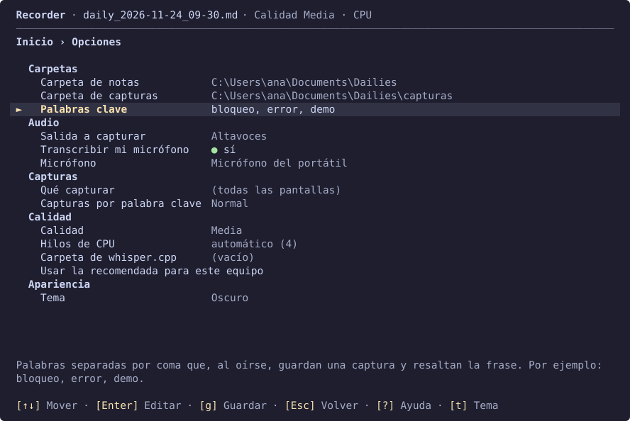

```text
 Recorder · daily_2026-11-24_09-30.md · Calidad Media · CPU
 ──────────────────────────────────────────────────────────────────────────────────────────────────
 Inicio › Opciones

   Carpetas
     Carpeta de notas            C:\Users\ana\Documents\Dailies
     Carpeta de capturas         C:\Users\ana\Documents\Dailies\capturas
 ►   Palabras clave              bloqueo, error, demo
   Audio
     Salida a capturar           Altavoces
     Transcribir mi micrófono    ● sí
     Micrófono                   Micrófono del portátil
   Capturas
     Qué capturar                (todas las pantallas)
     Capturas por palabra clave  Normal
   Calidad
     Calidad                     Media
     Hilos de CPU                automático (4)
     Carpeta de whisper.cpp      (vacío)
     Usar la recomendada para este equipo
   Apariencia
     Tema                        Oscuro


 Palabras separadas por coma que, al oírse, guardan una captura y resaltan la frase. Por ejemplo:
 bloqueo, error, demo.

 [↑↓] Mover · [Enter] Editar · [g] Guardar · [Esc] Volver · [?] Ayuda · [t] Tema
```

```text
 Recorder · daily_2026-11-24_09-30.md · Calidad Media · CPU
 ──────────────────────────────────────────────────────────
 Inicio › Opciones
   Carpetas
     Carpeta de notas            C:\Users…Documents\Dailies
     Carpeta de capturas         C:\Users…\Dailies\capturas
 ►   Palabras clave              bloqueo, error, demo
   Audio
     Salida a capturar           Altavoces
     Transcribir mi micrófono    ● sí
     Micrófono                   Micrófono del portátil
   Capturas
     Qué capturar                (todas las pantallas)
     Capturas por palabra clave  Normal
   Calidad
     Calidad                     Media
    ↓ 4 más abajo

 Palabras separadas por coma que, al oírse, guardan una
 captura y resaltan la frase. Por ejemplo: bloqueo, error,
 demo.


 [Enter] Editar · [g] Guardar · [Esc] Volver · [?] Más
```

#### Opciones · lista de selección

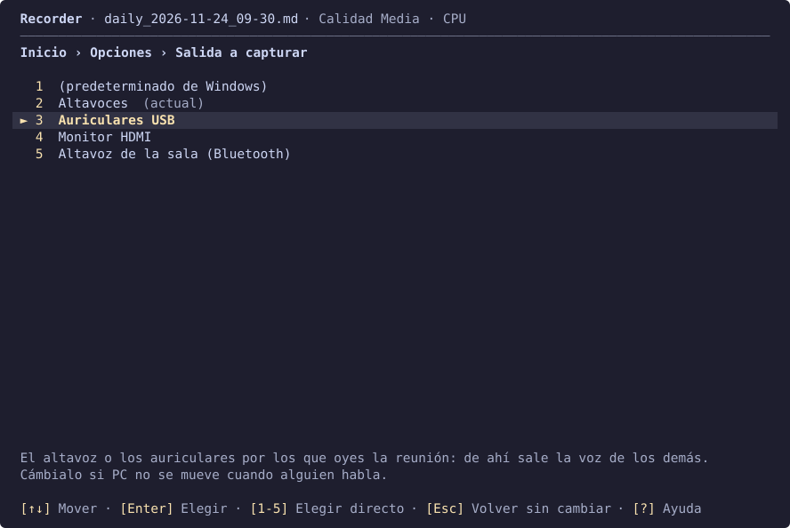

```text
 Recorder · daily_2026-11-24_09-30.md · Calidad Media · CPU
 ──────────────────────────────────────────────────────────────────────────────────────────────────
 Inicio › Opciones › Salida a capturar

   1  (predeterminado de Windows)
   2  Altavoces  (actual)
 ► 3  Auriculares USB
   4  Monitor HDMI
   5  Altavoz de la sala (Bluetooth)


 El altavoz o los auriculares por los que oyes la reunión: de ahí sale la voz de los demás.
 Cámbialo si PC no se mueve cuando alguien habla.

 [↑↓] Mover · [Enter] Elegir · [1-5] Elegir directo · [Esc] Volver sin cambiar · [?] Ayuda
```

```text
 Recorder · daily_2026-11-24_09-30.md · Calidad Media · CPU
 ──────────────────────────────────────────────────────────
 Inicio › Opciones › Salida a capturar
   1  (predeterminado de Windows)
   2  Altavoces  (actual)
 ► 3  Auriculares USB
   4  Monitor HDMI
   5  Altavoz de la sala (Bluetooth)


 El altavoz o los auriculares por los que oyes la reunión:
 de ahí sale la voz de los demás. Cámbialo si PC no se
 mueve cuando alguien habla.


 [Enter] Elegir · [Esc] Volver sin cambiar · [?] Más
```

#### Opciones · campo de texto con cursor

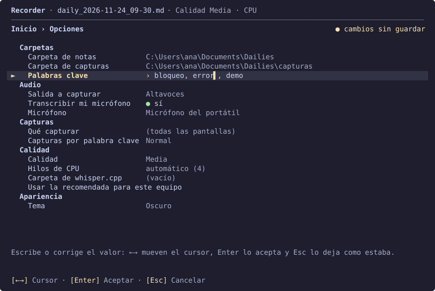

El cursor está tras «error». La marca de cambios aparece en cuanto el valor difiere de lo guardado.

```text
 Recorder · daily_2026-11-24_09-30.md · Calidad Media · CPU
 ──────────────────────────────────────────────────────────────────────────────────────────────────
 Inicio › Opciones                                                            ● cambios sin guardar

   Carpetas
     Carpeta de notas            C:\Users\ana\Documents\Dailies
     Carpeta de capturas         C:\Users\ana\Documents\Dailies\capturas
 ►   Palabras clave              › bloqueo, error▌, demo
   Audio
     Salida a capturar           Altavoces
     Transcribir mi micrófono    ● sí
     Micrófono                   Micrófono del portátil
   Capturas
     Qué capturar                (todas las pantallas)
     Capturas por palabra clave  Normal
   Calidad
     Calidad                     Media
     Hilos de CPU                automático (4)
     Carpeta de whisper.cpp      (vacío)
     Usar la recomendada para este equipo
   Apariencia
     Tema                        Oscuro


 Escribe o corrige el valor: ←→ mueven el cursor, Enter lo acepta y Esc lo deja como estaba.


 [←→] Cursor · [Enter] Aceptar · [Esc] Cancelar
```

```text
 Recorder · daily_2026-11-24_09-30.md · Calidad Media · CPU
 ──────────────────────────────────────────────────────────
 Inicio › Opciones                    ● cambios sin guardar
   Carpetas
     Carpeta de notas            C:\Users…Documents\Dailies
     Carpeta de capturas         C:\Users…\Dailies\capturas
 ►   Palabras clave              › bloqueo, error▌, demo
   Audio
     Salida a capturar           Altavoces
     Transcribir mi micrófono    ● sí
     Micrófono                   Micrófono del portátil
   Capturas
     Qué capturar                (todas las pantallas)
     Capturas por palabra clave  Normal
   Calidad
     Calidad                     Media
    ↓ 4 más abajo

 Escribe o corrige el valor: ←→ mueven el cursor, Enter lo
 acepta y Esc lo deja como estaba.


 [←→] Cursor · [Enter] Aceptar · [Esc] Cancelar
```

#### Opciones · confirmación «antes → después»

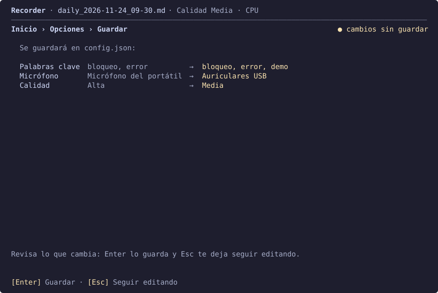

```text
 Recorder · daily_2026-11-24_09-30.md · Calidad Media · CPU
 ──────────────────────────────────────────────────────────────────────────────────────────────────
 Inicio › Opciones › Guardar                                                  ● cambios sin guardar

   Se guardará en config.json:

   Palabras clave  bloqueo, error          →  bloqueo, error, demo
   Micrófono       Micrófono del portátil  →  Auriculares USB
   Calidad         Alta                    →  Media


 Revisa lo que cambia: Enter lo guarda y Esc te deja seguir editando.


 [Enter] Guardar · [Esc] Seguir editando
```

```text
 Recorder · daily_2026-11-24_09-30.md · Calidad Media · CPU
 ──────────────────────────────────────────────────────────
 Inicio › Opciones › Guardar          ● cambios sin guardar
   Se guardará en config.json:

   Palabras clave
     bloqueo, error → bloqueo, error, demo
   Micrófono
     Micrófono del portátil → Auriculares USB
   Calidad
     Alta → Media


 Revisa lo que cambia: Enter lo guarda y Esc te deja seguir
 editando.


 [Enter] Guardar · [Esc] Seguir editando
```

### 7.3 Calibrar

Una sola pantalla. «Probar una frase» queda siempre a la vista, fijada abajo si la lista no cabe, y su veredicto se recalcula al escribir y al cambiar cualquier ajuste. Sin frase escrita, su línea dice `calibrar_probar_vacio` en `tenue`. El sentido de cada filtro: silencio y repeticiones descartan más hacia la izquierda; confianza mínima, hacia la derecha.

#### Calibrar · un filtro elegido y la frase que se queda


La pista de sentido solo acompaña a la fila elegida.

```text
 Recorder · daily_2026-11-24_09-30.md · Calidad Media · CPU
 ──────────────────────────────────────────────────────────────────────────────────────────────────
 Inicio › Calibrar                                                            ● cambios sin guardar

   Tus términos
     Vocabulario                 Recorder, Teams, QA, despliegue, demo
     Correcciones                cuba=QA
   Frases inventadas
     Frases a ignorar            suscríbete, gracias por ver
     Añadir las comunes
     Quitar eco del vocabulario  ● sí
   Filtros de frases dudosas
 ►   Filtro de silencio          ‹ 0,60 ›   ← descarta más · descarta menos →
     Confianza mínima            -1,0
     Filtro de repeticiones      2,4

   Probar una frase
     › En cuba ya probamos Teams y funcionó.
     √ Se queda: «En QA ya probamos Teams y funcionó.» (corregido: cuba → QA)


 Descarta lo que probablemente era solo ruido. Bájalo si salen frases inventadas en silencios;
 súbelo si se pierden frases dichas en voz baja.

 [↑↓] Mover · [←→] Ajustar · [Enter] Teclear · [e] Ejemplo · [g] Guardar · [Esc] Volver · [?] Más
```

```text
 Recorder · daily_2026-11-24_09-30.md · Calidad Media · CPU
 ──────────────────────────────────────────────────────────
 Inicio › Calibrar                    ● cambios sin guardar
    ↑ 2 más arriba
   Frases inventadas
     Frases a ignorar            suscríbete, gracias por v…
     Añadir las comunes
     Quitar eco del vocabulario  ● sí
   Filtros de frases dudosas
 ►   Filtro de silencio          ‹ 0,60 ›   ← descarta más
     Confianza mínima            -1,0
     Filtro de repeticiones      2,4

   Probar una frase
     › En cuba ya probamos Teams y funcionó.
     √ Se queda: «En QA ya probamos Teams y funcionó.»
       (corregido: cuba → QA)

 Descarta lo que probablemente era solo ruido. Bájalo si
 salen frases inventadas en silencios; súbelo si se pierden
 frases dichas en voz baja.


 [←→] Ajustar · [g] Guardar · [Esc] Volver · [?] Más
```

#### Calibrar · la frase que se descarta

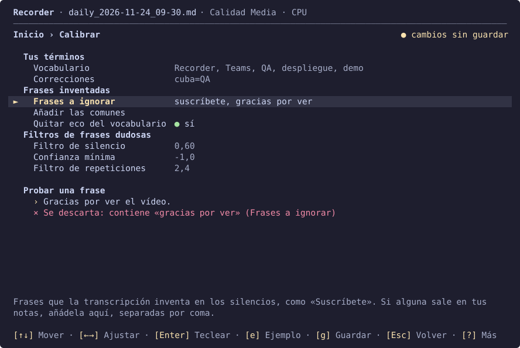

```text
 Recorder · daily_2026-11-24_09-30.md · Calidad Media · CPU
 ──────────────────────────────────────────────────────────────────────────────────────────────────
 Inicio › Calibrar                                                            ● cambios sin guardar

   Tus términos
     Vocabulario                 Recorder, Teams, QA, despliegue, demo
     Correcciones                cuba=QA
   Frases inventadas
 ►   Frases a ignorar            suscríbete, gracias por ver
     Añadir las comunes
     Quitar eco del vocabulario  ● sí
   Filtros de frases dudosas
     Filtro de silencio          0,60
     Confianza mínima            -1,0
     Filtro de repeticiones      2,4

   Probar una frase
     › Gracias por ver el vídeo.
     × Se descarta: contiene «gracias por ver» (Frases a ignorar)


 Frases que la transcripción inventa en los silencios, como «Suscríbete». Si alguna sale en tus
 notas, añádela aquí, separadas por coma.

 [↑↓] Mover · [←→] Ajustar · [Enter] Teclear · [e] Ejemplo · [g] Guardar · [Esc] Volver · [?] Más
```

```text
 Recorder · daily_2026-11-24_09-30.md · Calidad Media · CPU
 ──────────────────────────────────────────────────────────
 Inicio › Calibrar                    ● cambios sin guardar
   Tus términos
     Vocabulario                 Recorder, Teams, QA, desp…
     Correcciones                cuba=QA
   Frases inventadas
 ►   Frases a ignorar            suscríbete, gracias por v…
     Añadir las comunes
     Quitar eco del vocabulario  ● sí
   Filtros de frases dudosas
    ↓ 2 más abajo

   Probar una frase
     › Gracias por ver el vídeo.
     × Se descarta: contiene «gracias por ver» (Frases a
       ignorar)

 Frases que la transcripción inventa en los silencios, como
 «Suscríbete». Si alguna sale en tus notas, añádela aquí,
 separadas por coma.


 [←→] Ajustar · [g] Guardar · [Esc] Volver · [?] Más
```

### 7.4 Reagrupar nota

Tres pasos: elegir la nota, ajustar viendo el resultado, y crear. Con «Sin agrupar», «Hora corta» pasa a `tenue`, no se puede elegir (↑↓ la saltan) y la ayuda de la pantalla explica por qué (`reagrupar_hora_corta_no`). Tras crear la copia se vuelve a las opciones con el aviso `reagrupar_creada`.

#### Reagrupar · elegir la nota

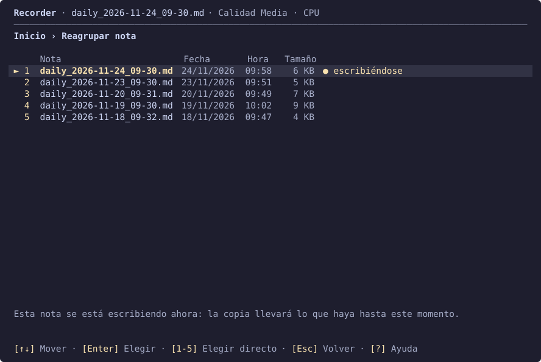

```text
 Recorder · daily_2026-11-24_09-30.md · Calidad Media · CPU
 ──────────────────────────────────────────────────────────────────────────────────────────────────
 Inicio › Reagrupar nota

      Nota                       Fecha       Hora   Tamaño
 ► 1  daily_2026-11-24_09-30.md  24/11/2026  09:58    6 KB  ● escribiéndose
   2  daily_2026-11-23_09-30.md  23/11/2026  09:51    5 KB
   3  daily_2026-11-20_09-31.md  20/11/2026  09:49    7 KB
   4  daily_2026-11-19_09-30.md  19/11/2026  10:02    9 KB
   5  daily_2026-11-18_09-32.md  18/11/2026  09:47    4 KB


 Esta nota se está escribiendo ahora: la copia llevará lo que haya hasta este momento.


 [↑↓] Mover · [Enter] Elegir · [1-5] Elegir directo · [Esc] Volver · [?] Ayuda
```

```text
 Recorder · daily_2026-11-24_09-30.md · Calidad Media · CPU
 ──────────────────────────────────────────────────────────
 Inicio › Reagrupar nota
      Nota                       Tamaño
 ► 1  daily_2026-11-24_09-30.md    6 KB  ● escribiéndose
   2  daily_2026-11-23_09-30.md    5 KB
   3  daily_2026-11-20_09-31.md    7 KB
   4  daily_2026-11-19_09-30.md    9 KB
   5  daily_2026-11-18_09-32.md    4 KB


 Esta nota se está escribiendo ahora: la copia llevará lo
 que haya hasta este momento.


 [↑↓] Mover · [Enter] Elegir · [Esc] Volver · [?] Más
```

#### Reagrupar · opciones con vista previa viva

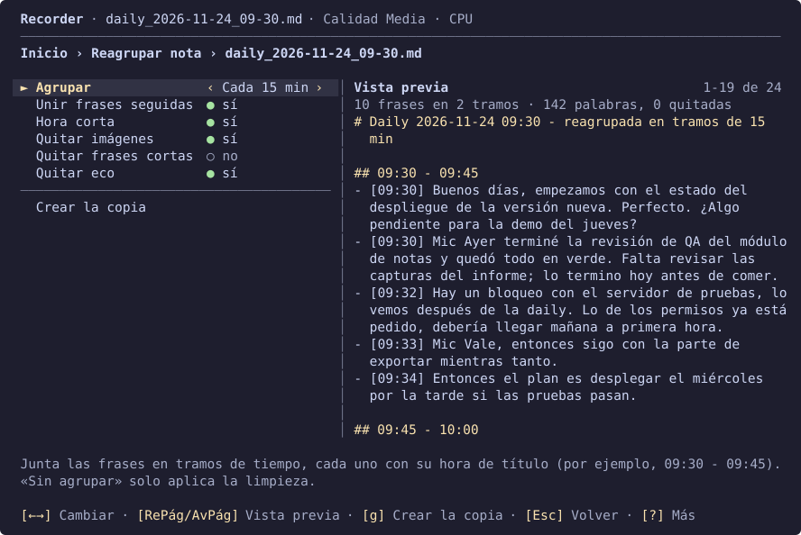

A 100 columnas, vista previa a la derecha; a 60, debajo.

```text
 Recorder · daily_2026-11-24_09-30.md · Calidad Media · CPU
 ──────────────────────────────────────────────────────────────────────────────────────────────────
 Inicio › Reagrupar nota › daily_2026-11-24_09-30.md

 ► Agrupar               ‹ Cada 15 min ›  │ Vista previa                                 1-19 de 24
   Unir frases seguidas  ● sí             │ 10 frases en 2 tramos · 142 palabras, 0 quitadas
   Hora corta            ● sí             │ # Daily 2026-11-24 09:30 - reagrupada en tramos de 15
   Quitar imágenes       ● sí             │   min
   Quitar frases cortas  ○ no             │
   Quitar eco            ● sí             │ ## 09:30 - 09:45
 ──────────────────────────────────────── │ - [09:30] Buenos días, empezamos con el estado del
   Crear la copia                         │   despliegue de la versión nueva. Perfecto. ¿Algo
                                          │   pendiente para la demo del jueves?
                                          │ - [09:30] Mic Ayer terminé la revisión de QA del módulo
                                          │   de notas y quedó todo en verde. Falta revisar las
                                          │   capturas del informe; lo termino hoy antes de comer.
                                          │ - [09:32] Hay un bloqueo con el servidor de pruebas, lo
                                          │   vemos después de la daily. Lo de los permisos ya está
                                          │   pedido, debería llegar mañana a primera hora.
                                          │ - [09:33] Mic Vale, entonces sigo con la parte de
                                          │   exportar mientras tanto.
                                          │ - [09:34] Entonces el plan es desplegar el miércoles
                                          │   por la tarde si las pruebas pasan.
                                          │
                                          │ ## 09:45 - 10:00

 Junta las frases en tramos de tiempo, cada uno con su hora de título (por ejemplo, 09:30 - 09:45).
 «Sin agrupar» solo aplica la limpieza.

 [←→] Cambiar · [RePág/AvPág] Vista previa · [g] Crear la copia · [Esc] Volver · [?] Más
```

```text
 Recorder · daily_2026-11-24_09-30.md · Calidad Media · CPU
 ──────────────────────────────────────────────────────────
 Inicio › Reagrupar nota › daily_2026-11-2…
 ► Agrupar               ‹ Cada 15 min ›
   Unir frases seguidas  ● sí
   Hora corta            ● sí
   Quitar imágenes       ● sí
   Quitar frases cortas  ○ no
   Quitar eco            ● sí
   Crear la copia
 ──────────────────────────────────────────────────────────
 Vista previa                                     1-4 de 23
 10 frases en 2 tramos · 142 palabras, 0 quitadas
 # Daily 2026-11-24 09:30 - reagrupada en tramos de 15 min

 ## 09:30 - 09:45
 - [09:30] Buenos días, empezamos con el estado del

 Junta las frases en tramos de tiempo, cada uno con su hora
 de título (por ejemplo, 09:30 - 09:45). «Sin agrupar» solo
 aplica la limpieza.


 [←→] Cambiar · [g] Crear la copia · [Esc] Volver · [?] Más
```

#### Reagrupar · crear la copia

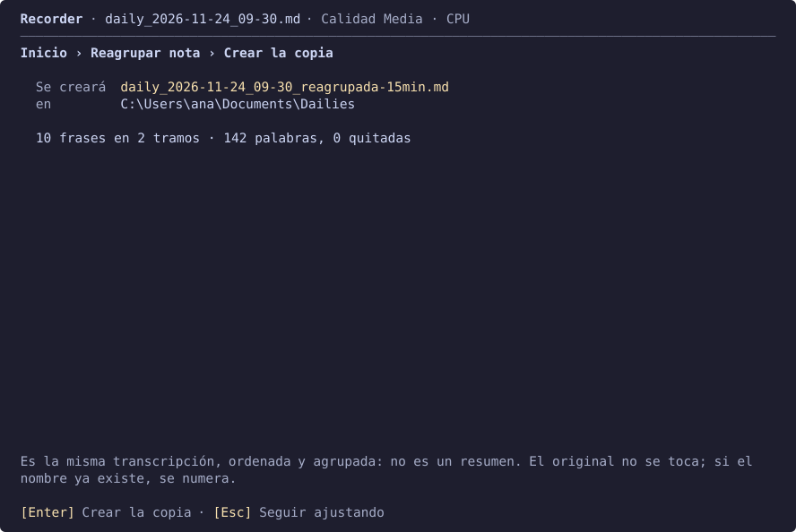

```text
 Recorder · daily_2026-11-24_09-30.md · Calidad Media · CPU
 ──────────────────────────────────────────────────────────────────────────────────────────────────
 Inicio › Reagrupar nota › Crear la copia

   Se creará  daily_2026-11-24_09-30_reagrupada-15min.md
   en         C:\Users\ana\Documents\Dailies

   10 frases en 2 tramos · 142 palabras, 0 quitadas


 Es la misma transcripción, ordenada y agrupada: no es un resumen. El original no se toca; si el
 nombre ya existe, se numera.

 [Enter] Crear la copia · [Esc] Seguir ajustando
```

```text
 Recorder · daily_2026-11-24_09-30.md · Calidad Media · CPU
 ──────────────────────────────────────────────────────────
 Inicio › Reagrupar nota › Crear la copia
   Se creará  daily_2026-11-24_09-30_reagrupada-15min.md
   en         C:\Users\ana\Documents\Dailies

   10 frases en 2 tramos · 142 palabras, 0 quitadas


 Es la misma transcripción, ordenada y agrupada: no es un
 resumen. El original no se toca; si el nombre ya existe,
 se numera.


 [Enter] Crear la copia · [Esc] Seguir ajustando
```

### 7.5 Recomendación del equipo

Mientras se detecta el equipo, el cuerpo es el spinner con `terminal_detectando_equipo`. Si lo guardado ya coincide, todas las filas dicen «igual», la acción desaparece y en su lugar va «√ Ya usas lo recomendado» en `ok`. Lo que no se pudo detectar se dice bajo «Tu equipo» con `recomendacion_sin_detectar`.

#### Recomendación · «Ahora / Recomendado»

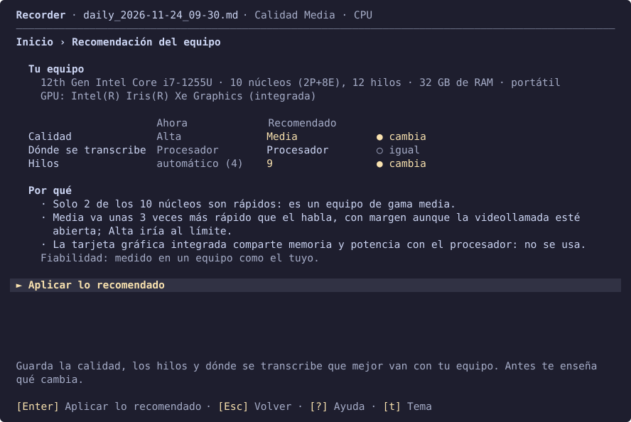

A 60×24 la ficha «Tu equipo» se quita (está en Rendimiento) y el estado va pegado al valor.

```text
 Recorder · daily_2026-11-24_09-30.md · Calidad Media · CPU
 ──────────────────────────────────────────────────────────────────────────────────────────────────
 Inicio › Recomendación del equipo

   Tu equipo
     12th Gen Intel Core i7-1255U · 10 núcleos (2P+8E), 12 hilos · 32 GB de RAM · portátil
     GPU: Intel(R) Iris(R) Xe Graphics (integrada)

                        Ahora             Recomendado
   Calidad              Alta              Media             ● cambia
   Dónde se transcribe  Procesador        Procesador        ○ igual
   Hilos                automático (4)    9                 ● cambia

   Por qué
     · Solo 2 de los 10 núcleos son rápidos: es un equipo de gama media.
     · Media va unas 3 veces más rápido que el habla, con margen aunque la videollamada esté
       abierta; Alta iría al límite.
     · La tarjeta gráfica integrada comparte memoria y potencia con el procesador: no se usa.
     Fiabilidad: medido en un equipo como el tuyo.

 ► Aplicar lo recomendado


 Guarda la calidad, los hilos y dónde se transcribe que mejor van con tu equipo. Antes te enseña
 qué cambia.

 [Enter] Aplicar lo recomendado · [Esc] Volver · [?] Ayuda · [t] Tema
```

```text
 Recorder · daily_2026-11-24_09-30.md · Calidad Media · CPU
 ──────────────────────────────────────────────────────────
 Inicio › Recomendación del equipo
                        Ahora           Recomendado
   Calidad              Alta            Media ● cambia
   Dónde se transcribe  Procesador      Procesador ○ igual
   Hilos                automático (4)  9 ● cambia
   Por qué
     · Solo 2 de los 10 núcleos son rápidos: es un equipo
       de gama media.
     · Media va unas 3 veces más rápido que el habla, con
       margen aunque la videollamada esté abierta; Alta
       iría al límite.
     · La tarjeta gráfica integrada comparte memoria y
       potencia con el procesador: no se usa.
     Fiabilidad: medido en un equipo como el tuyo.
 ► Aplicar lo recomendado

 Guarda la calidad, los hilos y dónde se transcribe que
 mejor van con tu equipo. Antes te enseña qué cambia.


 [Enter] Aplicar lo recomendado · [Esc] Volver · [?] Más
```

### 7.6 Rendimiento

Dos vistas con las mismas piezas. Sin grabación: veredicto de margen (umbral sobre la media del procesador de los últimos 30 s: menos de `MARGEN_HOLGADO` = 50 % hay margen; hasta `MARGEN_JUSTO` = 75 % va justo; por encima, cargado), con qué se transcribiría, y procesador, tarjeta gráfica y memoria del equipo. Durante la grabación (se abre con `m`): veredicto de velocidad (`VELOCIDAD_AL_DIA` = 1,5× o más va al día; entre 1,0× y 1,5× va justo; por debajo se atrasa), cola, y lo que gasta Recorder frente al equipo. Hasta la primera muestra, el veredicto es el spinner con `rendimiento_midiendo`. Si hubo caída al procesador, bajo «Motor» va una línea en `error` con `rendimiento_caida`. La fila «Medir mi equipo» solo existe si esa función está construida.

#### Rendimiento sin grabación

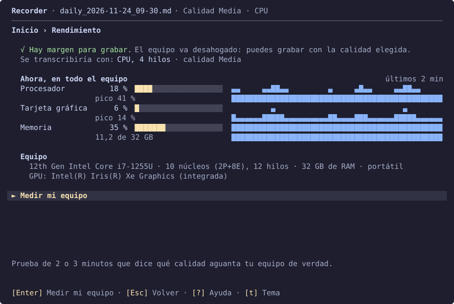

```text
 Recorder · daily_2026-11-24_09-30.md · Calidad Media · CPU
 ──────────────────────────────────────────────────────────────────────────────────────────────────
 Inicio › Rendimiento

   √ Hay margen para grabar. El equipo va desahogado: puedes grabar con la calidad elegida.
   Se transcribiría con: CPU, 4 hilos · calidad Media

   Ahora, en todo el equipo                                                           últimos 2 min
   Procesador          18 %  ████░░░░░░░░░░░░░░░░  ▄▄     ▄▄██▄▄         ▄     ▄█▄▄     ▄▄██▄▄
                    pico 41 %                      ████████████████████████████████████████████████
   Tarjeta gráfica      6 %  █░░░░░░░░░░░░░░░░░░░           ▄                             ▄
                    pico 14 %                      █▄▄▄▄▄▄█████▄▄▄▄▄▄▄▄▄▄██▄▄▄▄███▄▄▄▄▄▄█████▄▄▄▄▄▄
   Memoria             35 %  ███████░░░░░░░░░░░░░  ████████████████████████████████████████████████
                    11,2 de 32 GB                  ████████████████████████████████████████████████

   Equipo
     12th Gen Intel Core i7-1255U · 10 núcleos (2P+8E), 12 hilos · 32 GB de RAM · portátil
     GPU: Intel(R) Iris(R) Xe Graphics (integrada)

 ► Medir mi equipo


 Prueba de 2 o 3 minutos que dice qué calidad aguanta tu equipo de verdad.


 [Enter] Medir mi equipo · [Esc] Volver · [?] Ayuda · [t] Tema
```

```text
 Recorder · daily_2026-11-24_09-30.md · Calidad Media · CPU
 ──────────────────────────────────────────────────────────
 Inicio › Rendimiento
   √ Hay margen para grabar.
   Se transcribiría con: CPU, 4 hilos · calidad Media

   Ahora, en todo el equipo                   últimos 2 min
   Procesador         18 %  ██░░░░░░░░  █▄▄     ▄▄██▄▄
                    pico 41 %           ███████████████████
   Tarjeta gráfica     6 %  █░░░░░░░░░            ▄
                    pico 14 %           ██▄▄▄▄▄▄█████▄▄▄▄▄▄
   Memoria            35 %  ████░░░░░░  ███████████████████
                    11,2 de 32 GB       ███████████████████

 ► Medir mi equipo


 Prueba de 2 o 3 minutos que dice qué calidad aguanta tu
 equipo de verdad.


 [Enter] Medir mi equipo · [Esc] Volver · [?] Más
```

#### Rendimiento durante la grabación ([m])

![Rendimiento durante la grabación ([m])](terminal-especificacion/rendimiento-vivo.svg)

Es la función pura del paso 6b: las mismas líneas dentro del marco de la grabación.

```text
 Recorder · daily_2026-11-24_09-30.md · Calidad Media · CPU, 4 hilos
 ● Escuchando  00:04:02 · en cola 2                                       PC █████░░░  Mic █░░░░░░░
 ──────────────────────────────────────────────────────────────────────────────────────────────────
 Grabación › Rendimiento

   √ Va al día. Transcribe 2,6 veces más rápido de lo que se habla.

   Velocidad           2,6×  █████████████░░░░░░░  █████████▄▄██████████████████▄█████████▄▄███████
                    1× = al ritmo del habla        ████████████████████████████████████████████████
   En cola          2 trozos · 24 s de audio · último trozo: 3,1 s

   Procesador          38 %  ████████░░░░░░░░░░░░  █▄▄▄▄▄▄▄████▄▄▄▄▄▄▄▄▄▄▄▄▄▄▄▄███▄▄▄▄▄▄▄████▄▄▄▄▄▄
                    equipo 52 %                    ████████████████████████████████████████████████
   Tarjeta gráfica      n/d  ░░░░░░░░░░░░░░░░░░░░
                    equipo 6 %                     ▄▄▄▄▄▄▄▄▄▄▄▄▄▄▄▄▄▄▄▄▄▄▄▄▄▄▄▄▄▄▄▄▄▄▄▄▄▄▄▄▄▄▄▄▄▄▄▄
   Memoria           1,4 GB  █░░░░░░░░░░░░░░░░░░░
                    de 32 GB                       ▄▄▄▄▄▄▄▄▄▄▄▄▄▄▄▄▄▄▄▄▄▄▄▄▄▄▄▄▄▄▄▄▄▄▄▄▄▄▄▄▄▄▄▄▄▄▄▄

   Motor            faster-whisper · CPU, 4 hilos · small · haz 5


 [Esc] Volver a la transcripción · [p] Pausar · [c] Captura · [q] Salir
```

```text
 Recorder · daily_2026-11-24_09-30.md · Calidad Media · CPU
 ● Escuchando  00:04:02 · en cola 2       PC ██░░  Mic █░░░
 ──────────────────────────────────────────────────────────
 Grabación › Rendimiento

   √ Va al día. Transcribe 2,6 veces más rápido de lo que
     se habla.

   Velocidad          2,6×  ██████░░░░  ██████████▄████████
                    1× = habla          ███████████████████
   En cola          2 trozos · 24 s de audio · último troz…

   Procesador         38 %  ████░░░░░░  ██▄▄▄▄▄▄▄████▄▄▄▄▄▄
                    equipo 52 %         ███████████████████
   Tarjeta gráfica     n/d  ░░░░░░░░░░
                    equipo 6 %          ▄▄▄▄▄▄▄▄▄▄▄▄▄▄▄▄▄▄▄
   Memoria          1,4 GB  ░░░░░░░░░░
                    de 32 GB            ▄▄▄▄▄▄▄▄▄▄▄▄▄▄▄▄▄▄▄

   Motor            faster-whisper · CPU, 4 hilos · small ·
                    haz 5


 [Esc] Volver a la transcripción · [q] Salir · [?] Más
```

### 7.7 Medir mi equipo

La construye el paso 6 del plan anterior. Mientras mide solo vale Esc. La barra avanza con el total de pruebas; cada fila pasa de «en espera» a «midiendo…» y a su resultado. Al terminar, la mejor queda marcada con `●` y la palabra, y la acción elegida por defecto es «Aplicar el mejor», que abre la confirmación «antes → después».

#### Medir mi equipo · progreso

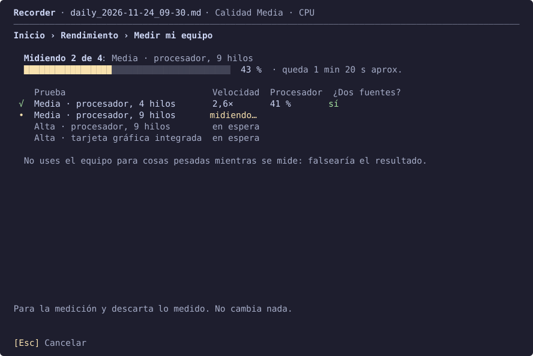

```text
 Recorder · daily_2026-11-24_09-30.md · Calidad Media · CPU
 ──────────────────────────────────────────────────────────────────────────────────────────────────
 Inicio › Rendimiento › Medir mi equipo

   Midiendo 2 de 4: Media · procesador, 9 hilos
   █████████████████░░░░░░░░░░░░░░░░░░░░░░░  43 %  · queda 1 min 20 s aprox.

     Prueba                            Velocidad  Procesador  ¿Dos fuentes?
  √  Media · procesador, 4 hilos       2,6×       41 %        sí
  •  Media · procesador, 9 hilos       midiendo…
     Alta · procesador, 9 hilos        en espera
     Alta · tarjeta gráfica integrada  en espera

   No uses el equipo para cosas pesadas mientras se mide: falsearía el resultado.


 Para la medición y descarta lo medido. No cambia nada.


 [Esc] Cancelar
```

```text
 Recorder · daily_2026-11-24_09-30.md · Calidad Media · CPU
 ──────────────────────────────────────────────────────────
 Inicio › Rendimiento › Medir mi equipo
   Midiendo 2 de 4: Media · procesador, 9 hilos
   █████████░░░░░░░░░░░  43 %  · queda 1 min 20 s aprox.

     Prueba                     Vel.   CPU   ¿Dos fuentes?
  √  Media · CPU, 4 hilos       2,6×   41 %  sí
  •  Media · CPU, 9 hilos       midiendo…
     Alta · CPU, 9 hilos        en espera
     Alta · GPU integrada       en espera

   No uses el equipo para cosas pesadas mientras se mide:
   falsearía el resultado.


 Para la medición y descarta lo medido. No cambia nada.


 [Esc] Cancelar
```

#### Medir mi equipo · resultados

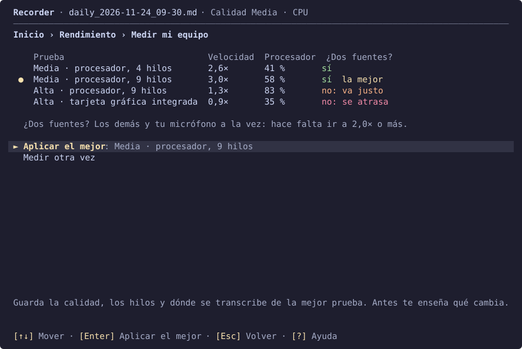

A 60 columnas, cabeceras cortas («Vel.», «CPU») y «la mejor» solo como `●`.

```text
 Recorder · daily_2026-11-24_09-30.md · Calidad Media · CPU
 ──────────────────────────────────────────────────────────────────────────────────────────────────
 Inicio › Rendimiento › Medir mi equipo

     Prueba                            Velocidad  Procesador  ¿Dos fuentes?
     Media · procesador, 4 hilos       2,6×       41 %        sí
  ●  Media · procesador, 9 hilos       3,0×       58 %        sí  la mejor
     Alta · procesador, 9 hilos        1,3×       83 %        no: va justo
     Alta · tarjeta gráfica integrada  0,9×       35 %        no: se atrasa

   ¿Dos fuentes? Los demás y tu micrófono a la vez: hace falta ir a 2,0× o más.

 ► Aplicar el mejor: Media · procesador, 9 hilos
   Medir otra vez


 Guarda la calidad, los hilos y dónde se transcribe de la mejor prueba. Antes te enseña qué cambia.


 [↑↓] Mover · [Enter] Aplicar el mejor · [Esc] Volver · [?] Ayuda
```

```text
 Recorder · daily_2026-11-24_09-30.md · Calidad Media · CPU
 ──────────────────────────────────────────────────────────
 Inicio › Rendimiento › Medir mi equipo
     Prueba                     Vel.   CPU   ¿Dos fuentes?
     Media · CPU, 4 hilos       2,6×   41 %  sí
  ●  Media · CPU, 9 hilos       3,0×   58 %  sí
     Alta · CPU, 9 hilos        1,3×   83 %  no: va justo
     Alta · GPU integrada       0,9×   35 %  no: se atrasa

   ¿Dos fuentes? Los demás y tu micrófono a la vez: hace
   falta ir a 2,0× o más.

 ► Aplicar el mejor: Media · procesador, 9 hilos
   Medir otra vez


 Guarda la calidad, los hilos y dónde se transcribe de la
 mejor prueba. Antes te enseña qué cambia.


 [Enter] Aplicar el mejor · [Esc] Volver · [?] Más
```

### 7.8 Grabación a pantalla completa

Sin región de Ayuda y con cabecera de dos líneas: la segunda es el estado. La transcripción se apoya abajo, guarda en memoria las últimas `LINEAS_MEMORIA` = 2000 líneas y nunca empieza a media frase. Los paneles (opciones, salida, vaciado) se abren bajo la transcripción, que sigue viva. Con «Mic» apagado, su medidor no se pinta. El indicador: `● Escuchando` en `ok`, `‖ En pausa` en `aviso`, `… Terminando` en `acento`.

#### Grabación · arranque

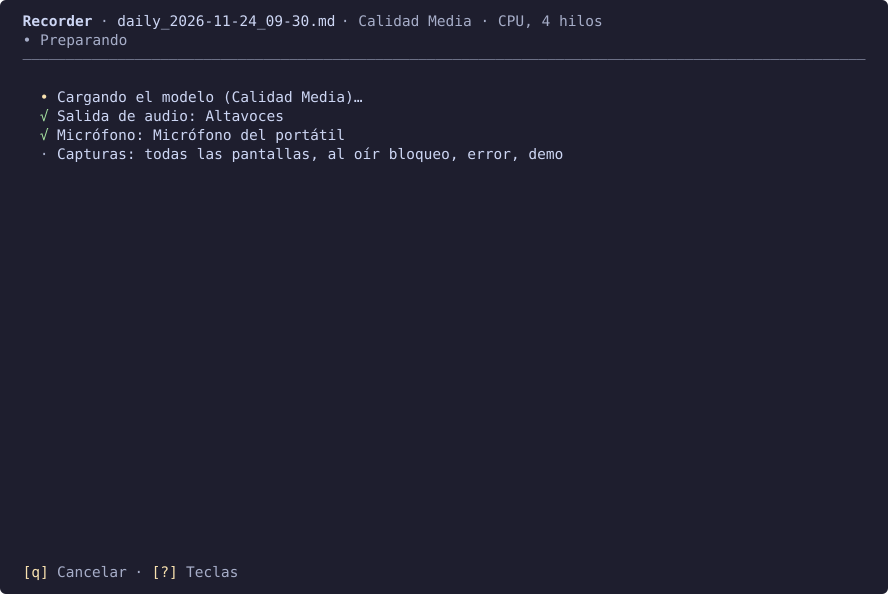

Cada fuente pasa de spinner a `√` al abrirse; si una falla, `×` y su motivo en `error`. Al cargar el modelo, la pantalla pasa sola a «Escuchando».

```text
 Recorder · daily_2026-11-24_09-30.md · Calidad Media · CPU, 4 hilos
 • Preparando
 ──────────────────────────────────────────────────────────────────────────────────────────────────

   • Cargando el modelo (Calidad Media)…
   √ Salida de audio: Altavoces
   √ Micrófono: Micrófono del portátil
   · Capturas: todas las pantallas, al oír bloqueo, error, demo


 [q] Cancelar · [?] Teclas
```

```text
 Recorder · daily_2026-11-24_09-30.md · Calidad Media · CPU
 • Preparando
 ──────────────────────────────────────────────────────────

   • Cargando el modelo (Calidad Media)…
   √ Salida de audio: Altavoces
   √ Micrófono: Micrófono del portátil
   · Capturas: todas las pantallas, al oír bloqueo, error,
     demo


 [q] Cancelar · [?] Teclas
```

#### Grabación · escuchando, con palabra clave, capturas y frase nueva

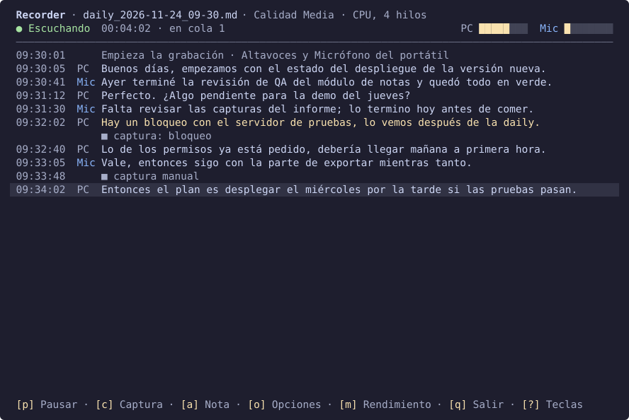

La última frase lleva fondo `superficie` durante `DURACION_FRASE_NUEVA`. La frase con palabra clave va en `acento` y debajo la línea de su captura.

```text
 Recorder · daily_2026-11-24_09-30.md · Calidad Media · CPU, 4 hilos
 ● Escuchando  00:04:02 · en cola 1                                       PC █████░░░  Mic █░░░░░░░
 ──────────────────────────────────────────────────────────────────────────────────────────────────
 09:30:01      Empieza la grabación · Altavoces y Micrófono del portátil
 09:30:05  PC  Buenos días, empezamos con el estado del despliegue de la versión nueva.
 09:30:41  Mic Ayer terminé la revisión de QA del módulo de notas y quedó todo en verde.
 09:31:12  PC  Perfecto. ¿Algo pendiente para la demo del jueves?
 09:31:30  Mic Falta revisar las capturas del informe; lo termino hoy antes de comer.
 09:32:02  PC  Hay un bloqueo con el servidor de pruebas, lo vemos después de la daily.
               ■ captura: bloqueo
 09:32:40  PC  Lo de los permisos ya está pedido, debería llegar mañana a primera hora.
 09:33:05  Mic Vale, entonces sigo con la parte de exportar mientras tanto.
 09:33:48      ■ captura manual
 09:34:02  PC  Entonces el plan es desplegar el miércoles por la tarde si las pruebas pasan.


 [p] Pausar · [c] Captura · [a] Nota · [o] Opciones · [m] Rendimiento · [q] Salir · [?] Teclas
```

```text
 Recorder · daily_2026-11-24_09-30.md · Calidad Media · CPU
 ● Escuchando  00:04:02 · en cola 1       PC ██░░  Mic █░░░
 ──────────────────────────────────────────────────────────

 09:30:05  PC  Buenos días, empezamos con el estado del
               despliegue de la versión nueva.
 09:30:41  Mic Ayer terminé la revisión de QA del módulo de
               notas y quedó todo en verde.
 09:31:12  PC  Perfecto. ¿Algo pendiente para la demo del
               jueves?
 09:31:30  Mic Falta revisar las capturas del informe; lo
               termino hoy antes de comer.
 09:32:02  PC  Hay un bloqueo con el servidor de pruebas,
               lo vemos después de la daily.
               ■ captura: bloqueo
 09:32:40  PC  Lo de los permisos ya está pedido, debería
               llegar mañana a primera hora.
 09:33:05  Mic Vale, entonces sigo con la parte de exportar
               mientras tanto.
 09:33:48      ■ captura manual
 09:34:02  PC  Entonces el plan es desplegar el miércoles
               por la tarde si las pruebas pasan.

 [p] Pausar · [c] Captura · [q] Salir · [?] Más
```

#### Grabación · revisando con «N frases nuevas abajo»

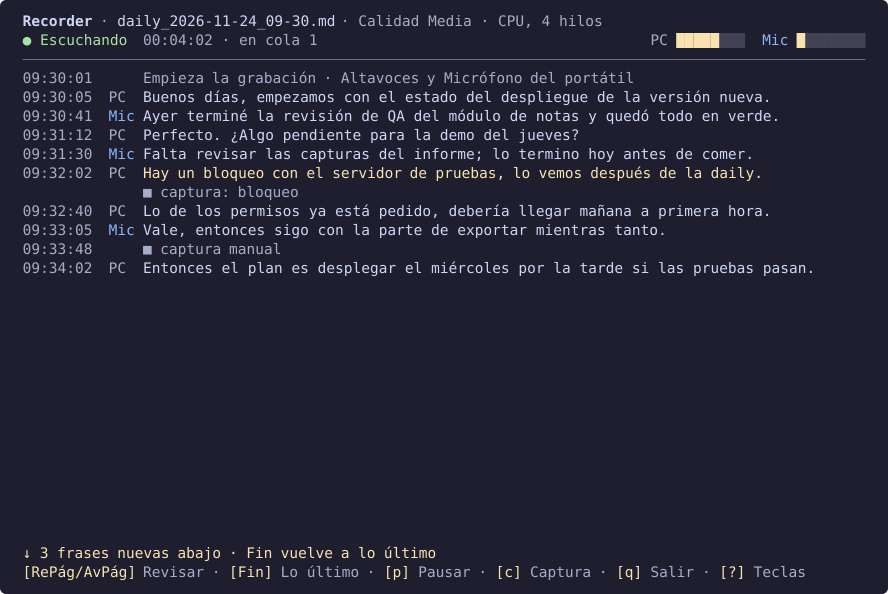

Mientras se revisa, lo nuevo no mueve la vista: se cuenta en el aviso. Fin, o llegar abajo con AvPág, vuelve a seguir lo último.

```text
 Recorder · daily_2026-11-24_09-30.md · Calidad Media · CPU, 4 hilos
 ● Escuchando  00:04:02 · en cola 1                                       PC █████░░░  Mic █░░░░░░░
 ──────────────────────────────────────────────────────────────────────────────────────────────────
 09:30:01      Empieza la grabación · Altavoces y Micrófono del portátil
 09:30:05  PC  Buenos días, empezamos con el estado del despliegue de la versión nueva.
 09:30:41  Mic Ayer terminé la revisión de QA del módulo de notas y quedó todo en verde.
 09:31:12  PC  Perfecto. ¿Algo pendiente para la demo del jueves?
 09:31:30  Mic Falta revisar las capturas del informe; lo termino hoy antes de comer.
 09:32:02  PC  Hay un bloqueo con el servidor de pruebas, lo vemos después de la daily.
               ■ captura: bloqueo
 09:32:40  PC  Lo de los permisos ya está pedido, debería llegar mañana a primera hora.
 09:33:05  Mic Vale, entonces sigo con la parte de exportar mientras tanto.
 09:33:48      ■ captura manual
 09:34:02  PC  Entonces el plan es desplegar el miércoles por la tarde si las pruebas pasan.


 ↓ 3 frases nuevas abajo · Fin vuelve a lo último
 [RePág/AvPág] Revisar · [Fin] Lo último · [p] Pausar · [c] Captura · [q] Salir · [?] Teclas
```

```text
 Recorder · daily_2026-11-24_09-30.md · Calidad Media · CPU
 ● Escuchando  00:04:02 · en cola 1       PC ██░░  Mic █░░░
 ──────────────────────────────────────────────────────────
 09:30:01      Empieza la grabación · Altavoces y Micrófono
               del portátil
 09:30:05  PC  Buenos días, empezamos con el estado del
               despliegue de la versión nueva.
 09:30:41  Mic Ayer terminé la revisión de QA del módulo de
               notas y quedó todo en verde.
 09:31:12  PC  Perfecto. ¿Algo pendiente para la demo del
               jueves?
 09:31:30  Mic Falta revisar las capturas del informe; lo
               termino hoy antes de comer.
 09:32:02  PC  Hay un bloqueo con el servidor de pruebas,
               lo vemos después de la daily.
               ■ captura: bloqueo
 09:32:40  PC  Lo de los permisos ya está pedido, debería
               llegar mañana a primera hora.
 09:33:05  Mic Vale, entonces sigo con la parte de exportar
               mientras tanto.
 09:33:48      ■ captura manual
 09:34:02  PC  Entonces el plan es desplegar el miércoles
 ↓ 3 frases nuevas abajo · Fin vuelve a lo último
 [RePág/AvPág] Revisar · [Fin] Lo último · [?] Más
```

#### Grabación · pausa y fuente sin audio

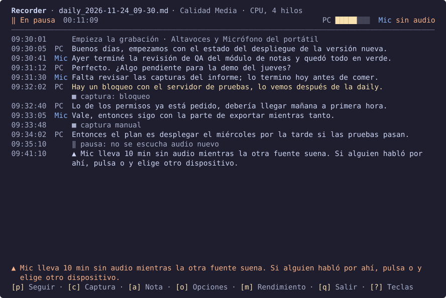

El aviso de fuente sin audio es persistente (ocupa hasta 2 líneas) y además queda como línea en la transcripción.

```text
 Recorder · daily_2026-11-24_09-30.md · Calidad Media · CPU, 4 hilos
 ‖ En pausa  00:11:09                                                    PC █████░░░  Mic sin audio
 ──────────────────────────────────────────────────────────────────────────────────────────────────
 09:30:01      Empieza la grabación · Altavoces y Micrófono del portátil
 09:30:05  PC  Buenos días, empezamos con el estado del despliegue de la versión nueva.
 09:30:41  Mic Ayer terminé la revisión de QA del módulo de notas y quedó todo en verde.
 09:31:12  PC  Perfecto. ¿Algo pendiente para la demo del jueves?
 09:31:30  Mic Falta revisar las capturas del informe; lo termino hoy antes de comer.
 09:32:02  PC  Hay un bloqueo con el servidor de pruebas, lo vemos después de la daily.
               ■ captura: bloqueo
 09:32:40  PC  Lo de los permisos ya está pedido, debería llegar mañana a primera hora.
 09:33:05  Mic Vale, entonces sigo con la parte de exportar mientras tanto.
 09:33:48      ■ captura manual
 09:34:02  PC  Entonces el plan es desplegar el miércoles por la tarde si las pruebas pasan.
 09:35:10      ‖ pausa: no se escucha audio nuevo
 09:41:10      ▲ Mic lleva 10 min sin audio mientras la otra fuente suena. Si alguien habló por
               ahí, pulsa o y elige otro dispositivo.


 ▲ Mic lleva 10 min sin audio mientras la otra fuente suena. Si alguien habló por ahí, pulsa o y
   elige otro dispositivo.
 [p] Seguir · [c] Captura · [a] Nota · [o] Opciones · [m] Rendimiento · [q] Salir · [?] Teclas
```

```text
 Recorder · daily_2026-11-24_09-30.md · Calidad Media · CPU
 ‖ En pausa  00:11:09                PC ██░░  Mic sin audio
 ──────────────────────────────────────────────────────────
 09:31:12  PC  Perfecto. ¿Algo pendiente para la demo del
               jueves?
 09:31:30  Mic Falta revisar las capturas del informe; lo
               termino hoy antes de comer.
 09:32:02  PC  Hay un bloqueo con el servidor de pruebas,
               lo vemos después de la daily.
               ■ captura: bloqueo
 09:32:40  PC  Lo de los permisos ya está pedido, debería
               llegar mañana a primera hora.
 09:33:05  Mic Vale, entonces sigo con la parte de exportar
               mientras tanto.
 09:33:48      ■ captura manual
 09:34:02  PC  Entonces el plan es desplegar el miércoles
               por la tarde si las pruebas pasan.
 09:35:10      ‖ pausa: no se escucha audio nuevo
 09:41:10      ▲ Mic lleva 10 min sin audio mientras la
               otra fuente suena. Si alguien habló por ahí,
               pulsa o y elige otro dispositivo.
 ▲ Mic lleva 10 min sin audio mientras la otra fuente
   suena. Si alguien habló por ahí, pulsa o y elige otro…
 [p] Seguir · [c] Captura · [q] Salir · [?] Más
```

#### Grabación · fuente caída

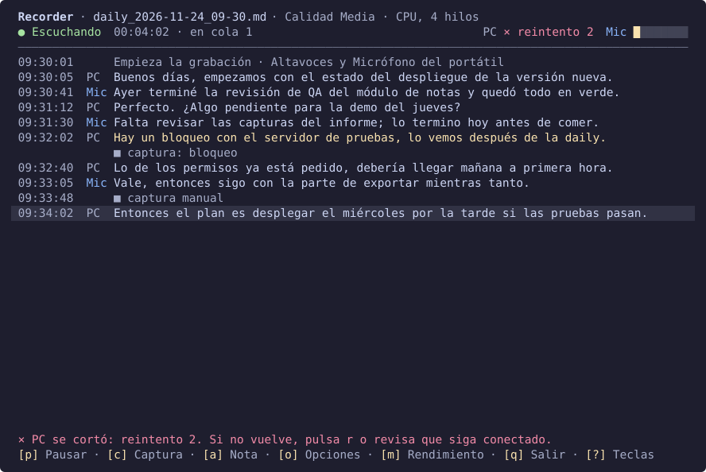

La fuente caída sustituye su medidor por el reintento. Al volver, línea `grabacion_vuelve` en `ok` y aviso pasajero.

```text
 Recorder · daily_2026-11-24_09-30.md · Calidad Media · CPU, 4 hilos
 ● Escuchando  00:04:02 · en cola 1                                  PC × reintento 2  Mic █░░░░░░░
 ──────────────────────────────────────────────────────────────────────────────────────────────────
 09:30:01      Empieza la grabación · Altavoces y Micrófono del portátil
 09:30:05  PC  Buenos días, empezamos con el estado del despliegue de la versión nueva.
 09:30:41  Mic Ayer terminé la revisión de QA del módulo de notas y quedó todo en verde.
 09:31:12  PC  Perfecto. ¿Algo pendiente para la demo del jueves?
 09:31:30  Mic Falta revisar las capturas del informe; lo termino hoy antes de comer.
 09:32:02  PC  Hay un bloqueo con el servidor de pruebas, lo vemos después de la daily.
               ■ captura: bloqueo
 09:32:40  PC  Lo de los permisos ya está pedido, debería llegar mañana a primera hora.
 09:33:05  Mic Vale, entonces sigo con la parte de exportar mientras tanto.
 09:33:48      ■ captura manual
 09:34:02  PC  Entonces el plan es desplegar el miércoles por la tarde si las pruebas pasan.


 × PC se cortó: reintento 2. Si no vuelve, pulsa r o revisa que siga conectado.
 [p] Pausar · [c] Captura · [a] Nota · [o] Opciones · [m] Rendimiento · [q] Salir · [?] Teclas
```

```text
 Recorder · daily_2026-11-24_09-30.md · Calidad Media · CPU
 ● Escuchando  00:04:02          PC × reintento 2  Mic █░░░
 ──────────────────────────────────────────────────────────
 09:30:05  PC  Buenos días, empezamos con el estado del
               despliegue de la versión nueva.
 09:30:41  Mic Ayer terminé la revisión de QA del módulo de
               notas y quedó todo en verde.
 09:31:12  PC  Perfecto. ¿Algo pendiente para la demo del
               jueves?
 09:31:30  Mic Falta revisar las capturas del informe; lo
               termino hoy antes de comer.
 09:32:02  PC  Hay un bloqueo con el servidor de pruebas,
               lo vemos después de la daily.
               ■ captura: bloqueo
 09:32:40  PC  Lo de los permisos ya está pedido, debería
               llegar mañana a primera hora.
 09:33:05  Mic Vale, entonces sigo con la parte de exportar
               mientras tanto.
 09:33:48      ■ captura manual
 09:34:02  PC  Entonces el plan es desplegar el miércoles
               por la tarde si las pruebas pasan.
 × PC se cortó: reintento 2. Si no vuelve, pulsa r o revisa
   que siga conectado.
 [p] Pausar · [c] Captura · [q] Salir · [?] Más
```

#### Grabación · panel [o]

![Grabación · panel [o]](terminal-especificacion/grabacion-panel.svg)

Al elegir en una sección, el panel se cierra y el aviso dice `grabacion_aplicado` en `ok`.

```text
 Recorder · daily_2026-11-24_09-30.md · Calidad Media · CPU, 4 hilos
 ● Escuchando  00:04:02 · en cola 1                                       PC █████░░░  Mic █░░░░░░░
 ──────────────────────────────────────────────────────────────────────────────────────────────────
 09:30:01      Empieza la grabación · Altavoces y Micrófono del portátil
 09:30:05  PC  Buenos días, empezamos con el estado del despliegue de la versión nueva.
 09:30:41  Mic Ayer terminé la revisión de QA del módulo de notas y quedó todo en verde.
 09:31:12  PC  Perfecto. ¿Algo pendiente para la demo del jueves?
 09:31:30  Mic Falta revisar las capturas del informe; lo termino hoy antes de comer.
 09:32:02  PC  Hay un bloqueo con el servidor de pruebas, lo vemos después de la daily.
               ■ captura: bloqueo
 09:32:40  PC  Lo de los permisos ya está pedido, debería llegar mañana a primera hora.
 09:33:05  Mic Vale, entonces sigo con la parte de exportar mientras tanto.
 09:33:48      ■ captura manual
 09:34:02  PC  Entonces el plan es desplegar el miércoles por la tarde si las pruebas pasan.


 ── Opciones de la grabación ──────────────────────────────────────────────────────────────────────
 ► 1  Salida de audio      Altavoces
   2  Micrófono            Micrófono del portátil
   3  Qué capturar         todas las pantallas
   4  Calidad de capturas  Normal
 El altavoz o los auriculares por los que oyes la reunión. Cámbialo si no se transcribe a los
 demás.

 [↑↓] Mover · [Enter] Abrir · [1-4] Directo · [Esc] Cerrar · [q] Salir
```

```text
 Recorder · daily_2026-11-24_09-30.md · Calidad Media · CPU
 ● Escuchando  00:04:02 · en cola 1       PC ██░░  Mic █░░░
 ──────────────────────────────────────────────────────────

 09:32:02  PC  Hay un bloqueo con el servidor de pruebas,
               lo vemos después de la daily.
               ■ captura: bloqueo
 09:32:40  PC  Lo de los permisos ya está pedido, debería
               llegar mañana a primera hora.
 09:33:05  Mic Vale, entonces sigo con la parte de exportar
               mientras tanto.
 09:33:48      ■ captura manual
 09:34:02  PC  Entonces el plan es desplegar el miércoles
               por la tarde si las pruebas pasan.
 ── Opciones de la grabación ──────────────────────────────
 ► 1  Salida de audio      Altavoces
   2  Micrófono            Micrófono del portátil
   3  Qué capturar         todas las pantallas
   4  Calidad de capturas  Normal
 El altavoz o los auriculares por los que oyes la reunión.
 Cámbialo si no se transcribe a los demás.


 [↑↓] Mover · [Enter] Abrir · [Esc] Cerrar · [?] Más
```

#### Grabación · panel [o], una sección

![Grabación · panel [o], una sección](terminal-especificacion/grabacion-panel-lista.svg)

`grabacion_dispositivo_nuevo` solo en las secciones de dispositivos. En «Qué capturar», el pie añade «r Releer ventanas».

```text
 Recorder · daily_2026-11-24_09-30.md · Calidad Media · CPU, 4 hilos
 ● Escuchando  00:04:02 · en cola 1                                       PC █████░░░  Mic █░░░░░░░
 ──────────────────────────────────────────────────────────────────────────────────────────────────
 09:30:01      Empieza la grabación · Altavoces y Micrófono del portátil
 09:30:05  PC  Buenos días, empezamos con el estado del despliegue de la versión nueva.
 09:30:41  Mic Ayer terminé la revisión de QA del módulo de notas y quedó todo en verde.
 09:31:12  PC  Perfecto. ¿Algo pendiente para la demo del jueves?
 09:31:30  Mic Falta revisar las capturas del informe; lo termino hoy antes de comer.
 09:32:02  PC  Hay un bloqueo con el servidor de pruebas, lo vemos después de la daily.
               ■ captura: bloqueo
 09:32:40  PC  Lo de los permisos ya está pedido, debería llegar mañana a primera hora.
 09:33:05  Mic Vale, entonces sigo con la parte de exportar mientras tanto.
 09:33:48      ■ captura manual
 09:34:02  PC  Entonces el plan es desplegar el miércoles por la tarde si las pruebas pasan.


 ── Opciones de la grabación › Salida de audio ────────────────────────────────────────────────────
   1  (predeterminado de Windows)
   2  Altavoces  (actual)
 ► 3  Auriculares USB
 ¿No aparece? Si lo conectaste después de empezar, sal con q y vuelve a entrar.

 [↑↓] Mover · [Enter] Elegir · [1-3] Directo · [Esc] Volver · [q] Salir
```

```text
 Recorder · daily_2026-11-24_09-30.md · Calidad Media · CPU
 ● Escuchando  00:04:02 · en cola 1       PC ██░░  Mic █░░░
 ──────────────────────────────────────────────────────────

 09:31:30  Mic Falta revisar las capturas del informe; lo
               termino hoy antes de comer.
 09:32:02  PC  Hay un bloqueo con el servidor de pruebas,
               lo vemos después de la daily.
               ■ captura: bloqueo
 09:32:40  PC  Lo de los permisos ya está pedido, debería
               llegar mañana a primera hora.
 09:33:05  Mic Vale, entonces sigo con la parte de exportar
               mientras tanto.
 09:33:48      ■ captura manual
 09:34:02  PC  Entonces el plan es desplegar el miércoles
               por la tarde si las pruebas pasan.
 ── Opciones › Salida de audio ────────────────────────────
   1  (predeterminado de Windows)
   2  Altavoces  (actual)
 ► 3  Auriculares USB
 ¿No aparece? Si lo conectaste después de empezar, sal con
 q y vuelve a entrar.

 [↑↓] Mover · [Enter] Elegir · [Esc] Volver · [?] Más
```

#### Grabación · leyenda [?]

![Grabación · leyenda [?]](terminal-especificacion/grabacion-teclas.svg)

```text
 Recorder · daily_2026-11-24_09-30.md · Calidad Media · CPU, 4 hilos
 ● Escuchando  00:04:02 · en cola 1                                       PC █████░░░  Mic █░░░░░░░
 ──────────────────────────────────────────────────────────────────────────────────────────────────
 Grabación › Teclas

   p            Pausar / seguir: Deja de escuchar audio nuevo sin cerrar; lo pendiente se sigue
                transcribiendo. Pulsa p otra vez para seguir.
   c            Captura: Guarda ahora una imagen de la pantalla o ventana elegida y la enlaza en la
                nota en este punto.
   a            Abrir la nota: Abre la nota de hoy con el programa que usa tu PC para los .md, para
                leerla mientras se escribe.
   r            Reconectar: Vuelve a abrir el audio con los dispositivos elegidos. Úsalo si una
                fuente marca × o dejó de oírse.
   o            Opciones: Cambia audio, micrófono y capturas sin parar la grabación. Elige con ↑↓ y
                Enter o con el número; Esc vuelve sin cambiar nada.
   m            Rendimiento: Muestra la velocidad, la cola y lo que gasta Recorder ahora. Esc
                vuelve a la transcripción.
   RePág AvPág  Revisar: RePág, AvPág y ↑↓ recorren lo ya transcrito; Inicio va al principio y Fin
                vuelve a lo último.
   ?            Teclas: Muestra esta lista de teclas. Esc vuelve a la transcripción.
   q            Salir: Termina la grabación. Si queda audio sin transcribir, te pregunta si esperar
                o salir sin esperar. Ctrl+C hace lo mismo.


 [Esc] Volver a la transcripción · [q] Salir
```

```text
 Recorder · daily_2026-11-24_09-30.md · Calidad Media · CPU
 ● Escuchando  00:04:02 · en cola 1       PC ██░░  Mic █░░░
 ──────────────────────────────────────────────────────────
 Grabación › Teclas

   p     Pausar / seguir: Deja de escuchar audio nuevo sin
         cerrar; lo pendiente se sigue transcribiendo.
   c     Captura: Guarda ahora una imagen de la pantalla o
         ventana elegida y la enlaza en la nota en este…
   a     Abrir la nota: Abre la nota de hoy con el programa
         que usa tu PC para los .md, para leerla mientras…
   r     Reconectar: Vuelve a abrir el audio con los
         dispositivos elegidos.
   o     Opciones: Cambia audio, micrófono y capturas sin
         parar la grabación.
   m     Rendimiento: Muestra la velocidad, la cola y lo
         que gasta Recorder ahora.
   RePág Revisar: RePág, AvPág y ↑↓ recorren lo ya
         transcrito; Inicio va al principio y Fin vuelve a…
   ?     Teclas: Muestra esta lista de teclas.
   q     Salir: Termina la grabación.


 [Esc] Volver a la transcripción · [q] Salir
```

#### Grabación · pregunta de salida con audio pendiente

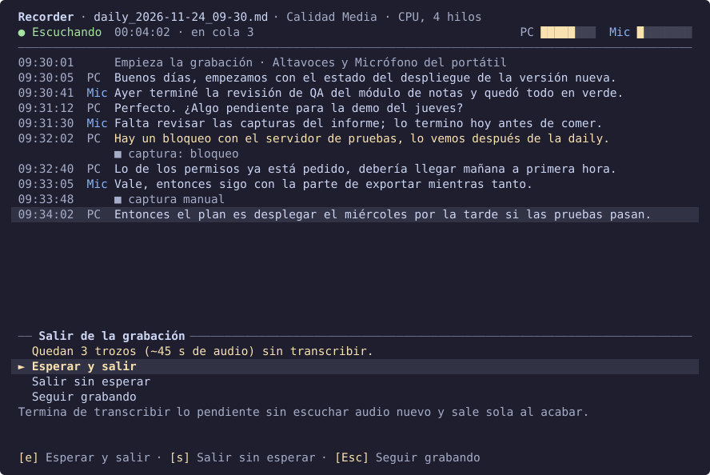

La ayuda bajo la lista es la de la fila elegida (`cierre_e`, `cierre_s`, `cierre_esc`).

```text
 Recorder · daily_2026-11-24_09-30.md · Calidad Media · CPU, 4 hilos
 ● Escuchando  00:04:02 · en cola 3                                       PC █████░░░  Mic █░░░░░░░
 ──────────────────────────────────────────────────────────────────────────────────────────────────
 09:30:01      Empieza la grabación · Altavoces y Micrófono del portátil
 09:30:05  PC  Buenos días, empezamos con el estado del despliegue de la versión nueva.
 09:30:41  Mic Ayer terminé la revisión de QA del módulo de notas y quedó todo en verde.
 09:31:12  PC  Perfecto. ¿Algo pendiente para la demo del jueves?
 09:31:30  Mic Falta revisar las capturas del informe; lo termino hoy antes de comer.
 09:32:02  PC  Hay un bloqueo con el servidor de pruebas, lo vemos después de la daily.
               ■ captura: bloqueo
 09:32:40  PC  Lo de los permisos ya está pedido, debería llegar mañana a primera hora.
 09:33:05  Mic Vale, entonces sigo con la parte de exportar mientras tanto.
 09:33:48      ■ captura manual
 09:34:02  PC  Entonces el plan es desplegar el miércoles por la tarde si las pruebas pasan.


 ── Salir de la grabación ─────────────────────────────────────────────────────────────────────────
   Quedan 3 trozos (~45 s de audio) sin transcribir.
 ► Esperar y salir
   Salir sin esperar
   Seguir grabando
 Termina de transcribir lo pendiente sin escuchar audio nuevo y sale sola al acabar.


 [e] Esperar y salir · [s] Salir sin esperar · [Esc] Seguir grabando
```

```text
 Recorder · daily_2026-11-24_09-30.md · Calidad Media · CPU
 ● Escuchando  00:04:02 · en cola 3       PC ██░░  Mic █░░░
 ──────────────────────────────────────────────────────────
 09:31:30  Mic Falta revisar las capturas del informe; lo
               termino hoy antes de comer.
 09:32:02  PC  Hay un bloqueo con el servidor de pruebas,
               lo vemos después de la daily.
               ■ captura: bloqueo
 09:32:40  PC  Lo de los permisos ya está pedido, debería
               llegar mañana a primera hora.
 09:33:05  Mic Vale, entonces sigo con la parte de exportar
               mientras tanto.
 09:33:48      ■ captura manual
 09:34:02  PC  Entonces el plan es desplegar el miércoles
               por la tarde si las pruebas pasan.
 ── Salir de la grabación ─────────────────────────────────
   Quedan 3 trozos (~45 s de audio) sin transcribir.
 ► Esperar y salir
   Salir sin esperar
   Seguir grabando
 Termina de transcribir lo pendiente sin escuchar audio
 nuevo y sale sola al acabar.

 [e] Esperar y salir · [s] Salir sin esperar · [Esc] Seguir
```

#### Grabación · vaciado de la cola

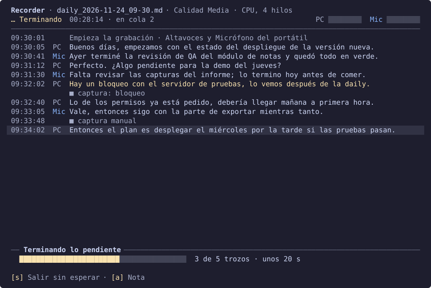

Los medidores se vacían: ya no se escucha. Al terminar se sale sola.

```text
 Recorder · daily_2026-11-24_09-30.md · Calidad Media · CPU, 4 hilos
 … Terminando  00:28:14 · en cola 2                                       PC ░░░░░░░░  Mic ░░░░░░░░
 ──────────────────────────────────────────────────────────────────────────────────────────────────
 09:30:01      Empieza la grabación · Altavoces y Micrófono del portátil
 09:30:05  PC  Buenos días, empezamos con el estado del despliegue de la versión nueva.
 09:30:41  Mic Ayer terminé la revisión de QA del módulo de notas y quedó todo en verde.
 09:31:12  PC  Perfecto. ¿Algo pendiente para la demo del jueves?
 09:31:30  Mic Falta revisar las capturas del informe; lo termino hoy antes de comer.
 09:32:02  PC  Hay un bloqueo con el servidor de pruebas, lo vemos después de la daily.
               ■ captura: bloqueo
 09:32:40  PC  Lo de los permisos ya está pedido, debería llegar mañana a primera hora.
 09:33:05  Mic Vale, entonces sigo con la parte de exportar mientras tanto.
 09:33:48      ■ captura manual
 09:34:02  PC  Entonces el plan es desplegar el miércoles por la tarde si las pruebas pasan.


 ── Terminando lo pendiente ───────────────────────────────────────────────────────────────────────
   ████████████████████████░░░░░░░░░░░░░░░░  3 de 5 trozos · unos 20 s

 [s] Salir sin esperar · [a] Nota
```

```text
 Recorder · daily_2026-11-24_09-30.md · Calidad Media · CPU
 … Terminando  00:28:14 · en cola 2       PC ░░░░  Mic ░░░░
 ──────────────────────────────────────────────────────────

 09:30:41  Mic Ayer terminé la revisión de QA del módulo de
               notas y quedó todo en verde.
 09:31:12  PC  Perfecto. ¿Algo pendiente para la demo del
               jueves?
 09:31:30  Mic Falta revisar las capturas del informe; lo
               termino hoy antes de comer.
 09:32:02  PC  Hay un bloqueo con el servidor de pruebas,
               lo vemos después de la daily.
               ■ captura: bloqueo
 09:32:40  PC  Lo de los permisos ya está pedido, debería
               llegar mañana a primera hora.
 09:33:05  Mic Vale, entonces sigo con la parte de exportar
               mientras tanto.
 09:33:48      ■ captura manual
 09:34:02  PC  Entonces el plan es desplegar el miércoles
               por la tarde si las pruebas pasan.
 ── Terminando lo pendiente ───────────────────────────────
   ████████████░░░░░░░░  3 de 5 trozos · unos 20 s

 [s] Salir sin esperar · [a] Nota
```

#### Grabación · resumen que queda en el historial al salir

Es lo único que la grabación escribe en el historial de la terminal. Sin colores de la paleta: título en negrita y el resto en el color de la consola. «Avisos» solo si los hubo; la última línea, solo si se salió sin esperar. Abierta desde el menú no se imprime: vuelve a Inicio con `inicio_fin_grabacion` como aviso.

```text
Recorder · grabación terminada
  Nota      C:\Users\ana\Documents\Dailies\daily_2026-11-24_09-30.md
  Duración  28 min · 142 frases · 3 capturas
  Avisos    1: Mic estuvo 10 min sin audio
  ▲ Se perdieron 3 trozos (~45 s de audio) sin transcribir.
```

### 7.9 Ayuda

Tres bloques desplazables: teclas de las pantallas, teclas de la grabación y glosario. Sin región de Ayuda (toda la pantalla lo es).

#### Ayuda

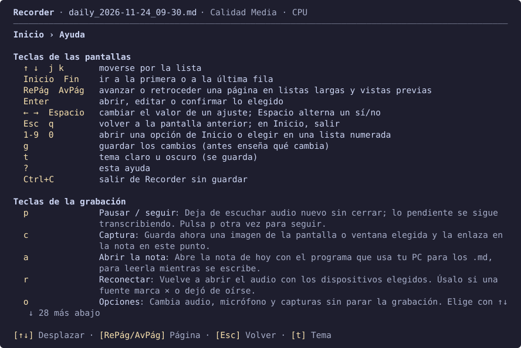

```text
 Recorder · daily_2026-11-24_09-30.md · Calidad Media · CPU
 ──────────────────────────────────────────────────────────────────────────────────────────────────
 Inicio › Ayuda

 Teclas de las pantallas
   ↑ ↓  j k       moverse por la lista
   Inicio  Fin    ir a la primera o a la última fila
   RePág  AvPág   avanzar o retroceder una página en listas largas y vistas previas
   Enter          abrir, editar o confirmar lo elegido
   ← →  Espacio   cambiar el valor de un ajuste; Espacio alterna un sí/no
   Esc  q         volver a la pantalla anterior; en Inicio, salir
   1-9  0         abrir una opción de Inicio o elegir en una lista numerada
   g              guardar los cambios (antes enseña qué cambia)
   t              tema claro u oscuro (se guarda)
   ?              esta ayuda
   Ctrl+C         salir de Recorder sin guardar

 Teclas de la grabación
   p              Pausar / seguir: Deja de escuchar audio nuevo sin cerrar; lo pendiente se sigue
                  transcribiendo. Pulsa p otra vez para seguir.
   c              Captura: Guarda ahora una imagen de la pantalla o ventana elegida y la enlaza en
                  la nota en este punto.
   a              Abrir la nota: Abre la nota de hoy con el programa que usa tu PC para los .md,
                  para leerla mientras se escribe.
   r              Reconectar: Vuelve a abrir el audio con los dispositivos elegidos. Úsalo si una
                  fuente marca × o dejó de oírse.
   o              Opciones: Cambia audio, micrófono y capturas sin parar la grabación. Elige con ↑↓
    ↓ 28 más abajo

 [↑↓] Desplazar · [RePág/AvPág] Página · [Esc] Volver · [t] Tema
```

```text
 Recorder · daily_2026-11-24_09-30.md · Calidad Media · CPU
 ──────────────────────────────────────────────────────────
 Inicio › Ayuda

 Teclas de las pantallas
   ↑ ↓  j k       moverse por la lista
   Inicio  Fin    ir a la primera o a la última fila
   RePág  AvPág   avanzar o retroceder una página en listas
                  largas y vistas previas
   Enter          abrir, editar o confirmar lo elegido
   ← →  Espacio   cambiar el valor de un ajuste; Espacio
                  alterna un sí/no
   Esc  q         volver a la pantalla anterior; en Inicio,
                  salir
   1-9  0         abrir una opción de Inicio o elegir en
                  una lista numerada
   g              guardar los cambios (antes enseña qué
                  cambia)
   t              tema claro u oscuro (se guarda)
   ?              esta ayuda
   Ctrl+C         salir de Recorder sin guardar
    ↓ 59 más abajo

 [↑↓] Desplazar · [Esc] Volver · [?] Más
```

### 7.10 Ventana abierta

Mientras la ventana gráfica está abierta, la terminal enseña este mensaje fijo y no atiende el teclado (la ventana ocupa el hilo principal). Al cerrarla se vuelve a Inicio con el aviso `ventana_cerrada`. Sin pie de botones: no hay ninguna tecla que ofrecer.

#### Ventana abierta

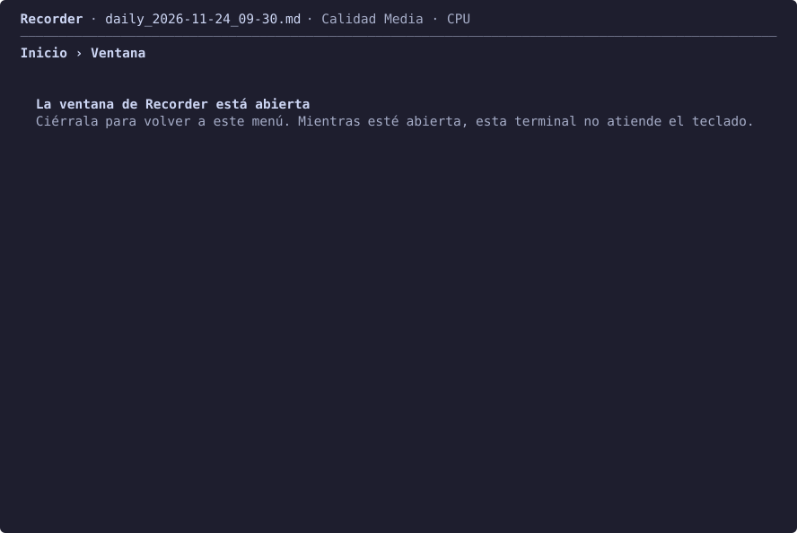

```text
 Recorder · daily_2026-11-24_09-30.md · Calidad Media · CPU
 ──────────────────────────────────────────────────────────────────────────────────────────────────
 Inicio › Ventana


   La ventana de Recorder está abierta
   Ciérrala para volver a este menú. Mientras esté abierta, esta terminal no atiende el teclado.


```

```text
 Recorder · daily_2026-11-24_09-30.md · Calidad Media · CPU
 ──────────────────────────────────────────────────────────
 Inicio › Ventana


   La ventana de Recorder está abierta
   Ciérrala para volver a este menú. Mientras esté abierta,
   esta terminal no atiende el teclado.


```

### 7.11 Estados comunes

Los mismos en todas las pantallas. Cargando: spinner y texto en el cuerpo, solo Esc y ?. Vacío: una línea que dice qué hacer. Error de detección: igual que vacío, en `error`, con `terminal_error_entorno`. config.json ilegible: la cabecera lo dice en `error` en lugar de la nota, el aviso es persistente y `g` no guarda (`terminal_no_se_guarda`). Cambios sin guardar: marca en la ruta y, al pulsar Esc, aviso en `error` y el pie pasa a «Esc Salir sin guardar». Aviso pasajero: una línea sobre el pie. Terminal demasiado pequeña: solo el aviso.

#### Estado · cargando

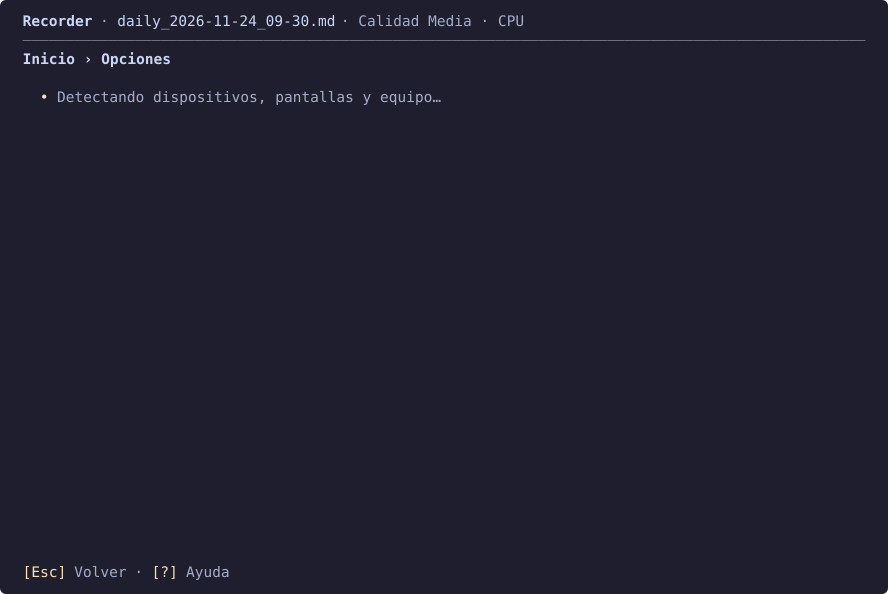

```text
 Recorder · daily_2026-11-24_09-30.md · Calidad Media · CPU
 ──────────────────────────────────────────────────────────────────────────────────────────────────
 Inicio › Opciones

   • Detectando dispositivos, pantallas y equipo…


 [Esc] Volver · [?] Ayuda
```

```text
 Recorder · daily_2026-11-24_09-30.md · Calidad Media · CPU
 ──────────────────────────────────────────────────────────
 Inicio › Opciones
   • Detectando dispositivos, pantallas y equipo…


 [Esc] Volver · [?] Ayuda
```

#### Estado · vacío

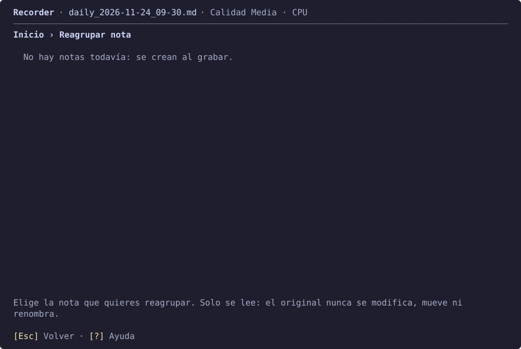

```text
 Recorder · daily_2026-11-24_09-30.md · Calidad Media · CPU
 ──────────────────────────────────────────────────────────────────────────────────────────────────
 Inicio › Reagrupar nota

   No hay notas todavía: se crean al grabar.


 Elige la nota que quieres reagrupar. Solo se lee: el original nunca se modifica, mueve ni
 renombra.

 [Esc] Volver · [?] Ayuda
```

```text
 Recorder · daily_2026-11-24_09-30.md · Calidad Media · CPU
 ──────────────────────────────────────────────────────────
 Inicio › Reagrupar nota
   No hay notas todavía: se crean al grabar.


 Elige la nota que quieres reagrupar. Solo se lee: el
 original nunca se modifica, mueve ni renombra.


 [Esc] Volver · [?] Ayuda
```

#### Estado · config.json ilegible

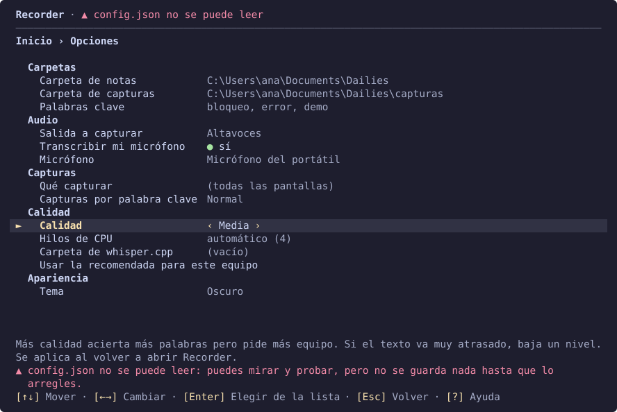

```text
 Recorder · ▲ config.json no se puede leer
 ──────────────────────────────────────────────────────────────────────────────────────────────────
 Inicio › Opciones

   Carpetas
     Carpeta de notas            C:\Users\ana\Documents\Dailies
     Carpeta de capturas         C:\Users\ana\Documents\Dailies\capturas
     Palabras clave              bloqueo, error, demo
   Audio
     Salida a capturar           Altavoces
     Transcribir mi micrófono    ● sí
     Micrófono                   Micrófono del portátil
   Capturas
     Qué capturar                (todas las pantallas)
     Capturas por palabra clave  Normal
   Calidad
 ►   Calidad                     ‹ Media ›
     Hilos de CPU                automático (4)
     Carpeta de whisper.cpp      (vacío)
     Usar la recomendada para este equipo
   Apariencia
     Tema                        Oscuro


 Más calidad acierta más palabras pero pide más equipo. Si el texto va muy atrasado, baja un nivel.
 Se aplica al volver a abrir Recorder.
 ▲ config.json no se puede leer: puedes mirar y probar, pero no se guarda nada hasta que lo
   arregles.
 [↑↓] Mover · [←→] Cambiar · [Enter] Elegir de la lista · [Esc] Volver · [?] Ayuda
```

```text
 Recorder · ▲ config.json no se puede leer
 ──────────────────────────────────────────────────────────
 Inicio › Opciones
    ↑ 5 más arriba
     Transcribir mi micrófono    ● sí
     Micrófono                   Micrófono del portátil
   Capturas
     Qué capturar                (todas las pantallas)
     Capturas por palabra clave  Normal
   Calidad
 ►   Calidad                     ‹ Media ›
     Hilos de CPU                automático (4)
     Carpeta de whisper.cpp      (vacío)
     Usar la recomendada para este equipo
   Apariencia
     Tema                        Oscuro

 Más calidad acierta más palabras pero pide más equipo. Si
 el texto va muy atrasado, baja un nivel. Se aplica al
 volver a abrir Recorder.

 ▲ config.json no se puede leer: puedes mirar y probar,
   pero no se guarda nada hasta que lo arregles.
 [Enter] Elegir de la lista · [Esc] Volver · [?] Más
```

#### Estado · cambios sin guardar y aviso

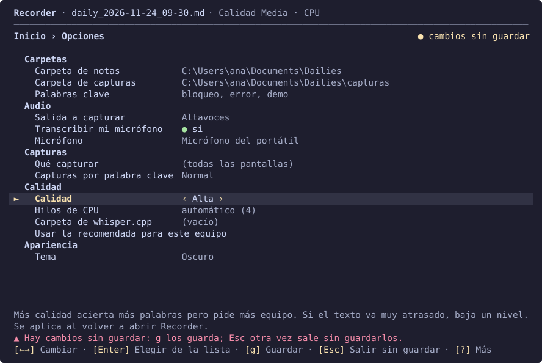

```text
 Recorder · daily_2026-11-24_09-30.md · Calidad Media · CPU
 ──────────────────────────────────────────────────────────────────────────────────────────────────
 Inicio › Opciones                                                            ● cambios sin guardar

   Carpetas
     Carpeta de notas            C:\Users\ana\Documents\Dailies
     Carpeta de capturas         C:\Users\ana\Documents\Dailies\capturas
     Palabras clave              bloqueo, error, demo
   Audio
     Salida a capturar           Altavoces
     Transcribir mi micrófono    ● sí
     Micrófono                   Micrófono del portátil
   Capturas
     Qué capturar                (todas las pantallas)
     Capturas por palabra clave  Normal
   Calidad
 ►   Calidad                     ‹ Alta ›
     Hilos de CPU                automático (4)
     Carpeta de whisper.cpp      (vacío)
     Usar la recomendada para este equipo
   Apariencia
     Tema                        Oscuro


 Más calidad acierta más palabras pero pide más equipo. Si el texto va muy atrasado, baja un nivel.
 Se aplica al volver a abrir Recorder.
 ▲ Hay cambios sin guardar: g los guarda; Esc otra vez sale sin guardarlos.
 [←→] Cambiar · [Enter] Elegir de la lista · [g] Guardar · [Esc] Salir sin guardar · [?] Más
```

```text
 Recorder · daily_2026-11-24_09-30.md · Calidad Media · CPU
 ──────────────────────────────────────────────────────────
 Inicio › Opciones                    ● cambios sin guardar
    ↑ 5 más arriba
     Transcribir mi micrófono    ● sí
     Micrófono                   Micrófono del portátil
   Capturas
     Qué capturar                (todas las pantallas)
     Capturas por palabra clave  Normal
   Calidad
 ►   Calidad                     ‹ Alta ›
     Hilos de CPU                automático (4)
     Carpeta de whisper.cpp      (vacío)
     Usar la recomendada para este equipo
   Apariencia
     Tema                        Oscuro

 Más calidad acierta más palabras pero pide más equipo. Si
 el texto va muy atrasado, baja un nivel. Se aplica al
 volver a abrir Recorder.

 ▲ Hay cambios sin guardar: g los guarda; Esc otra vez sale
   sin guardarlos.
 [g] Guardar · [Esc] Salir sin guardar · [?] Más
```

#### Estado · terminal demasiado pequeña (menos de 60×24)

```text
 ▲ Agranda la ventana de la terminal: Recorder
   necesita al menos 60 columnas y 24 líneas.

```

#### Estado · avisos pasajeros (la región de Aviso, sola)

```text
√ Guardado. Vale desde la próxima grabación.
√ Creada daily_2026-11-24_09-30_reagrupada-15min.md. El original sigue intacto.
No hay nada que guardar.
▲ Hilos de CPU: escribe un número entre 0 y 16.
```

### 7.12 Primera ejecución en terminal

Como máximo `DURACION_LOGO` = 1 s, una sola vez (la primera ejecución) y saltable con cualquier tecla; `--sin-intro` y «animations: ninguna» lo omiten. El dibujo definitivo es el de `docs/intro/`; aquí se fija el encuadre: centrado en la pantalla alternativa, con el fondo propio si hay color real, lema en `tenue` y la pista de salto en la última línea. Al terminar se abre la grabación o el menú sin dejar nada en el historial.

#### Primera ejecución · logotipo

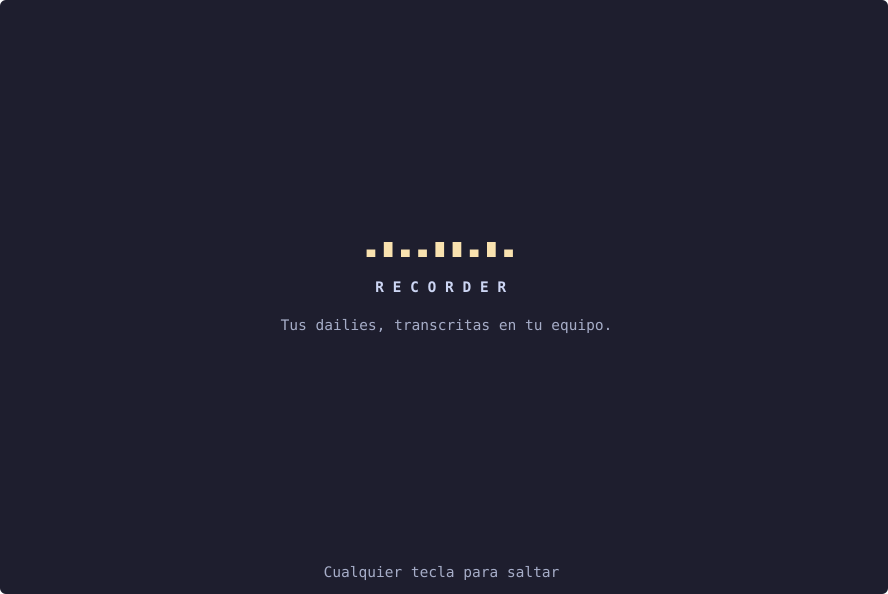

```text


                                         ▄ █ ▄ ▄ █ █ ▄ █ ▄

                                          R E C O R D E R

                               Tus dailies, transcritas en tu equipo.


                                    Cualquier tecla para saltar
```

```text


                     ▄ █ ▄ ▄ █ █ ▄ █ ▄

                      R E C O R D E R

           Tus dailies, transcritas en tu equipo.


                Cualquier tecla para saltar
```

### 7.13 `daily -h`

**Se queda como ayuda estándar de la línea de comandos, sin estilo.** Es texto de consulta que debe poder leerse con la salida redirigida, buscarse con `Select-String` y pegarse en un correo; quien la pide ya está en el historial de la terminal y espera el formato de siempre. Darle pantalla propia la haría más lenta de consultar y obligaría a mantener dos ayudas. Lo que sí cambia son sus textos, para que cuenten lo nuevo y sin jerga:

```text
uso: daily [-h] [--ascii] [--gui] [--historial] [--sin-intro] [comando] ...

Recorder desde la terminal. Sin comando, graba: transcribe la reunión a pantalla completa
y la guarda en la nota de hoy. Para verlo todo con el teclado: daily menu

opciones:
  -h, --help    muestra esta ayuda y sale
  --ascii       símbolos ASCII y 16 colores (en una consola antigua se detecta solo)
  --gui         abre la ventana en vez de usar la terminal
  --historial   graba escribiendo las frases en el historial de la terminal, sin pantalla
                completa (para copiar de la terminal)
  --sin-intro   no enseña el logotipo de la primera vez

comandos:
    menu        todo lo que se puede hacer, con el teclado
    config      opciones: carpetas, audio, capturas, calidad y tema
    calibrar    tus términos y qué frases inventadas descartar; prueba frases
    sintesis    reagrupa una nota: copia ordenada por hora y por tramos (no resume);
                el original no se toca
    recomendar  qué calidad conviene a este equipo (--aplicar la guarda)
    ventana     abre la ventana (igual que --gui)

En una terminal, cada comando abre su pantalla. Con la entrada o la salida redirigidas,
o con argumentos de script, pregunta y responde línea a línea como siempre.
```

### 7.14 Inicio, Calibrar y Grabación en «completo» y en «ASCII»

A 100×30. En ASCII no hay fondo propio y los colores son los 16 de la consola (sección 3.4): las láminas lo enseñan sobre el azul de PowerShell y sobre negro.

#### Inicio, juego completo

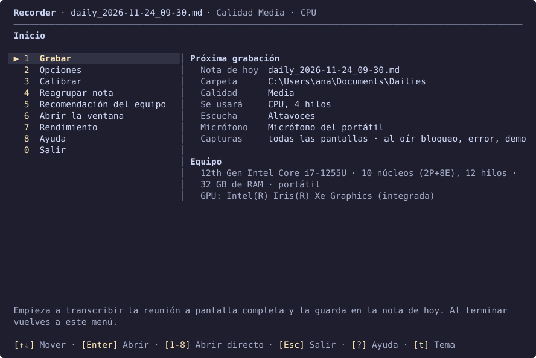

```text
 Recorder · daily_2026-11-24_09-30.md · Calidad Media · CPU
 ──────────────────────────────────────────────────────────────────────────────────────────────────
 Inicio

 ▶ 1  Grabar                     │ Próxima grabación
   2  Opciones                   │   Nota de hoy  daily_2026-11-24_09-30.md
   3  Calibrar                   │   Carpeta      C:\Users\ana\Documents\Dailies
   4  Reagrupar nota             │   Calidad      Media
   5  Recomendación del equipo   │   Se usará     CPU, 4 hilos
   6  Abrir la ventana           │   Escucha      Altavoces
   7  Rendimiento                │   Micrófono    Micrófono del portátil
   8  Ayuda                      │   Capturas     todas las pantallas · al oír bloqueo, error, demo
   0  Salir                      │
                                 │ Equipo
                                 │   12th Gen Intel Core i7-1255U · 10 núcleos (2P+8E), 12 hilos ·
                                 │   32 GB de RAM · portátil
                                 │   GPU: Intel(R) Iris(R) Xe Graphics (integrada)


 Empieza a transcribir la reunión a pantalla completa y la guarda en la nota de hoy. Al terminar
 vuelves a este menú.

 [↑↓] Mover · [Enter] Abrir · [1-8] Abrir directo · [Esc] Salir · [?] Ayuda · [t] Tema
```

#### Inicio, ASCII en 16 colores sobre el azul de PowerShell (sin fondo propio)

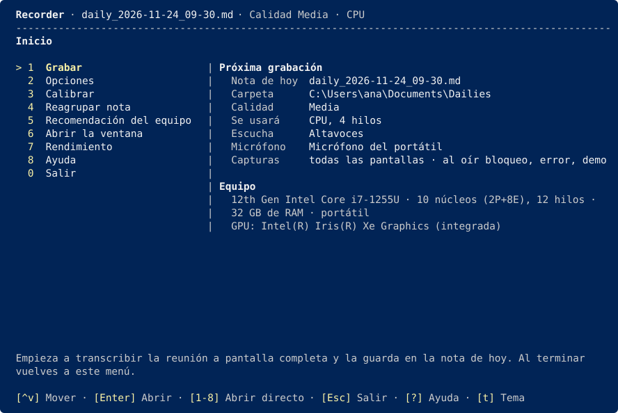

```text
 Recorder · daily_2026-11-24_09-30.md · Calidad Media · CPU
 --------------------------------------------------------------------------------------------------
 Inicio

 > 1  Grabar                     | Próxima grabación
   2  Opciones                   |   Nota de hoy  daily_2026-11-24_09-30.md
   3  Calibrar                   |   Carpeta      C:\Users\ana\Documents\Dailies
   4  Reagrupar nota             |   Calidad      Media
   5  Recomendación del equipo   |   Se usará     CPU, 4 hilos
   6  Abrir la ventana           |   Escucha      Altavoces
   7  Rendimiento                |   Micrófono    Micrófono del portátil
   8  Ayuda                      |   Capturas     todas las pantallas · al oír bloqueo, error, demo
   0  Salir                      |
                                 | Equipo
                                 |   12th Gen Intel Core i7-1255U · 10 núcleos (2P+8E), 12 hilos ·
                                 |   32 GB de RAM · portátil
                                 |   GPU: Intel(R) Iris(R) Xe Graphics (integrada)


 Empieza a transcribir la reunión a pantalla completa y la guarda en la nota de hoy. Al terminar
 vuelves a este menú.

 [^v] Mover · [Enter] Abrir · [1-8] Abrir directo · [Esc] Salir · [?] Ayuda · [t] Tema
```

#### Calibrar, juego completo

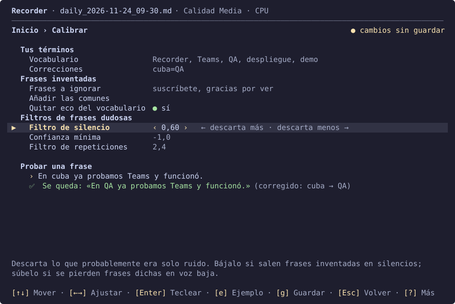

```text
 Recorder · daily_2026-11-24_09-30.md · Calidad Media · CPU
 ──────────────────────────────────────────────────────────────────────────────────────────────────
 Inicio › Calibrar                                                            ● cambios sin guardar

   Tus términos
     Vocabulario                 Recorder, Teams, QA, despliegue, demo
     Correcciones                cuba=QA
   Frases inventadas
     Frases a ignorar            suscríbete, gracias por ver
     Añadir las comunes
     Quitar eco del vocabulario  ● sí
   Filtros de frases dudosas
 ▶   Filtro de silencio          ‹ 0,60 ›   ← descarta más · descarta menos →
     Confianza mínima            -1,0
     Filtro de repeticiones      2,4

   Probar una frase
     › En cuba ya probamos Teams y funcionó.
     ✅ Se queda: «En QA ya probamos Teams y funcionó.» (corregido: cuba → QA)


 Descarta lo que probablemente era solo ruido. Bájalo si salen frases inventadas en silencios;
 súbelo si se pierden frases dichas en voz baja.

 [↑↓] Mover · [←→] Ajustar · [Enter] Teclear · [e] Ejemplo · [g] Guardar · [Esc] Volver · [?] Más
```

#### Calibrar, ASCII en 16 colores sobre negro

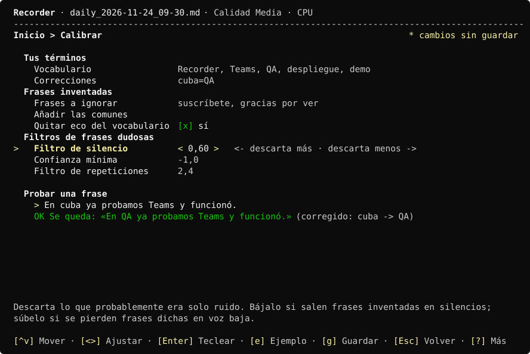

```text
 Recorder · daily_2026-11-24_09-30.md · Calidad Media · CPU
 --------------------------------------------------------------------------------------------------
 Inicio > Calibrar                                                            * cambios sin guardar

   Tus términos
     Vocabulario                 Recorder, Teams, QA, despliegue, demo
     Correcciones                cuba=QA
   Frases inventadas
     Frases a ignorar            suscríbete, gracias por ver
     Añadir las comunes
     Quitar eco del vocabulario  [x] sí
   Filtros de frases dudosas
 >   Filtro de silencio          < 0,60 >   <- descarta más · descarta menos ->
     Confianza mínima            -1,0
     Filtro de repeticiones      2,4

   Probar una frase
     > En cuba ya probamos Teams y funcionó.
     OK Se queda: «En QA ya probamos Teams y funcionó.» (corregido: cuba -> QA)


 Descarta lo que probablemente era solo ruido. Bájalo si salen frases inventadas en silencios;
 súbelo si se pierden frases dichas en voz baja.

 [^v] Mover · [<>] Ajustar · [Enter] Teclear · [e] Ejemplo · [g] Guardar · [Esc] Volver · [?] Más
```

#### Grabación, juego completo

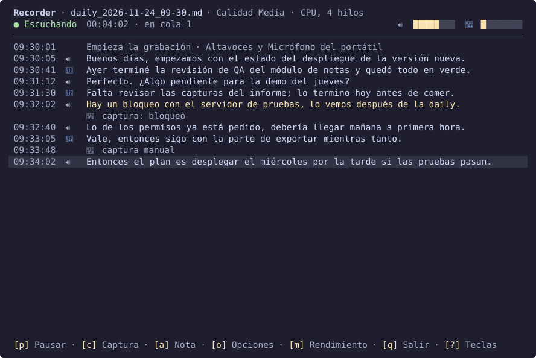

```text
 Recorder · daily_2026-11-24_09-30.md · Calidad Media · CPU, 4 hilos
 ● Escuchando  00:04:02 · en cola 1                                        🔊 █████░░░  🎤 █░░░░░░░
 ──────────────────────────────────────────────────────────────────────────────────────────────────
 09:30:01      Empieza la grabación · Altavoces y Micrófono del portátil
 09:30:05  🔊  Buenos días, empezamos con el estado del despliegue de la versión nueva.
 09:30:41  🎤  Ayer terminé la revisión de QA del módulo de notas y quedó todo en verde.
 09:31:12  🔊  Perfecto. ¿Algo pendiente para la demo del jueves?
 09:31:30  🎤  Falta revisar las capturas del informe; lo termino hoy antes de comer.
 09:32:02  🔊  Hay un bloqueo con el servidor de pruebas, lo vemos después de la daily.
               📸 captura: bloqueo
 09:32:40  🔊  Lo de los permisos ya está pedido, debería llegar mañana a primera hora.
 09:33:05  🎤  Vale, entonces sigo con la parte de exportar mientras tanto.
 09:33:48      📸 captura manual
 09:34:02  🔊  Entonces el plan es desplegar el miércoles por la tarde si las pruebas pasan.


 [p] Pausar · [c] Captura · [a] Nota · [o] Opciones · [m] Rendimiento · [q] Salir · [?] Teclas
```

#### Grabación, ASCII en 16 colores sobre el azul de PowerShell

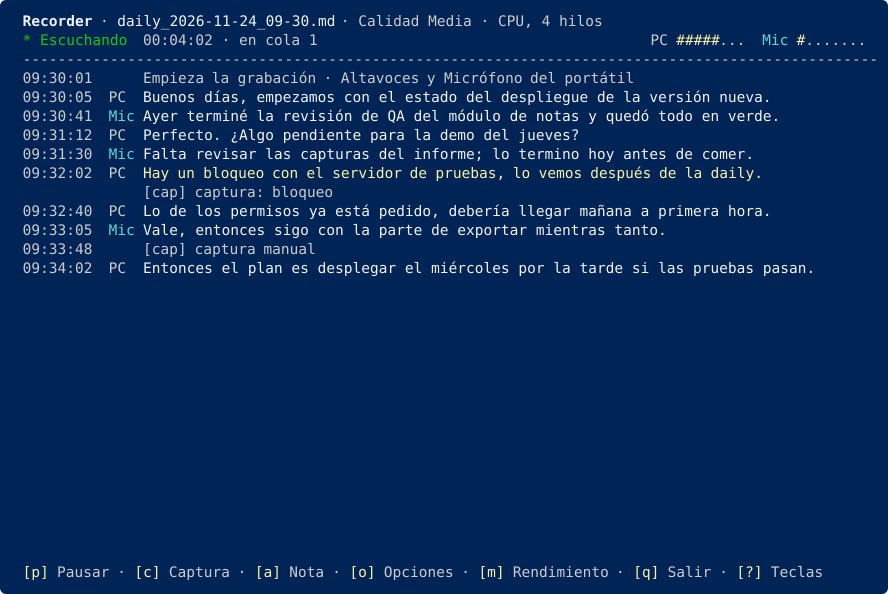

```text
 Recorder · daily_2026-11-24_09-30.md · Calidad Media · CPU, 4 hilos
 * Escuchando  00:04:02 · en cola 1                                       PC #####...  Mic #.......
 --------------------------------------------------------------------------------------------------
 09:30:01      Empieza la grabación · Altavoces y Micrófono del portátil
 09:30:05  PC  Buenos días, empezamos con el estado del despliegue de la versión nueva.
 09:30:41  Mic Ayer terminé la revisión de QA del módulo de notas y quedó todo en verde.
 09:31:12  PC  Perfecto. ¿Algo pendiente para la demo del jueves?
 09:31:30  Mic Falta revisar las capturas del informe; lo termino hoy antes de comer.
 09:32:02  PC  Hay un bloqueo con el servidor de pruebas, lo vemos después de la daily.
               [cap] captura: bloqueo
 09:32:40  PC  Lo de los permisos ya está pedido, debería llegar mañana a primera hora.
 09:33:05  Mic Vale, entonces sigo con la parte de exportar mientras tanto.
 09:33:48      [cap] captura manual
 09:34:02  PC  Entonces el plan es desplegar el miércoles por la tarde si las pruebas pasan.


 [p] Pausar · [c] Captura · [a] Nota · [o] Opciones · [m] Rendimiento · [q] Salir · [?] Teclas
```

Otras láminas: [Inicio en tema claro](terminal-especificacion/inicio-claro.svg), [Inicio a 60×24](terminal-especificacion/inicio-60.svg), [Grabación en tema claro](terminal-especificacion/grabacion-claro.svg) y [Grabación a 60×24](terminal-especificacion/grabacion-60.svg).


---

## 8. Tabla de textos

Cada entrada va en la sección «Terminal» de `recorder/ayuda.py` como `clave: (título, explicación)`:
el título es la etiqueta, el botón o el nombre del aviso (hasta 40 caracteres) y la explicación es la
línea de ayuda o el texto del aviso (hasta 180). Las que llevan `*` ya existen y cambian de texto.
`{así}` es un dato que se rellena al pintar. Los plurales se resuelven al rellenar («1 trozo»,
«2 trozos»; «1 frase nueva abajo»).

Claves que ya existen y se usan tal cual: `menu_sintesis`, `menu_salir`, `menu_ayuda`, `solo_windows`,
`opciones_recomendada`, `carpeta_notas`, `carpeta_capturas`, `palabras_clave`, `salida_audio`,
`microfono`, `transcribir_mic`, `que_capturar`, `capturas_clave`, `calidad`, `hilos`, `whispercpp`,
`gpu`, `flash`, `tema`, `tecla_p`, `tecla_c`, `tecla_r`, `tecla_a`, `cierre_e`, `cierre_s`,
`cierre_esc` y el `GLOSARIO` entero.

Etiquetas cortas de Opciones (sin emoji, sección 2): «Salida a capturar», «Micrófono», «Qué capturar»;
el resto, el título de su clave.

Botones del pie: palabra con mayúscula inicial («Mover», «Abrir», «Guardar», «Volver», «Salir»,
«Ayuda», «Tema», «Más», «Cambiar», «Editar», «Elegir», «Elegir de la lista», «Usar», «Cursor»,
«Aceptar», «Cancelar», «Seguir editando», «Ajustar», «Teclear», «Ejemplo», «Vista previa», «Crear la
copia», «Seguir ajustando», «Desplazar», «Página», «Directo», «Cerrar», «Pausar», «Seguir», «Captura»,
«Nota», «Opciones», «Rendimiento», «Teclas», «Revisar», «Lo último», «Volver a la transcripción»). Van
en `ayuda.py` con el prefijo `pie_` y la palabra en minúsculas con guiones bajos (`pie_mover`,
`pie_seguir_editando`); su explicación es la de la acción que disparan.

### Comunes a todas las pantallas

| Clave | Título, etiqueta o botón | Línea de ayuda o texto del aviso |
| :--- | :--- | :--- |
| `terminal_sin_guardar` | Cambios sin guardar | Hay cambios sin guardar: g los guarda; Esc otra vez sale sin guardarlos. |
| `terminal_marca_cambios` | cambios sin guardar | Se ve a la derecha de la ruta mientras haya algo cambiado y no guardado. |
| `terminal_guardado` | Guardado | Guardado. Vale desde la próxima grabación. |
| `terminal_sin_cambios` | Sin cambios | No hay nada que guardar. |
| `terminal_confirmar` | Guardar los cambios | Revisa lo que cambia: Enter lo guarda y Esc te deja seguir editando. |
| `terminal_no_se_guarda` | No se puede guardar | config.json no se puede leer: puedes mirar y probar, pero no se guarda nada hasta que lo arregles. |
| `terminal_config_ilegible` | config.json no se puede leer | Se usan los valores de fábrica y no se guarda nada. Arregla o borra el archivo y vuelve a abrir Recorder. |
| `terminal_pequena` | Ventana demasiado pequeña | Agranda la ventana de la terminal: Recorder necesita al menos 60 columnas y 24 líneas. |
| `terminal_cargando` | Detectando | Detectando dispositivos, pantallas y equipo… |
| `terminal_detectando_equipo` | Detectando el equipo | Detectando el equipo… |
| `terminal_error_entorno` | No se pudo detectar | No se pudieron leer los dispositivos de este equipo. Esc vuelve; prueba otra vez o usa la ventana. |
| `terminal_mas_arriba` | {n} más arriba | Hay filas por encima de las que se ven: sube con ↑ o RePág. |
| `terminal_mas_abajo` | {n} más abajo | Hay filas por debajo de las que se ven: baja con ↓ o AvPág. |
| `terminal_tema_guardado` | Tema {tema} guardado | Tema {tema} guardado: vale también para la ventana. |
| `terminal_tema_solo_aqui` | Tema cambiado solo aquí | Tema cambiado solo en esta terminal: config.json no se puede leer y no se guarda. |
| `terminal_si` | sí | Interruptor activado. Espacio, Enter o ←→ lo cambian. |
| `terminal_no` | no | Interruptor apagado. Espacio, Enter o ←→ lo cambian. |
| `terminal_vacio` | (vacío) | Este ajuste no tiene valor. Enter para escribirlo. |
| `terminal_actual` | (actual) | Lo que está guardado ahora. |

### Inicio

| Clave | Título, etiqueta o botón | Línea de ayuda o texto del aviso |
| :--- | :--- | :--- |
| `menu_grabar` \* | Grabar | Empieza a transcribir la reunión a pantalla completa y la guarda en la nota de hoy. Al terminar vuelves a este menú. |
| `menu_config` \* | Opciones | Cambia carpetas, audio, capturas, calidad y tema. Antes de guardar te enseña qué cambió; una grabación ya abierta sigue con lo anterior. |
| `menu_calibrar` \* | Calibrar | Enseña a Recorder tus términos y qué frases inventadas descartar, y pruébalo con una frase. Úsalo si ves palabras mal escritas o frases que nadie dijo. |
| `menu_recomendar` \* | Recomendación del equipo | Detecta tu procesador, memoria y tarjeta gráfica y te dice qué calidad conviene. Puedes aplicarla ahí mismo. |
| `menu_ventana` \* | Abrir la ventana | Abre Recorder con ventana y botones: mismos ajustes y misma nota. Mientras esté abierta, esta terminal espera. |
| `menu_rendimiento` \* | Rendimiento | Dice si el equipo tiene margen para grabar: procesador, tarjeta gráfica y memoria, ahora y en los últimos 2 minutos. |
| `inicio_proxima` | Próxima grabación | Lo que usará la próxima grabación. Se cambia en Opciones. |
| `inicio_nota` | Nota de hoy | El archivo donde se guardará la transcripción de hoy. |
| `inicio_sin_nota` | aún no hay | Aún no hay nota de hoy: se crea al grabar. |
| `inicio_carpeta` | Carpeta | La carpeta de notas. |
| `inicio_calidad` | Calidad | La calidad de transcripción elegida. |
| `inicio_motor` | Se usará | Con qué se transcribirá: el procesador o la tarjeta gráfica. |
| `inicio_escucha` | Escucha | La salida de audio de la que se transcribe a los demás. |
| `inicio_micro` | Micrófono | El micrófono que se transcribe, o «apagado». |
| `inicio_capturas` | Capturas | Qué se fotografía y con qué palabras clave. |
| `inicio_equipo` | Equipo | El equipo detectado. |
| `inicio_fin_grabacion` | Grabación terminada | Grabación terminada: {duracion} · {frases} frases · {capturas} capturas · {nota} |

### Opciones

| Clave | Título, etiqueta o botón | Línea de ayuda o texto del aviso |
| :--- | :--- | :--- |
| `opciones_carpetas` | Carpetas | Dónde se guardan las notas y las capturas, y qué palabras disparan una captura. |
| `opciones_audio` | Audio | Qué salida se escucha y si se transcribe también tu micrófono. |
| `opciones_capturas` | Capturas | Qué pantalla o ventana se fotografía y con qué calidad. |
| `opciones_calidad` | Calidad | Cuánta calidad usar según tu equipo y con qué se transcribe. |
| `opciones_apariencia` | Apariencia | El tema de colores de la ventana y de esta terminal. |
| `opciones_editar` \* | Editar un texto | Escribe o corrige el valor: ←→ mueven el cursor, Enter lo acepta y Esc lo deja como estaba. |
| `opciones_lista` | Elegir de la lista | Elige con ↑↓ y Enter, o con el número. Esc vuelve sin cambiar nada. |
| `opciones_hilos_auto` | automático ({n}) | Con 0, Recorder usa el valor de fábrica ({n} hilos). |
| `opciones_hilos_error` | Hilos de CPU | Escribe un número entre 0 y {max}. |
| `opciones_recomendada_puesta` | Recomendada puesta | Puesta la recomendada: {resumen}. Guárdala con g. |
| `opciones_releer` | Releer | Vuelve a buscar los dispositivos y las ventanas abiertas. |
| `opciones_no_detectado` | (no detectado ahora) | Lo guardado ya no aparece en este equipo; sigue elegido hasta que escojas otro. |

### Calibrar

| Clave | Título, etiqueta o botón | Línea de ayuda o texto del aviso |
| :--- | :--- | :--- |
| `calibrar_terminos` | Tus términos | Lo que Recorder debe saber escribir bien. |
| `calibrar_vocabulario` | Vocabulario | Nombres y siglas de tu equipo para que se escriban bien. Como lista, sin rótulos como «Términos:», que se colarían en el texto. |
| `calibrar_correcciones` | Correcciones | Arregla palabras que siempre se oyen mal: «oído_mal=escrito_bien», separadas por «;». Por ejemplo: cuba=QA; ayayas=IIS. |
| `calibrar_inventadas` | Frases inventadas | Lo que la transcripción se inventa en los silencios. |
| `calibrar_ignorar` | Frases a ignorar | Frases que la transcripción inventa en los silencios, como «Suscríbete». Si alguna sale en tus notas, añádela aquí, separadas por coma. |
| `calibrar_comunes` | Añadir las comunes | Agrega las frases inventadas más típicas («gracias por ver», «suscríbete»…). No borra las que ya tienes. |
| `calibrar_comunes_hecho` | Frases comunes | Añadidas {n} frases comunes; ahora hay {total}. |
| `calibrar_comunes_ya` | Frases comunes | Ya estaban todas. |
| `calibrar_eco` | Quitar eco del vocabulario | Quita los renglones que solo repiten tu vocabulario, algo que la transcripción inventa a veces en los silencios. Conviene dejarlo en «sí». |
| `calibrar_filtros` | Filtros de frases dudosas | Tres reglas que descartan frases dudosas. Tócalas solo si ves frases inventadas o se pierden frases reales. |
| `calibrar_silencio` | Filtro de silencio | Descarta lo que probablemente era solo ruido. Bájalo si salen frases inventadas en silencios; súbelo si se pierden frases dichas en voz baja. |
| `calibrar_confianza` | Confianza mínima | Descarta frases de las que la transcripción no está segura. Súbelo si salen frases sin sentido; bájalo si se pierden frases reales. |
| `calibrar_repeticiones` | Filtro de repeticiones | Descarta frases que repiten lo mismo una y otra vez. Bájalo si ves repeticiones en bucle; súbelo si se pierden frases largas que sí se dijeron. |
| `calibrar_descarta_mas` | descarta más | Hacia ese lado el filtro descarta más frases. |
| `calibrar_descarta_menos` | descarta menos | Hacia ese lado el filtro deja pasar más frases. |
| `calibrar_fuera_de_rango` | Fuera de rango | Escribe un número entre {min} y {max}. |
| `calibrar_probar` | Probar una frase | Escribe una frase y mira al momento si se quedaría o se descartaría con lo que hay ahora, sin guardar. e propone un ejemplo. |
| `calibrar_probar_vacio` | Probar una frase | Enter para escribir una frase · e para probar con un ejemplo |
| `calibrar_se_queda` | Se queda | Se queda: «{frase}» |
| `calibrar_corregido` | corregido | (corregido: {de} → {a}) |
| `calibrar_con_captura` | con captura | y guardaría una captura ({palabras}) |
| `calibrar_descarta_ignorar` | Se descarta | Se descarta: contiene «{frase}» (Frases a ignorar) |
| `calibrar_descarta_eco` | Se descarta | Se descarta: solo repite tu vocabulario (Quitar eco del vocabulario) |
| `calibrar_guardado` | Calibración guardada | Calibración guardada. Vale desde la próxima grabación. |

### Reagrupar nota

| Clave | Título, etiqueta o botón | Línea de ayuda o texto del aviso |
| :--- | :--- | :--- |
| `reagrupar_elegir` | Elige la nota | Elige la nota que quieres reagrupar. Solo se lee: el original nunca se modifica, mueve ni renombra. |
| `reagrupar_col_nota` | Nota | El archivo original. |
| `reagrupar_col_fecha` | Fecha | Día del último cambio. |
| `reagrupar_col_hora` | Hora | Hora del último cambio. |
| `reagrupar_col_tamano` | Tamaño | Tamaño del archivo. |
| `reagrupar_en_curso` | escribiéndose | Esta nota se está escribiendo ahora: la copia llevará lo que haya hasta este momento. |
| `reagrupar_vacio` | No hay notas todavía | No hay notas todavía: se crean al grabar. |
| `reagrupar_agrupar` | Agrupar | Junta las frases en tramos de tiempo, cada uno con su hora de título (por ejemplo, 09:30 - 09:45). «Sin agrupar» solo aplica la limpieza. |
| `reagrupar_unir` | Unir frases seguidas | Une en un párrafo las frases seguidas de la misma fuente (los demás o tu micrófono) para leerlas de corrido. |
| `reagrupar_hora_corta` | Hora corta | Pone solo hora y minutos (09:30) al empezar cada párrafo, no la hora exacta de cada frase. |
| `reagrupar_hora_corta_no` | Hora corta | No se puede con «Sin agrupar»: ahí la hora exacta es lo único que ordena las frases. |
| `reagrupar_sin_imagenes` | Quitar imágenes | Deja la copia en texto puro, sin enlaces a las capturas. Útil para pegarla en un correo o en un chat. |
| `reagrupar_cortas` | Quitar frases cortas | Quita las frases de menos de 4 palabras, como «sí» u «ok». Ojo: también se van respuestas con contenido, como «Sí, va.». |
| `reagrupar_eco` | Quitar eco | Borra renglones como «Términos.» que solo repiten tu vocabulario de Calibrar y que nadie dijo. |
| `reagrupar_previa` | Vista previa | {frases} frases en {tramos} tramos · {palabras} palabras, {quitadas} quitadas |
| `reagrupar_posicion` | {de}-{a} de {total} | Las líneas de la copia que se ven. RePág y AvPág la recorren. |
| `reagrupar_crear` | Crear la copia | Crea el archivo reagrupado junto a la nota y deja el original intacto. Antes te dice cómo se llamará. |
| `reagrupar_confirmar` | Crear la copia | Es la misma transcripción, ordenada y agrupada: no es un resumen. El original no se toca; si el nombre ya existe, se numera. |
| `reagrupar_se_creara` | Se creará | El nombre de la copia. |
| `reagrupar_en` | en | La carpeta de la copia: la misma que la nota. |
| `reagrupar_creada` | Copia creada | Creada {nombre}. El original sigue intacto. |
| `reagrupar_error` | No se pudo crear | No se pudo crear la copia: {motivo} |
| `reagrupar_derivada` | Es una copia reagrupada | Esa nota ya es una copia reagrupada: elige la original. |

### Recomendación del equipo

| Clave | Título, etiqueta o botón | Línea de ayuda o texto del aviso |
| :--- | :--- | :--- |
| `recomendacion_equipo` | Tu equipo | Lo que se detecta en este equipo. |
| `recomendacion_ahora` | Ahora | Lo que tienes guardado. |
| `recomendacion_recomendado` | Recomendado | Lo que mejor va con este equipo. |
| `recomendacion_calidad` | Calidad | El nivel de calidad de la transcripción. |
| `recomendacion_donde` | Dónde se transcribe | En el procesador o en la tarjeta gráfica. |
| `recomendacion_hilos` | Hilos | Cuántos núcleos del procesador usa la transcripción. |
| `recomendacion_procesador` | Procesador | Se transcribe con el procesador (CPU). |
| `recomendacion_grafica` | Tarjeta gráfica | Se transcribe con la tarjeta gráfica (GPU). |
| `recomendacion_igual` | igual | Ya lo tienes así. |
| `recomendacion_cambia` | cambia | Cambiaría al aplicar lo recomendado. |
| `recomendacion_porque` | Por qué | Los motivos de la recomendación, en dos o tres frases llanas. |
| `recomendacion_fiable_medido` | Fiabilidad | Medido en un equipo como el tuyo. |
| `recomendacion_fiable_estimado` | Fiabilidad | Estimado a partir de equipos parecidos al tuyo. |
| `recomendacion_fiable_aprox` | Fiabilidad | Aproximado: no hay medidas de un equipo así. Mide el tuyo en Rendimiento. |
| `recomendacion_aplicar` | Aplicar lo recomendado | Guarda la calidad, los hilos y dónde se transcribe que mejor van con tu equipo. Antes te enseña qué cambia. |
| `recomendacion_ya` | Ya usas lo recomendado | No hay nada que cambiar. |
| `recomendacion_aplicada` | Aplicado | Aplicado. Vale desde la próxima grabación. |
| `recomendacion_sin_detectar` | Sin detectar | No se pudo detectar: {que}. La recomendación no lo tiene en cuenta. |

### Rendimiento

| Clave | Título, etiqueta o botón | Línea de ayuda o texto del aviso |
| :--- | :--- | :--- |
| `rendimiento_margen_ok` | Hay margen para grabar | El equipo va desahogado: puedes grabar con la calidad elegida. |
| `rendimiento_margen_justo` | El equipo va justo | Ya está ocupado: cierra lo que no uses antes de grabar. |
| `rendimiento_margen_no` | El equipo va cargado | Cierra algo o baja la calidad: así la transcripción se atrasaría. |
| `rendimiento_midiendo` | Midiendo | La primera cifra llega en un par de segundos. |
| `rendimiento_motor` | Se transcribiría con | Con qué se transcribiría una grabación que empezara ahora. |
| `rendimiento_ahora` | Ahora, en todo el equipo | Lo que usan todos los programas juntos, como en el Administrador de tareas. |
| `rendimiento_tendencia` | últimos 2 min | Cada columna es una muestra; más alta, más uso. |
| `rendimiento_cpu` | Procesador | Cuánto procesador se usa. Recorder necesita margen para no atrasarse. |
| `rendimiento_gpu` | Tarjeta gráfica | Cuánta tarjeta gráfica se usa. Solo importa si se transcribe con ella. |
| `rendimiento_ram` | Memoria | Cuánta memoria hay ocupada. Con poca libre, Windows va más lento. |
| `rendimiento_pico` | pico {n} % | Lo más alto de los últimos 2 minutos. |
| `rendimiento_nd` | n/d | Windows no da este dato en este equipo. |
| `rendimiento_equipo` | Equipo | El equipo detectado. |
| `rendimiento_medir` | Medir mi equipo | Prueba de 2 o 3 minutos que dice qué calidad aguanta tu equipo de verdad. |
| `rendimiento_al_dia` | Va al día | Transcribe {factor} veces más rápido de lo que se habla. |
| `rendimiento_va_justo` | Va justo | Transcribe casi a la velocidad del habla: si la reunión se alarga, se atrasará. |
| `rendimiento_se_atrasa` | Se atrasa | Transcribe más lento de lo que se habla. Baja la calidad en Opciones para la próxima grabación. |
| `rendimiento_cargando` | Cargando el modelo | La velocidad se sabrá con la primera frase. |
| `rendimiento_velocidad` | Velocidad | Cuántas veces más rápido que el habla se transcribe. Por debajo de 1× se acumula atraso. |
| `rendimiento_tiempo_real` | 1× = al ritmo del habla | La marca desde la que la transcripción deja de atrasarse. |
| `rendimiento_ultimo` | último trozo: {s} s | Lo que tardó en transcribirse el último trozo de audio. |
| `rendimiento_cola` | En cola | Trozos de audio que esperan su turno. Si crece sin parar, el equipo no da abasto. |
| `rendimiento_cola_valor` | {n} trozos · {s} s de audio | Lo que falta por transcribir. |
| `rendimiento_cola_vacia` | nada pendiente | Todo lo oído ya está en la nota. |
| `rendimiento_recorder` | Recorder | Lo que usa Recorder (con whisper.cpp si lo usa). |
| `rendimiento_todo` | equipo | Lo que usa el equipo entero. |
| `rendimiento_motor_efectivo` | Motor | Con qué se transcribe de verdad: programa, procesador o tarjeta gráfica, y calidad. |
| `rendimiento_caida` | Caída al procesador | La tarjeta gráfica falló y se transcribe con el procesador: {motivo} |

### Medir mi equipo

| Clave | Título, etiqueta o botón | Línea de ayuda o texto del aviso |
| :--- | :--- | :--- |
| `medir_progreso` | Midiendo {i} de {n} | {prueba} |
| `medir_queda` | queda {tiempo} aprox. | Lo que falta para terminar todas las pruebas. |
| `medir_consejo` | Mientras se mide | No uses el equipo para cosas pesadas mientras se mide: falsearía el resultado. |
| `medir_col_prueba` | Prueba | Calidad y con qué se transcribe. |
| `medir_col_velocidad` | Velocidad | Veces más rápido que el habla. |
| `medir_col_cpu` | Procesador | Procesador usado durante la prueba. |
| `medir_col_dos` | ¿Dos fuentes? | Los demás y tu micrófono a la vez: hace falta ir a 2,0× o más. |
| `medir_en_espera` | en espera | Aún no ha empezado. |
| `medir_midiendo` | midiendo… | Se está midiendo ahora. |
| `medir_si` | sí | Aguanta los demás y tu micrófono a la vez. |
| `medir_no_justo` | no: va justo | Sirve con una sola fuente; con dos se atrasaría. |
| `medir_no_atrasa` | no: se atrasa | Va más lento que el habla: no sirve para grabar. |
| `medir_mejor` | la mejor | La de más calidad entre las que aguantan dos fuentes. |
| `medir_ninguna` | Ninguna aguanta dos fuentes | Usa la más rápida y apaga el micrófono, o cierra otros programas y mide otra vez. |
| `medir_aplicar` | Aplicar el mejor | Guarda la calidad, los hilos y dónde se transcribe de la mejor prueba. Antes te enseña qué cambia. |
| `medir_cancelar` | Cancelar | Para la medición y descarta lo medido. No cambia nada. |
| `medir_cancelada` | Medición cancelada | Medición cancelada. No se cambió nada. |
| `medir_aplicado` | Aplicado | Aplicado. Vale desde la próxima grabación. |
| `medir_otra_vez` | Medir otra vez | Repite las pruebas, por ejemplo tras cerrar otros programas. |

### Grabación

| Clave | Título, etiqueta o botón | Línea de ayuda o texto del aviso |
| :--- | :--- | :--- |
| `grabacion_preparando` | Preparando | Se carga el modelo y se abre el audio. Tarda unos segundos. |
| `grabacion_cargando_modelo` | Cargando el modelo | Cargando el modelo (Calidad {calidad})… |
| `grabacion_abriendo_audio` | Abriendo el audio | Abriendo el audio… |
| `grabacion_fuente_salida` | Salida de audio | Salida de audio: {dispositivo} |
| `grabacion_fuente_micro` | Micrófono | Micrófono: {dispositivo} |
| `grabacion_fuente_capturas` | Capturas | Capturas: {que}, al oír {palabras} |
| `grabacion_escuchando` | Escuchando | Se transcribe lo que suena en tu PC y, si está activado, tu micrófono. |
| `grabacion_pausa` | En pausa | No se escucha audio nuevo; lo pendiente se sigue transcribiendo. |
| `grabacion_terminando` | Terminando | Ya no se escucha: se transcribe lo pendiente y se sale sola. |
| `grabacion_en_cola` | en cola {n} | Trozos de audio que esperan su turno para pasar a texto. |
| `grabacion_con_fallo` | {n} con fallo | Trozos que no se pudieron transcribir o capturas que no se guardaron. |
| `grabacion_empieza` | Empieza la grabación | Empieza la grabación · {fuentes} |
| `grabacion_captura` | captura: {palabras} | Se guardó una captura al oír esa palabra clave. |
| `grabacion_captura_manual` | captura manual | Guardaste una captura con c. |
| `grabacion_linea_pausa` | pausa | pausa: no se escucha audio nuevo |
| `grabacion_linea_sigue` | sigue | sigue la grabación |
| `grabacion_nuevas` | {n} frases nuevas abajo | {n} frases nuevas abajo · Fin vuelve a lo último |
| `grabacion_muda` | {fuente} sin audio | {fuente} lleva {min} min sin audio mientras la otra fuente suena. Si alguien habló por ahí, pulsa o y elige otro dispositivo. |
| `grabacion_caida` | {fuente} se cortó | {fuente} se cortó: reintento {n}. Si no vuelve, pulsa r o revisa que siga conectado. |
| `grabacion_vuelve` | {fuente} ha vuelto | {fuente} ha vuelto: se sigue transcribiendo. |
| `grabacion_esc` | Para salir, q | Para terminar la grabación pulsa q. Esc solo cierra paneles. |
| `grabacion_opciones` | Opciones de la grabación | Lo que se puede cambiar sin parar de grabar. Se aplica al elegir. |
| `grabacion_op_salida` | Salida de audio | El altavoz o los auriculares por los que oyes la reunión. Cámbialo si no se transcribe a los demás. |
| `grabacion_op_micro` | Micrófono | El micrófono con el que hablas; elige el mismo que usa Teams, o «apagado» para no transcribirte. |
| `grabacion_op_captura` | Qué capturar | La pantalla o la ventana que se fotografía en cada captura. r vuelve a buscar las ventanas abiertas. |
| `grabacion_op_calidad` | Calidad de capturas | Calidad de la imagen que se guarda al oír una palabra clave, o apagarlas. |
| `grabacion_mic_apagado` | apagado | apagado: no se transcribe el micrófono |
| `grabacion_dispositivo_nuevo` | ¿No aparece? | ¿No aparece? Si lo conectaste después de empezar, sal con q y vuelve a entrar. |
| `grabacion_aplicado` | Cambiado | {ajuste}: {valor} |
| `grabacion_teclas` | Teclas de la grabación | Lo que hace cada tecla mientras grabas. |
| `tecla_o` \* | Opciones | Cambia audio, micrófono y capturas sin parar la grabación. Elige con ↑↓ y Enter o con el número; Esc vuelve sin cambiar nada. |
| `tecla_q` \* | Salir | Termina la grabación. Si queda audio sin transcribir, te pregunta si esperar o salir sin esperar. Ctrl+C hace lo mismo. |
| `tecla_m` | Rendimiento | Muestra la velocidad, la cola y lo que gasta Recorder ahora. Esc vuelve a la transcripción. |
| `tecla_ayuda` | Teclas | Muestra esta lista de teclas. Esc vuelve a la transcripción. |
| `tecla_revisar` | Revisar | RePág, AvPág y ↑↓ recorren lo ya transcrito; Inicio va al principio y Fin vuelve a lo último. |
| `grabacion_salir` | Salir de la grabación | Quedan {resumen} sin transcribir. |
| `grabacion_vaciando` | Terminando lo pendiente | {hechos} de {total} trozos · unos {tiempo} |
| `grabacion_resumen` | Grabación terminada | Lo que queda en el historial de la terminal al salir. |
| `grabacion_resumen_nota` | Nota | {ruta} |
| `grabacion_resumen_duracion` | Duración | {duracion} · {frases} frases · {capturas} capturas |
| `grabacion_resumen_avisos` | Avisos | {n}: {lista} |
| `grabacion_perdido` | Sin transcribir | Se perdieron {resumen} sin transcribir. |
| `grabacion_nota_no_abre` | No se pudo abrir la nota | No se pudo abrir la nota: {motivo} |

### Ayuda

| Clave | Título, etiqueta o botón | Línea de ayuda o texto del aviso |
| :--- | :--- | :--- |
| `ayuda_teclas` | Teclas de las pantallas | Valen en Inicio, Opciones, Calibrar, Reagrupar, Recomendación y Rendimiento. |
| `atajo_mover` | ↑ ↓  j k | moverse por la lista |
| `atajo_extremos` | Inicio  Fin | ir a la primera o a la última fila |
| `atajo_pagina` | RePág  AvPág | avanzar o retroceder una página en listas largas y vistas previas |
| `atajo_abrir` | Enter | abrir, editar o confirmar lo elegido |
| `atajo_cambiar` | ← →  Espacio | cambiar el valor de un ajuste; Espacio alterna un sí/no |
| `atajo_volver` | Esc  q | volver a la pantalla anterior; en Inicio, salir |
| `atajo_numeros` | 1-9  0 | abrir una opción de Inicio o elegir en una lista numerada |
| `atajo_guardar` | g | guardar los cambios (antes enseña qué cambia) |
| `atajo_tema` | t | tema claro u oscuro (se guarda) |
| `atajo_ayuda` | ? | esta ayuda |
| `atajo_ctrl_c` | Ctrl+C | salir de Recorder sin guardar |
| `ayuda_glosario` | Glosario | La jerga de Recorder en palabras llanas. |

### Ventana abierta

| Clave | Título, etiqueta o botón | Línea de ayuda o texto del aviso |
| :--- | :--- | :--- |
| `ventana_abierta` | La ventana de Recorder está abierta | Ciérrala para volver a este menú. Mientras esté abierta, esta terminal no atiende el teclado. |
| `ventana_cerrada` | Ventana cerrada | Ventana cerrada: has vuelto al menú. |

### Primera ejecución

| Clave | Título, etiqueta o botón | Línea de ayuda o texto del aviso |
| :--- | :--- | :--- |
| `intro_lema` | Recorder | Tus dailies, transcritas en tu equipo. |
| `intro_saltar` | Saltar | Cualquier tecla para saltar |


---

## 9. Cambios respecto al estado actual, por vista

| Vista | Paso | Qué cambia |
| :--- | :-: | :--- |
| Todas las pantallas | 3 | Margen de 1 columna; fondo propio con color real; fila elegida con fondo `superficie`; cabecera de 1 línea en todas (hoy 3); línea en blanco de respiro según el alto; altura de Ayuda fija por ancho; región de Aviso siempre reservada; pie de una sola línea con «[?] Más» y prioridades; «↑/↓ N más» en listas que no caben; estado «terminal demasiado pequeña»; «● cambios sin guardar» en la ruta; recorte de rutas por el medio; «…» también en ASCII |
| Símbolos | 3 | `SEGUROS_CONSOLA` crece con la columna «consola» de la sección 2 y pierde `‥`; marca de fila `►` (hoy `›`); spinner propio del juego consola (el de rich es braille y no se ve en Consolas); pares de flechas del pie `[^v]` `[<>]` en ASCII; sin emoji en las etiquetas; tema de 16 colores explícito (sección 3.4) en vez del que deduce rich |
| Inicio | 3 | Sin descripción junto a cada opción (la dice la línea de ayuda); ficha «Próxima grabación» y «Equipo» a la derecha (debajo y resumida si no cabe); la línea «Equipo:» sale de la cabecera; el aviso de vuelta de la grabación y de la ventana |
| Opciones | 3 | Rótulos de sección; Enter en un ajuste de lista abre la lista de selección (hoy pasa al siguiente valor); campo de texto con cursor movible; interruptores `●`/`○`; «automático (4)» en Hilos; GPU de whisper.cpp y Flash attention solo con carpeta de whisper.cpp; confirmación como subpantalla «› Guardar» con forma estrecha; el pie cambia según el tipo de fila |
| Calibrar | 4 | De menú numerado que se reimprime a pantalla con lista de ajustes; campos editables con cursor (hoy se reescriben enteros); filtros como numéricos con paso y sentido en palabras, sin `no_speech_prob` ni «decodificador»; «Probar una frase» fija abajo con veredicto en vivo que dice la corrección aplicada; «Se queda / Se descarta» en vez de «ACEPTADA / DESCARTADA»; guardar con confirmación y aviso único; `e` propone un ejemplo (hoy `?`) |
| Reagrupar | 5 | Tres pasos en pantalla: nota, opciones con vista previa viva, crear; las seis preguntas a ciegas pasan a interruptores; cifras en una frase («10 frases en 2 tramos · 142 palabras, 0 quitadas»); «no es un resumen» una sola vez, en la confirmación; «escribiéndose» en vez de «● en curso» junto a la nota; a 60 columnas la lista de notas pierde fecha y hora (van en el nombre) |
| Recomendación | 6 | De tres líneas de texto a tarjeta «Ahora / Recomendado» con «cambia / igual»; motivo en viñetas llanas; fiabilidad en palabras; «Aplicar lo recomendado» con confirmación; «Ya usas lo recomendado» si coincide. El texto del menú deja de decir «solo informa» |
| Rendimiento | 6b | Veredicto en palabras arriba; tres métricas (procesador, tarjeta gráfica, memoria) con barra, pico y tendencia de dos filas; ficha del equipo; acceso a «Medir mi equipo»; sin «__» ni dos tercios vacíos. Necesita una lectura nueva en `metricas.py`: memoria ocupada del equipo (hoy solo se mide la de Recorder) |
| Rendimiento en vivo | 6b, 7 | Vista nueva, abierta con `m` desde la grabación: veredicto («va al día / va justo / se atrasa»), velocidad con su marca de 1×, cola, último trozo, procesador y tarjeta gráfica de Recorder y del equipo, memoria, motor efectivo y caída |
| Medir mi equipo | plan anterior, 6 | Vista nueva: progreso cancelable y tabla de resultados con «Aplicar el mejor» |
| Grabación | 7 | Pantalla completa con cabecera de estado (indicador, tiempo, cola, medidores), transcripción apoyada abajo que no corta frases, frase nueva resaltada, revisión con RePág/AvPág y «N frases nuevas abajo»; arranque dentro de la pantalla; panel [o] con fila elegida, ↑↓, ayuda de la fila e índice vertical; `m` y `?`; pregunta de salida y vaciado como paneles; resumen de 4 líneas en el historial; fuera «☕», «[Loopback]» y el aviso largo de dispositivos; `PC`/`Mic` en vez de `OUT`/`MIC` |
| Ayuda | 3 | Teclas nuevas (Inicio/Fin, RePág/AvPág, Espacio, Ctrl+C); teclas de la grabación con `m`; «↓ N más abajo»; los atajos salen de `ayuda.py` (hoy están escritos en `pantallas.py`) |
| Ventana abierta | 8 | Vista nueva: mensaje fijo mientras la ventana está abierta y vuelta a Inicio con aviso |
| Logotipo | plan anterior, 8 | Vista nueva de 1 s como máximo; aquí solo su encuadre |
| `daily -h` | 8 | Se queda como ayuda estándar; solo cambian textos (sección 7, vista 13) |
| `recorder/ayuda.py` | 3 a 8 | Las entradas de la sección 8; `ATAJOS` de `pantallas.py` y las constantes de texto de `live.py` (`TECLAS`, `ACCIONES`, `AVISO_*`, `MIC_APAGADO`) pasan a claves |

---

## 10. Decisiones, preguntas abiertas y lo que quedó fuera

### Decisiones tomadas

1. Fondo propio con color real; sin fondo en 16 colores; el historial, sin colores de la paleta (3.3).
2. Cabecera de una línea en todas las pantallas, también en Inicio; el equipo pasa a la ficha.
3. Inicio sin descripciones en la lista: las da la línea de ayuda. A cambio, ficha «Próxima grabación».
4. Marca de fila `►` en el juego consola, distinta de `›` (que ya es ruta, flecha de valor y entrada
   de texto). Reserva: `›`.
5. Se admiten `↑ ↓ ← → …` y el resto de la columna «consola» de la sección 2, con reserva para cada
   uno; `‥` sale porque no está en Consolas.
6. `borde` solo para lo que no es texto.
7. Etiquetas sin emoji en los tres juegos; fuentes como `PC` y `Mic` fuera del juego completo.
8. Tendencias de dos filas con escala al pico: en Consolas solo hay `▄` y `█`, y así dan cuatro
   alturas.
9. ↑↓ desplazan la transcripción; Esc nunca termina una grabación; `m` solo en la grabación.
10. «Probar una frase» siempre a la vista en Calibrar; `e` para el ejemplo.
11. Cada fila de las pantallas nuevas tiene clave propia en «Terminal» (etiqueta corta + ayuda), aunque
    la ayuda repita la de la clave común que usa la ventana: así la etiqueta de la terminal puede ser
    corta sin tocar los textos de la ventana.
12. `daily -h` no se estiliza.
13. La ventana abierta deja la terminal con un mensaje fijo, sin animación ni teclas: la ventana
    ocupa el hilo principal del mismo proceso.

### Preguntas abiertas

1. **Marca de fila**: el paso 2b dejó `›`; aquí se propone `►` (glifo comprobado en la fuente, no en
   captura). ¿Se confirma tras verla en la consola, o se prefiere seguir con `›`?
2. **Motivo de la recomendación**: hoy es un párrafo técnico que compone `config/schema.py`. Las
   viñetas llanas de la maqueta piden reescribir esos textos allí (no caben en `ayuda.py`, se componen
   con datos del equipo). ¿Entra en el paso 6 o se deja el párrafo actual partido por frases?
3. **Memoria del equipo** en Rendimiento sin grabación: hace falta una lectura nueva en
   `metricas.py`. Si no se quiere, la fila «Memoria» se quita de esa vista y queda solo en la de la
   grabación.
4. **Fiabilidad de la recomendación**: hay que fijar qué valores de `confidence` corresponden a
   «medido», «estimado» y «aproximado».
5. **«Medir mi equipo»**: «la mejor» es aquí la de más calidad entre las que aguantan dos fuentes y,
   a igual calidad, la más rápida. ¿Vale ese criterio?
6. **Duración y recuento** del resumen de la grabación (minutos, frases, capturas, avisos): la sesión
   debe contarlos; hoy no los expone juntos.
7. **Lucida Console**: no se detecta la fuente de la consola. ¿Basta con `--ascii` para quien la use?

### Vistas que quedaron fuera y por qué

* **Modo línea** (entrada redirigida) de todos los comandos y **`daily --historial`**: el plan los
  conserva como están; no se rediseñan.
* **Asistente `daily config`** por secciones: en terminal real lo sustituye Opciones (paso 8); con la
  entrada redirigida sigue igual.
* **Arte del logotipo**: lo fija el diseño de la introducción (`docs/intro/`); aquí solo el encuadre,
  la duración y cómo se salta.
* **Confirmaciones de Calibrar, Recomendación y Medir**: no tienen maqueta propia; son el componente
  «Confirmación» tal como se ve en «Opciones · confirmación», con sus filas.
* **Edición del número de un filtro con Enter** y **lista de selección de pantallas y ventanas**: son
  el campo de texto y la lista de selección ya maquetados, con otros datos.
* **Juego «completo» en Windows Terminal real**: no está instalado en el equipo; sus maquetas están
  contadas con los anchos que mide rich y quedan por ver en una terminal de verdad (paso 9).
